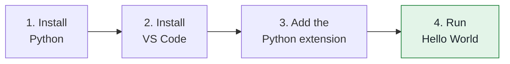
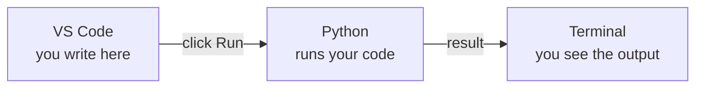
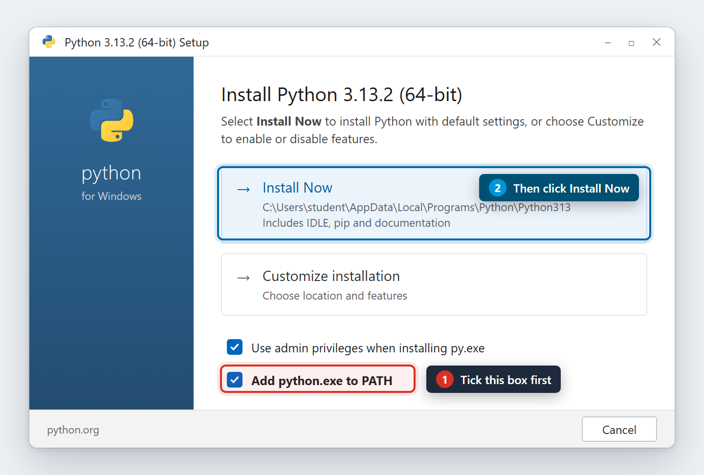
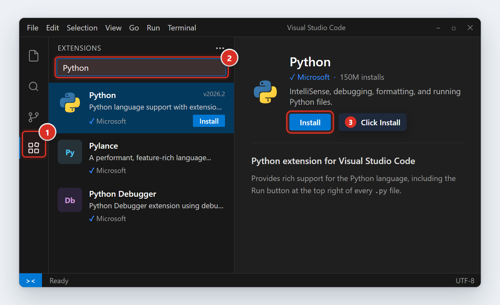
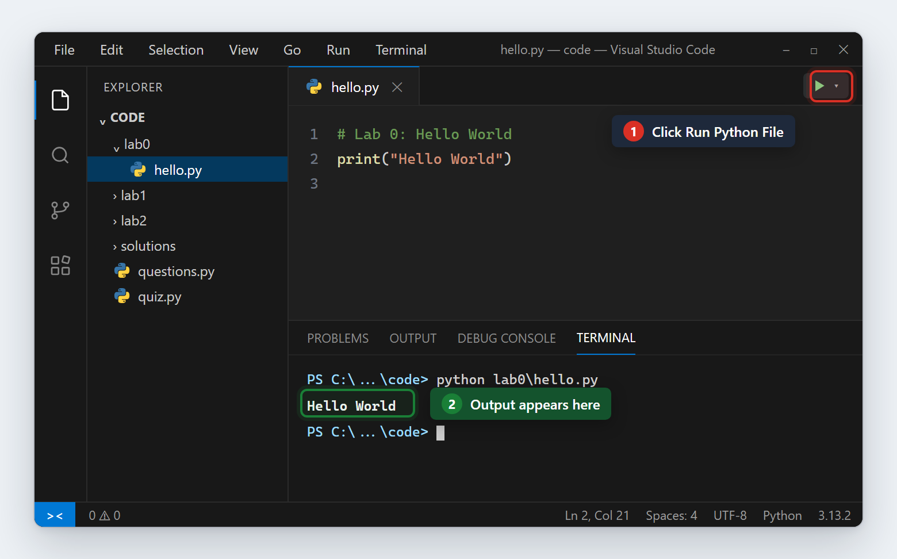

# Before you come

<div class="lab-summary" markdown>
**:material-laptop: You need:** your laptop, the internet, and permission to install programs

**:material-flag-checkered: Goal:** your laptop prints `Hello World`
</div>

Do this at home, so the workshop is all coding. Stuck? **No worries**: note what you saw and we fix
it together in [Lab 0](lab0-setup.md). (The virtual environment is also set up in Lab 0.)

Four steps, two free programs:





<div class="concepts" markdown>
<div markdown>
<p class="card-title">Python</p>
The **interpreter**: the program that reads your Python code and runs it.
<p class="like">a translator who reads your instructions to the computer</p>
</div>
<div markdown>
<p class="card-title">VS Code</p>
The **editor**: where you write your code, save it and press Run.
<p class="like">a notebook with a "go" button</p>
</div>
</div>

## Step 1: Install Python

=== "Windows"

    1. Open [python.org/downloads](https://www.python.org/downloads/) and click the yellow
       button **Download Python 3.x**.
    2. Open the file you downloaded (it is in your **Downloads** folder).
    3. **Very important:** at the bottom of the first window, tick **Add python.exe to PATH**.
       Then click **Install Now**.

        

    4. Wait until you see **Setup was successful**, then click **Close**.

    !!! error "Forgot to tick the box?"
        Run the installer again, choose **Modify**, click **Next**, tick **Add Python to environment
        variables**, then **Install**. Or ask us on the day.

=== "macOS"

    1. Open [python.org/downloads](https://www.python.org/downloads/) and click the yellow
       button **Download Python 3.x**.
    2. Open the `.pkg` file from your **Downloads** folder and click **Continue** until it says
       **The installation was successful**.
    3. A Finder window opens with a file called **Install Certificates.command**. Double-click it
       once. Then you can close that window.

    !!! warning "On a Mac, Python is `python3`"
        On a Mac, you always type **`python3`** (with a 3), never `python`.
        Everywhere this guide says `python`, you type `python3`.

## Step 2: Install VS Code

=== "Windows"

    1. Open [code.visualstudio.com](https://code.visualstudio.com/) and click **Download for Windows**.
    2. Open the file and click **Next** until you can click **Install**.
       On the page **Select Additional Tasks**, tick **Add "Open with Code" action** for files and
       folders. It is handy later.
    3. Click **Finish**. VS Code opens.

=== "macOS"

    1. Open [code.visualstudio.com](https://code.visualstudio.com/) and click **Download for macOS**.
    2. Open the downloaded `.zip` file. Drag **Visual Studio Code** into your **Applications** folder.
    3. Open VS Code from **Applications**. If macOS asks "Are you sure you want to open it?",
       click **Open**.

## Step 3: Add Python to VS Code

VS Code can edit many languages. The **Python extension** teaches it Python.

1. In VS Code, click the **Extensions** icon on the left (four small squares), or press
   ++ctrl+shift+x++ (++cmd+shift+x++ on a Mac).
2. Type `Python` in the search box.
3. Click **Install** on the extension called **Python** by **Microsoft**.



## Step 4: Your first program

1. Make a new folder on your Desktop called `python-test`.
2. In VS Code choose **File > Open Folder...** and open `python-test`.
   If VS Code asks **Do you trust the authors of the files?**, click **Yes, I trust the authors**.
3. Choose **File > New File...**, type the name `hello.py` and press ++enter++.
4. Type this line in the new file:

    ```python title="hello.py"
    print("Hello World")
    ```

5. Save with ++ctrl+s++ (++cmd+s++ on a Mac).
6. Click the **triangle** at the top right of VS Code (**Run Python File**).



At the bottom of VS Code a **terminal** opens and shows:

```text title="Output"
Hello World
```

!!! badge "Badge earned"
    **Ready Player One**

    Your laptop speaks Python. See you at the workshop!

## Did it work?

| What you see | What to do |
|---|---|
| `Hello World` | You are ready. Well done! |
| No triangle at the top right | The Python extension is not installed yet. Do Step 3 again. |
| `Python was not found` or the Microsoft Store opens | Python is not on the PATH. See [Troubleshooting](../help/troubleshooting.md#python-opens-the-microsoft-store). |
| Anything else | Take a photo of the screen and show it to us on the day. |

??? instructor "For instructors: the message to send before the event"
    Send this page (as a link or a PDF) about a week before, with a short message:

    > Hello! In our Python workshop you write code on your own laptop. Please install Python and
    > VS Code before the workshop; the guide shows every click.
    > If it does not work, no problem: bring your laptop and we fix it together in the first lab.
    > Bring your charger too!
