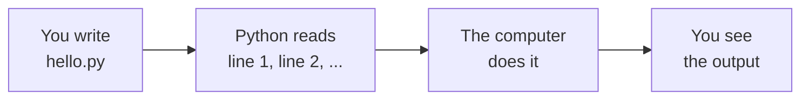
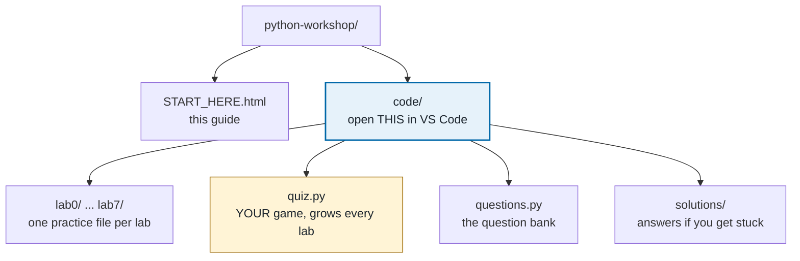
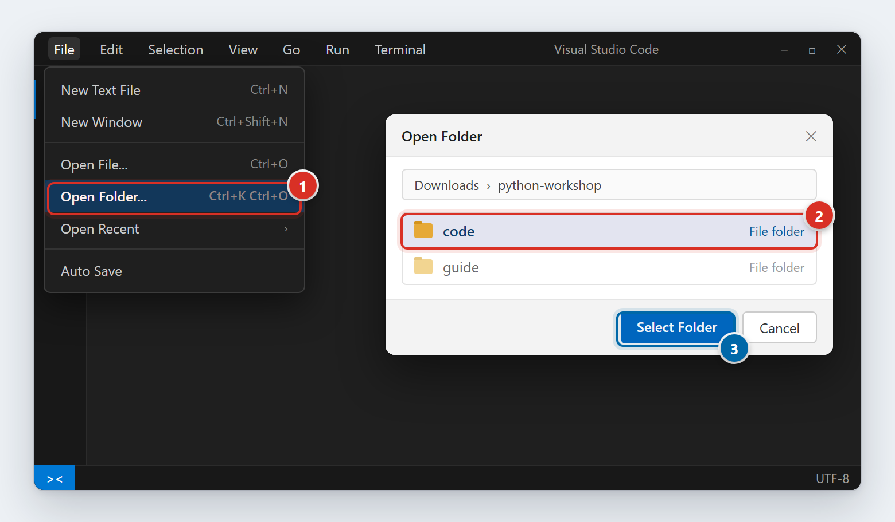
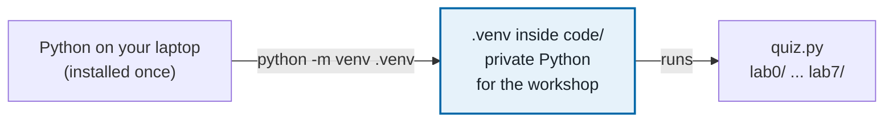
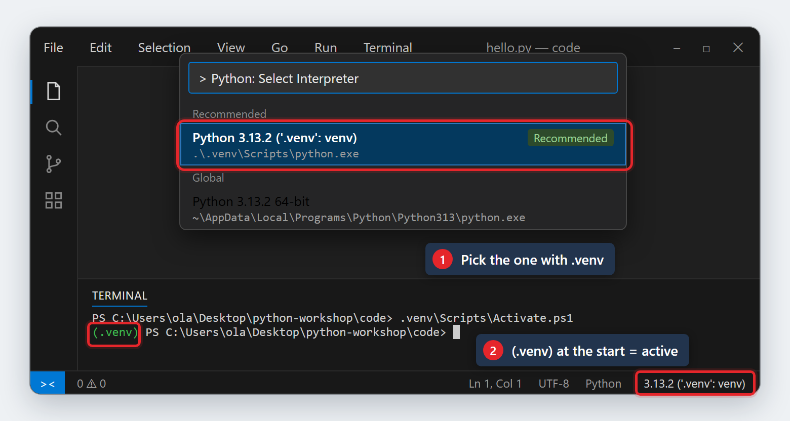
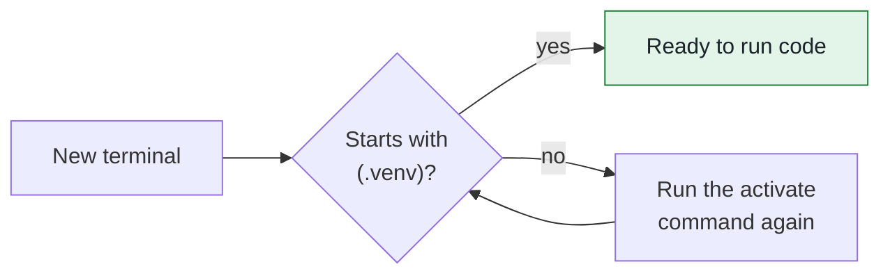
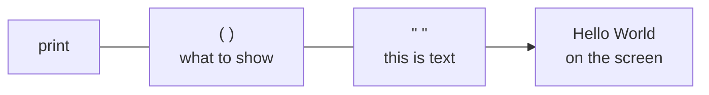
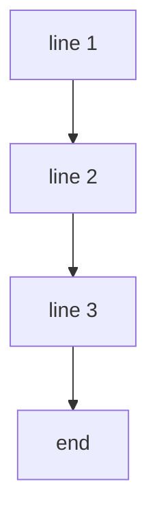
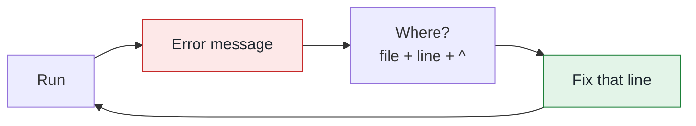
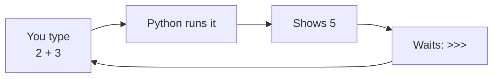

# Lab 0 - Setup check and Hello World

<div class="lab-summary" markdown>
**:material-presentation: After slides 1-19** <span class="slides-chip">Programming basics</span>

**:material-hammer-wrench: You build:** your first program, and you break it on purpose
</div>

A **program** is a list of exact instructions. You write them in Python; the computer follows them.



<div class="concepts" markdown>
<div markdown>
<p class="card-title">Program</p>
A list of instructions that the computer follows from top to bottom, one line at a time.
<p class="like">a recipe: do step 1, then step 2, then step 3</p>
</div>
<div markdown>
<p class="card-title">Interpreter</p>
Python reads your code line by line and runs each line straight away (slide 12).
<p class="like">a live translator who translates each sentence as you say it</p>
</div>
<div markdown>
<p class="card-title">Syntax</p>
The grammar of a language. `print("Hi")` is correct. `print("Hi"` is not: a bracket is missing.
<p class="like">"Welcome to the workshop" vs. "workshop the to Welcome"</p>
</div>
</div>

## Getting the workshop files

Your instructor gives you a folder called `python-workshop` (USB stick or download):



!!! warning "Unzip first"
    If you got a `.zip` file, right-click it and choose **Extract All...** (Windows) or double-click
    it (Mac). Do not work inside the zip file: VS Code cannot save files there.

## Steps

### <span class="step-num">0.1</span> Open the code folder

1. In VS Code choose **File > Open Folder...**.
2. Go into `python-workshop`, click once on the folder **`code`** and click **Select Folder**.
3. If VS Code asks **Do you trust the authors of the files?**, click **Yes, I trust the authors**.



On the left you now see `lab0`, `lab1`, ... `quiz.py` and `questions.py`. This list is the
**Explorer**.

!!! vscode "Make room"
    Put this guide on one half of your screen and VS Code on the other half.
    On Windows: drag a window to the left edge of the screen until it snaps.
    On a Mac: hold the green button at the top left of the window and choose **Tile Window to Left of Screen**.

### Create your virtual environment

A **virtual environment** (`.venv`) is a private copy of Python just for this folder.



!!! analogy "Think of it like..."
    Your own pencil case for the workshop. Whatever you put in it does not mess up anyone else's.

**1. Open the terminal:** **Terminal > New Terminal**. It opens at the bottom, already inside `code`.

**2. Create it** (once):

=== "Windows"

    ```powershell
    python -m venv .venv
    ```

=== "macOS"

    ```bash
    python3 -m venv .venv
    ```

Wait a few seconds. A new folder `.venv` appears in the Explorer. Do not change anything inside it.

**3. Activate it** (every new terminal):

=== "Windows"

    ```powershell
    .venv\Scripts\Activate.ps1
    ```

=== "macOS"

    ```bash
    source .venv/bin/activate
    ```

**4. Check:** the terminal line now starts with `(.venv)`.

```text title="Output"
(.venv) PS C:\Users\ola\Desktop\python-workshop\code>
```

**5. Tell VS Code to use it:** press ++ctrl+shift+p++ (Mac: ++cmd+shift+p++), type
**Python: Select Interpreter** and choose the one that says **`.venv`**.





!!! error "Error decoder: `Activate.ps1 cannot be loaded because running scripts is disabled on this system`"
    **What it means:** Windows blocks scripts by default, and activating is a script.

    **How to fix it:** run this once, type `Y` and press ++enter++, then activate again:

    ```powershell
    Set-ExecutionPolicy -Scope CurrentUser -ExecutionPolicy RemoteSigned
    ```

!!! tip "Good to know"
    - After step 5, VS Code activates `.venv` by itself every time you open a new terminal or click Run.
    - To leave the environment, type `deactivate`.
    - Inside `(.venv)`, plain `python` works on a Mac too.
    - More fixes: [Troubleshooting: virtual environment](../help/troubleshooting.md#virtual-environment-problems).

### <span class="step-num">0.2</span> Hello World

Open `lab0/hello.py` (click it in the Explorer). Find `TODO 2` and type this line under it:

```python title="lab0/hello.py"
print("Hello World")
```

Save (++ctrl+s++, Mac: ++cmd+s++) and click the **triangle** at the top right.

```text title="Output"
Hello World
```

**Congratulations, you are a programmer!**



!!! tip "Save before you run"
    A white dot next to the file name at the top means: **not saved**. VS Code runs the saved file,
    so always save first. Even better: choose **File > Auto Save** once, and VS Code saves for you.

### <span class="step-num">0.3</span> More lines

Under `TODO 3`, write three `print` lines about you.



Python always runs **top to bottom**, one line at a time.

```python title="lab0/hello.py"
print("My name is Ola")
print("I live in Krakow")
print("Today I write my first program!")
```

```text title="Output"
Hello World
My name is Ola
I live in Krakow
Today I write my first program!
```

### <span class="step-num">0.4</span> Draw with print

Under `TODO 4`, remove the `#` at the start of the three lines. A line that starts with `#` is a
**comment**: Python skips it. Removing the `#` turns it back into code.

!!! vscode "Shortcut"
    Select the three lines and press ++ctrl+slash++ (Mac: ++cmd+slash++). VS Code adds or
    removes the `#` on all of them at once.

!!! predict "Predict"
    The last line is `print(" /(__)\\")`. It has **two** backslashes. How many does the output show?

    ??? success "Show the answer"
        **One.** A backslash inside a string is special: `\\` means "one real backslash".
        You get:

        ```text title="Output"
           __
          (oo)   Python says hi!
         /(__)\
        ```

### <span class="step-num">0.5</span> Break it on purpose

Mistakes are normal. The skill is **reading the error message**.

Delete the last `)` of your `print("Hello World")` line, save, and run.



!!! error "Error decoder: `SyntaxError: '(' was never closed`"
    ```text title="Output"
      File "...\code\lab0\hello.py", line 5
        print("Hello World"
             ^
    SyntaxError: '(' was never closed
    ```
    **What it means:** you opened a bracket `(` but did not close it. Python cannot understand
    the line, so it does not run **any** of your program.

    **How to read it:** Python tells you the **file**, the **line number** and points with `^` at
    the place. Look there first.

    **How to fix it:** put the `)` back, save, run again.

Now try two more mistakes, one at a time. Read the message, then fix it:

| Change this | Error you get | It means |
|---|---|---|
| `print("Hello World)` (delete the last `"`) | `SyntaxError: unterminated string literal` | The text has no closing quote. |
| `Print("Hello World")` (capital P) | `NameError: name 'Print' is not defined` | Python is case sensitive: `print` and `Print` are different names. |

### <span class="step-num">0.6</span> Talk to Python directly

You can also give Python one instruction at a time, like a calculator.

1. Click in the terminal at the bottom. It should start with `(.venv)`.
2. Type `python` and press ++enter++. You see `>>>`. Python is waiting for you.
3. Type each line and press ++enter++ after each one:

```python
>>> 2 + 3
5
>>> 10 * 365
3650
>>> "Krakow" * 3
'KrakowKrakowKrakow'
>>> exit()
```

This is the **interpreter** (slide 12) working live:



## Practise

=== "Follow along"

    Make a name badge with `print`. Create a new file `lab0/badge.py` (**File > New File...**)
    and type:

    ```python title="lab0/badge.py"
    --8<-- "code/solutions/lab0_exercise.py"
    ```

    Change the name and the city to yours, save and run.

=== "Try it"

    Make a name badge with a border, like this one, with **your** name. Use one `print` per line.

    ```text title="Output"
    +----------------+
    |                |
    |   OLA NOWAK    |
    |   Krakow 2026  |
    |                |
    +----------------+
    ```

    **Hint:** count the spaces so the right border lines up. A monospace font makes every
    letter the same width, so counting works.

=== "Challenge"

    Draw something bigger with `print`: the Cisco bridge logo, a dragon (smok!) or the Wawel
    castle. Then try `print("=" * 30)`. What does `*` do with text?

!!! checkpoint "Checkpoint"
    - [ ] The terminal starts with `(.venv)`.
    - [ ] The status bar at the bottom right shows `('.venv': venv)`.
    - [ ] Running `lab0/hello.py` shows `Hello World` and your other lines.

    Not working? Compare with `code/solutions/lab0_hello.py`, or see
    [Troubleshooting](../help/troubleshooting.md). Still stuck? Raise your hand: Lab 0 is exactly
    the time to fix it.

!!! badge "Badge earned"
    **Hello, World!**

    You ran your first program, met your first error messages, and talked to the interpreter.

??? instructor "For instructors"
    - Students who did the pre-work move quickly through 0.1-0.4; use this lab to help anyone
      who still needs a working install.
    - Check every screen for `(.venv)` in the terminal before 0.2. The `.venv` is optional for
      the code (standard library only), but it builds the habit. If activation blocks a student
      for more than a few minutes, let them continue without it.
    - On Windows, the most common problem is Python missing from PATH. See
      [Troubleshooting](../help/troubleshooting.md).
    - A student whose laptop cannot run Python pairs with a neighbour.
