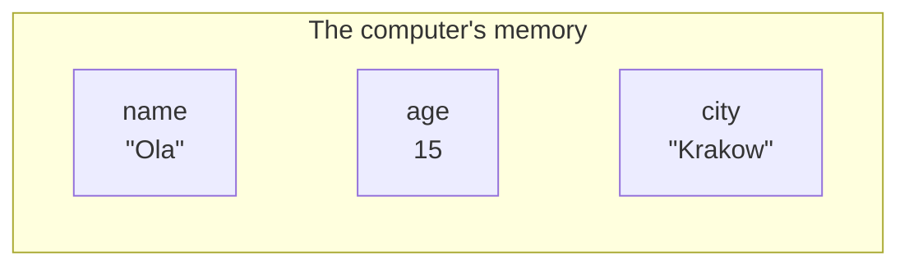
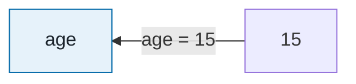
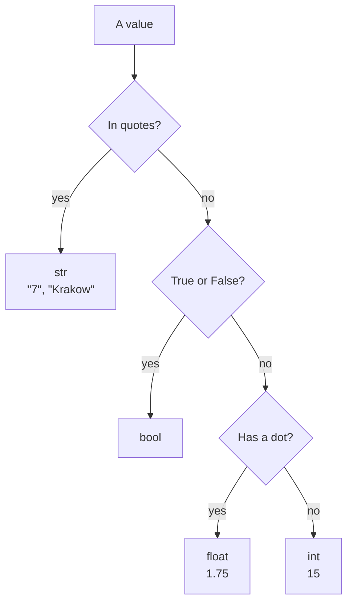
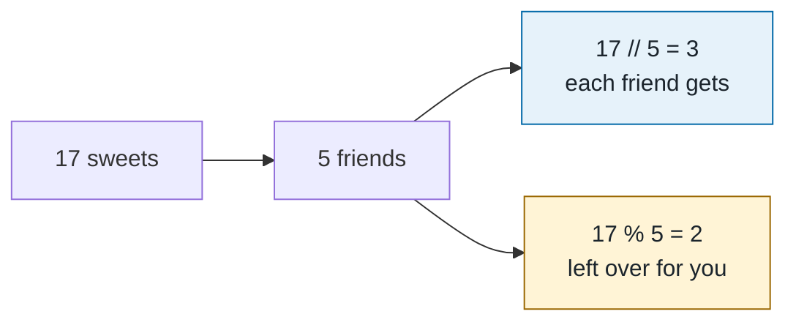
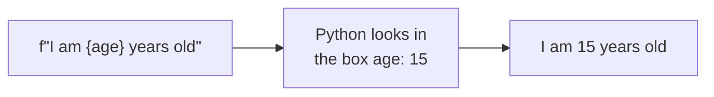
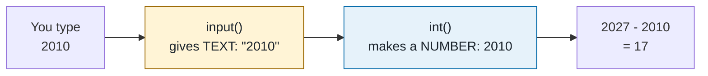
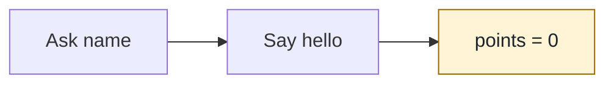

# Lab 1 - Variables, types and operators

<div class="lab-summary" markdown>
**:material-presentation: After slides 20-28** <span class="slides-chip">Variables, data types, operators</span>

**:material-hammer-wrench: You build:** a pocket money calculator, and the start of your Quiz Game

**:material-file-code: File:** `lab1/variables.py`
</div>

Programs **remember** things in **variables**: labelled boxes that hold one value each.



<div class="concepts" markdown>
<div markdown>
<p class="card-title">Variable</p>
A name for a value. `age = 15` puts the value `15` into a box with the label `age`.
<p class="like">a labelled box. You can look inside, or throw out the old thing and put in a new one</p>
</div>
<div markdown>
<p class="card-title">Data type</p>
The kind of value: whole number (`int`), decimal number (`float`), text (`str`), or True/False (`bool`).
<p class="like">liquids go in a bottle, books go on a shelf. Each kind of thing has its own place</p>
</div>
<div markdown>
<p class="card-title">Operator</p>
A symbol that calculates: `+ - * / // % **`.
<p class="like">the buttons on a calculator</p>
</div>
<div markdown>
<p class="card-title">input()</p>
Asks the user to type something and gives it to your program as **text**.
<p class="like">a waiter taking your order</p>
</div>
</div>

## Steps

Open `lab1/variables.py`. It already runs: click the triangle and look at the output.
For each step, find its `TODO` in the file.

### <span class="step-num">1.1</span> Your first variables

Find `TODO 1`. Change the values so they describe **you**, then run.

```python title="lab1/variables.py"
name = "Ola"
age = 15
city = "Krakow"
print(name)
print(age)
print(city)
```

```text title="Output"
Ola
15
Krakow
```

`=` is **not** "equals" from maths. It is an arrow pointing left: **put the value into the box**.



!!! tip "Rules for variable names (slide 23)"
    - Start with a letter or `_`: `score`, `_secret`. Not `1st_place`.
    - Only letters, numbers and `_`. No spaces: write `first_name`, not `first name`.
    - Upper and lower case are different: `Age` and `age` are two different boxes.
    - Choose names that explain themselves: `points` is better than `p`.

!!! predict "Predict"
    What does this print?

    ```python
    score = 10
    score = 20
    print(score)
    ```

    ??? success "Show the answer"
        `20`. A variable holds **one** value. The second line throws out the 10 and puts in 20.

### <span class="step-num">1.2</span> Data types

Find `TODO 2` and remove the `#` in front of the four lines (select them, then ++ctrl+slash++).

```python title="lab1/variables.py"
print(type(name))
print(type(age))
print(type(1.75))
print(type(True))
```

```text title="Output"
<class 'str'>
<class 'int'>
<class 'float'>
<class 'bool'>
```

| Type | Name | Examples | Use it for |
|---|---|---|---|
| `int` | integer | `7`, `-3`, `2026` | counting: points, age, number of tries |
| `float` | float | `3.14`, `1.75`, `0.5` | measuring: height, price, seconds |
| `str` | string | `"Krakow"`, `'hi'`, `"7"` | text: names, questions, answers |
| `bool` | Boolean | `True`, `False` | yes or no questions (Lab 2!) |

How to tell the type of any value:



!!! predict "Predict"
    What is `type("7")`? Careful!

    ??? success "Show the answer"
        `<class 'str'>`. The quotes make it **text**, even if it looks like a number.
        `7` is a number, `"7"` is a string. This difference matters a lot in Step 1.5.

### <span class="step-num">1.3</span> Operators: a pocket money calculator

Find `TODO 3`. Run it, then change `pocket_money` and `weeks` and run again.

```python title="lab1/variables.py"
pocket_money = 50      # zloty per week
weeks = 4
total = pocket_money * weeks
print("In", weeks, "weeks I get", total, "zloty")
```

```text title="Output"
In 4 weeks I get 200 zloty
```

Now remove the `#` from the four operator lines and guess each result **before** you run.

| Operator | Meaning | Example | Result |
|---|---|---|---|
| `+` `-` | plus, minus | `7 - 2` | `5` |
| `*` | times | `6 * 7` | `42` |
| `/` | divide (always gives a `float`) | `17 / 5` | `3.4` |
| `//` | divide and throw away the rest | `17 // 5` | `3` |
| `%` | only the rest ("modulo") | `17 % 5` | `2` |
| `**` | power | `2 ** 10` | `1024` |

`//` and `%` with sweets: share 17 sweets between 5 friends.



### <span class="step-num">1.4</span> Joining text

Find `TODO 4`. Line **A** joins strings with `+`:

```python
print("Hello, " + name + "!")    # Hello, Ola!
```

Now remove the `#` in front of line **B** and run.

!!! error "Error decoder: `TypeError: can only concatenate str (not "int") to str`"
    ```text title="Output"
    TypeError: can only concatenate str (not "int") to str
    ```
    **What it means:** `+` adds two numbers **or** joins two strings. It cannot mix them.

    | | Result |
    |---|---|
    | `5 + 3` | `8` |
    | `"5" + "3"` | `"53"` |
    | `"I am " + 15` | **TypeError** |

    **How to fix it (two ways):**

    - Turn the number into text with `str()`: `"I am " + str(age) + " years old"`
    - Or use an **f-string** (line **C**): put `f` before the quotes and the variable in `{ }`.

Put the `#` back on line B, and remove it from line C:

```python title="lab1/variables.py"
print(f"I am {age} years old")
```

```text title="Output"
I am 15 years old
```

An **f-string** fills every `{ }` with a value:



You can even calculate inside: `f"Next year I am {age + 1}"`.

### <span class="step-num">1.5</span> Ask the user with input()

Find `TODO 5` and remove the `#` from the three lines. Run it and type a year in the terminal,
then press ++enter++.

```python title="lab1/variables.py"
year = input("Which year were you born? ")
age_next_year = 2027 - int(year)
print(f"In 2027 you will be {age_next_year}.")
```

```text title="Output"
Which year were you born? 2010
In 2027 you will be 17.
```



!!! predict "Predict"
    What happens if you remove `int( )` and write `2027 - year`?

    ??? success "Show the answer"
        A `TypeError`. `input()` **always** gives you a string, even if you type numbers.
        `int()` turns the text `"2010"` into the number `2010`, so you can calculate with it.

!!! error "Error decoder: `NameError: name 'nme' is not defined`"
    **What it means:** you used a name that Python does not know. Usually a typo (`nme` instead of
    `name`), or you used the variable **before** the line that creates it.

    **How to fix it:** check the spelling, upper and lower case, and that the `name = ...` line
    comes first.

!!! error "Error decoder: `ValueError: invalid literal for int() with base 10: 'abc'`"
    **What it means:** `int()` got text that is not a whole number, like `abc` or `15.5`.

    **How to fix it:** type a whole number when the program asks. In Lab 6 you learn to catch this
    error so the program does not stop.

## Practise: pizza party calculator

You are planning a class pizza party. Every pizza has **8 slices** and costs **39.90 zloty**.

=== "Follow along"

    Create `lab1/pizza.py` and type:

    ```python title="lab1/pizza.py"
    --8<-- "code/solutions/lab1_exercise.py"
    ```

    ```text title="Output"
    How many people are coming? 10
    How many slices does each person eat? 3
    You need 30 slices.
    Order 4 pizzas.
    That costs 159.6 zloty.
    ```

    `(slices + 7) // 8` is a trick to **round up**: 30 slices need 4 pizzas, not 3.

=== "Try it"

    Write `lab1/pizza.py` that:

    1. asks how many people are coming and how many slices each person eats,
    2. prints how many slices you need,
    3. prints how many pizzas to order,
    4. prints the total price.

    **Hints:** `int(input(...))` gives you a number. Use `*` for the slices and `//` for the
    pizzas. `round(x, 2)` rounds a price to 2 decimals.

=== "Challenge"

    Make it smarter:

    - 30 slices must give **4** pizzas, not 3. Can you round **up** using only `//` and `+`?
    - Split the price fairly: how much does each person pay?
    - Print a receipt with an f-string, for example `f"{'Pizzas':<10}{pizzas:>5}"`.
      What do `<10` and `>5` do?

## Add it to your Quiz Game

Open **`quiz.py`** (in the main `code` folder, not in `lab1`). Type this under the comments:

```python title="quiz.py"
# --- Lab 1: say hello ---
name = input("What is your name? ")
print("Hello, " + name + "! Welcome to the Python Quiz.")

points = 0
print(f"{name}, you start with {points} points.")
```

Run `quiz.py`:

```text title="Output"
What is your name? Ola
Hello, Ola! Welcome to the Python Quiz.
Ola, you start with 0 points.
```



`points` keeps the score for the rest of the game.

!!! checkpoint "Checkpoint"
    Your `quiz.py` asks for a name, greets the player and shows 0 points.

    Not the same? Copy `code/solutions/quiz_after_lab1.py` over your `quiz.py`
    (open the solution, select all with ++ctrl+a++, copy, paste into `quiz.py`, save).

!!! badge "Badge earned"
    **Variable Wizard**

    You can store values, tell the types apart, calculate, and talk to the user.

??? instructor "For instructors"
    - Slides 23-28 match Steps 1.1-1.3. Run the "Exercise time!" slide (26) as Step 1.2.
    - The `str + int` error in Step 1.4 is on purpose: everyone meets it today, better now.
    - Fast students: the Challenge tab introduces format specs. Slow students: skip the
      Practise section and do the Quiz Game step.
