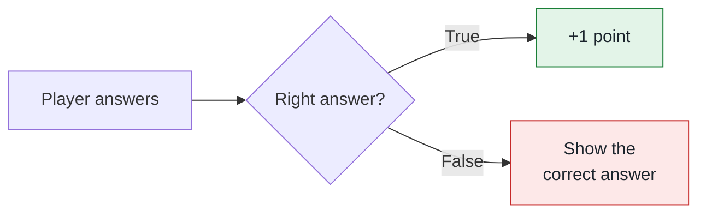
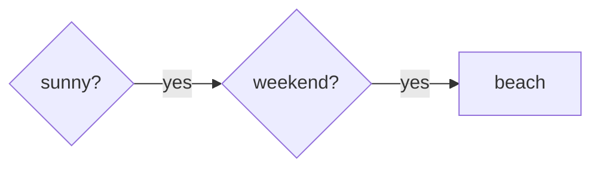
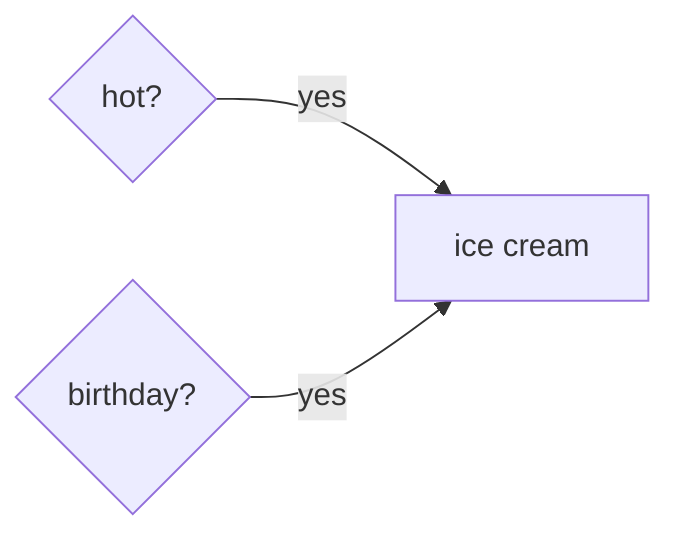
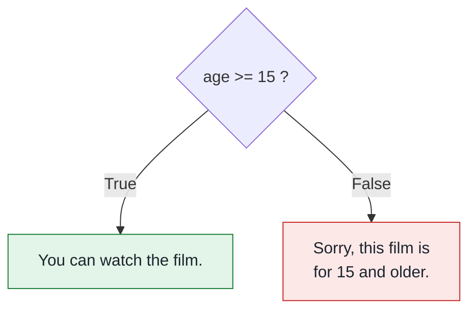
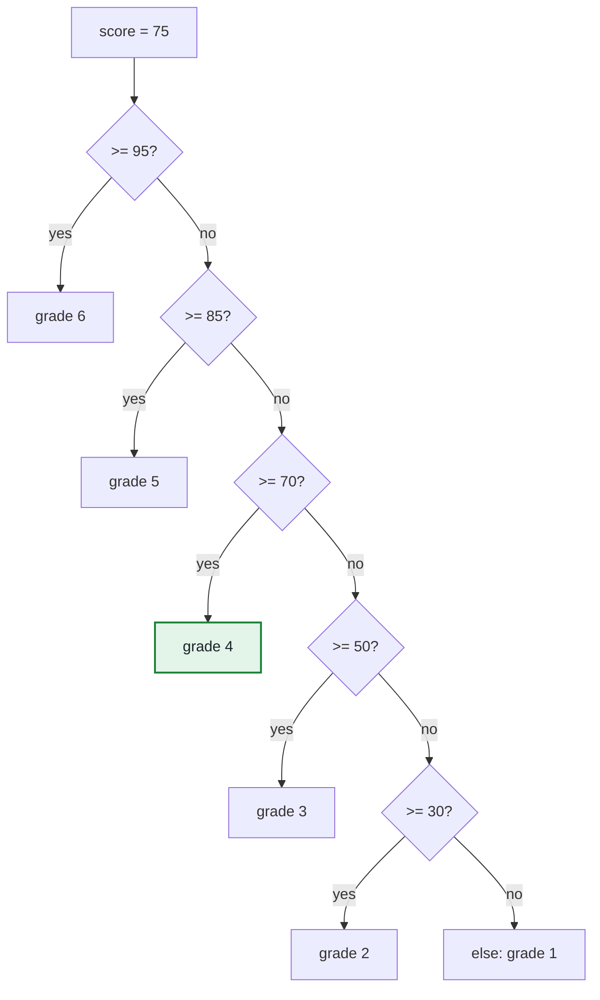
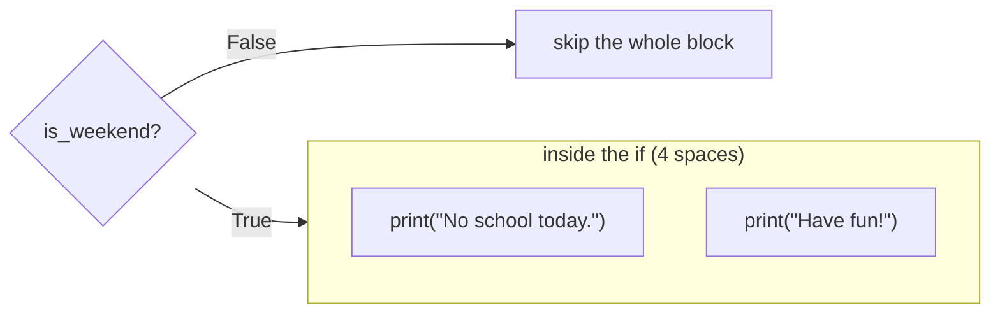
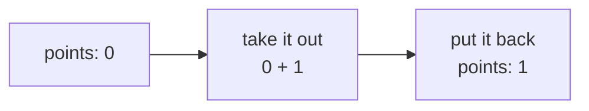

# Lab 2 - Making decisions

<div class="lab-summary" markdown>
**:material-presentation: After slides 29-42** <span class="slides-chip">Booleans, comparisons, if / elif / else</span>

**:material-hammer-wrench: You build:** a grade calculator, a cinema ticket machine, and your game's first question

**:material-file-code: File:** `lab2/decisions.py`
</div>

Now your programs learn to **decide**:



<div class="concepts" markdown>
<div markdown>
<p class="card-title">Boolean</p>
A value that is `True` or `False`. Every comparison gives you one.
<p class="like">a light switch: on or off, nothing in between</p>
</div>
<div markdown>
<p class="card-title">Comparison</p>
`==` equal, `!=` not equal, `<` `>` `<=` `>=`. The answer is always `True` or `False`.
<p class="like">a judge holding up "yes" or "no"</p>
</div>
<div markdown>
<p class="card-title">if / elif / else</p>
Runs a block of code only when a condition is `True`.
<p class="like">a traffic light: green, go; yellow, slow down; else, stop</p>
</div>
<div markdown>
<p class="card-title">Indentation</p>
4 spaces at the start of a line. They show which lines belong to the `if`.
<p class="like">the steps under one heading in a recipe</p>
</div>
</div>

## Steps

Open `lab2/decisions.py`. For each step, find its `TODO`.

### <span class="step-num">2.1</span> True or False?

Find `TODO 1`. **Guess** each answer on paper first. Then remove the `#` and run.

```python title="lab2/decisions.py"
print(5 > 3)
print(5 == 5.0)
print("cat" == "Cat")
print(10 != 10)
```

??? success "Show the answers"
    ```text title="Output"
    True
    True
    False
    False
    ```
    - `5 == 5.0` is `True`: Python compares the **values**, and 5 and 5.0 are the same number.
    - `"cat" == "Cat"` is `False`: for strings, upper and lower case are different.
    - `10 != 10` is `False`: `!=` means "not equal", and 10 **is** equal to 10.

!!! warning "`=` vs `==`"
    ```mermaid
    flowchart LR
        V1["15"] -- "age = 15<br/>PUTS" --> B1["age"]
        B2{"age == 15 ?<br/>ASKS"} --> R["True or False"]
    ```

    The most common beginner bug. If Python says
    `SyntaxError: invalid syntax. Maybe you meant '==' or ':=' instead of '='?`, you wrote `=`
    where you meant `==`.

### <span class="step-num">2.2</span> and, or, not

Find `TODO 2`. Guess, then remove the `#` and run.

```python title="lab2/decisions.py"
sunny = True
weekend = False
print(sunny and weekend)
print(sunny or weekend)
print(not weekend)
```

| Operator | `True` when... | Everyday example |
|---|---|---|
| `and` | **both** sides are True | "I go to the beach if it is sunny **and** it is the weekend" |
| `or` | **at least one** side is True | "I get ice cream if it is hot **or** it is my birthday" |
| `not` | the value is False | "I go outside if it is **not** raining" |



<p class="caption"><code>and</code>: both must be yes.</p>



<p class="caption"><code>or</code>: one yes is enough.</p>

!!! predict "Predict"
    With `sunny = True` and `weekend = False`, what does `sunny and not weekend` give?

    ??? success "Show the answer"
        `True`. First `not weekend` is `not False`, which is `True`. Then `True and True` is `True`.

### <span class="step-num">2.3</span> if / else

Find `TODO 3`. Run it. Then change `age = 12` to `age = 16` and run again.

```python title="lab2/decisions.py"
age = 12
if age >= 15:
    print("You can watch the film.")
else:
    print("Sorry, this film is for 15 and older.")
```



| Rule | Example |
|---|---|
| The `if` line ends with `:` | `if age >= 15:` |
| Its lines are pushed in by **4 spaces** | `    print(...)` |
| `else:` has no condition: it catches the rest | `else:` |

!!! error "Error decoder: `SyntaxError: expected ':'`"
    ```text title="Output"
        if age >= 15
                    ^
    SyntaxError: expected ':'
    ```
    **What it means:** a line that starts a block has no colon at the end.

    **How to fix it:** every `if`, `elif`, `else`, `for`, `while` and `def` line ends with `:`.

    ```python
    if age >= 15:
    ```

### <span class="step-num">2.4</span> elif: more than two choices

Polish schools give grades from 1 to 6. Find `TODO 4` and add the missing `elif` lines so that:

| Score | Grade |
|---|---|
| 95 or more | 6 |
| 85 or more | 5 |
| 70 or more | 4 |
| 50 or more | 3 |
| 30 or more | 2 |
| less than 30 | 1 |

??? example "Show the code"
    ```python title="lab2/decisions.py"
    score = 75
    if score >= 95:
        grade = 6
    elif score >= 85:
        grade = 5
    elif score >= 70:
        grade = 4
    elif score >= 50:
        grade = 3
    elif score >= 30:
        grade = 2
    else:
        grade = 1
    print(f"A score of {score} gives grade {grade}")
    ```

```text title="Output"
A score of 75 gives grade 4
```

Python checks **top to bottom** and stops at the **first** `True`:



!!! predict "Predict"
    What if you put `elif score >= 30:` at the **top**, right after `if`? Which grade does a score
    of 75 get?

    ??? success "Show the answer"
        Grade **2**. 75 is `>= 30`, so that block runs first, and Python skips all the others.
        Always put the strictest condition first.

### <span class="step-num">2.5</span> Indentation

Find `TODO 5`. The program says "Have fun!" even on school days, because the last line is not
indented. Move it **inside** the `if` by putting 4 spaces in front of it.

```python title="lab2/decisions.py"
is_weekend = True
if is_weekend:
    print("No school today.")
    print("Have fun!")
```

Now set `is_weekend = False` and run: nothing is printed.



!!! error "Error decoder: `IndentationError: expected an indented block after 'if' statement on line 3`"
    **What it means:** after a line ending in `:`, Python expects at least one indented line.

    **How to fix it:** press ++tab++ at the start of the line. VS Code puts in 4 spaces.

!!! error "Error decoder: `IndentationError: unindent does not match any outer indentation level`"
    **What it means:** the spaces in a block do not line up: one line has 4 spaces, the next has 3.

    **How to fix it:** make every line in the block start at exactly the same place. Select the
    lines and press ++shift+tab++ and then ++tab++ to line them up.

!!! vscode "See the spaces"
    The thin vertical lines in VS Code show you the indentation levels.
    Lines in the same block are on the same line.

## Practise: cinema ticket machine

A cinema in Krakow has these prices:

| Who | Price |
|---|---|
| under 7 | free |
| 7 to 17 | 15 zloty |
| 65 and older | 18 zloty |
| everyone else | 25 zloty |

=== "Follow along"

    Create `lab2/tickets.py` and type:

    ```python title="lab2/tickets.py"
    --8<-- "code/solutions/lab2_exercise.py"
    ```

    Run it a few times with different ages and days.

=== "Try it"

    Write `lab2/tickets.py`. It asks for the age and prints the price.

    **Hints:**

    - `age = int(input("How old are you? "))`
    - Start with the youngest group: `if age < 7:` ... `elif age < 18:` ...
    - Do not forget the colon and the 4 spaces!

=== "Challenge"

    On Saturday and Sunday, tickets cost 5 zloty more, but children under 7 stay free.
    Ask for the day too. You need `and`, `or` and maybe brackets `( )`. Then test **every**
    group on a weekday and at the weekend.

## Add it to your Quiz Game

Open `quiz.py`. Under your Lab 1 code, add:

```python title="quiz.py"
# --- Lab 2: ask to start, then ask one question ---
start = input("Start the quiz? (Y/N) ")
if start == "Y" or start == "y":
    print("Great, let's go!")
else:
    print(f"No problem. See you next time, {name}!")
    exit()

answer = input("What is the capital of Poland? ")
if answer == "Warsaw" or answer == "warsaw":
    print("Correct! +1 point")
    points = points + 1
else:
    print("Not this time. The answer is Warsaw.")

print(f"{name}, you have {points} points.")
```

`exit()` stops the program straight away. `points = points + 1` works like this:



```text title="Output"
What is your name? Ola
Hello, Ola! Welcome to the Python Quiz.
Ola, you start with 0 points.
Start the quiz? (Y/N) y
Great, let's go!
What is the capital of Poland? Warsaw
Correct! +1 point
Ola, you have 1 points.
```

Run it again and answer `n`. The game says goodbye and asks no question.

!!! predict "Predict"
    What happens if the player answers `WARSAW` in capitals?

    ??? success "Show the answer"
        "Not this time". `"WARSAW"` is not equal to `"Warsaw"` or `"warsaw"`. You fix this properly
        in Lab 4, with a string method that makes any answer lowercase.

!!! checkpoint "Checkpoint"
    Your game asks "Start the quiz? (Y/N)", stops politely on `n`, and gives a point for `Warsaw`.

    Not the same? Copy `code/solutions/quiz_after_lab2.py` over your `quiz.py`.

!!! badge "Badge earned"
    **Decision Maker**

    Your programs can compare, combine conditions, and choose what to do.

??? instructor "For instructors"
    - Slides 38-39 show the flowcharts. Draw the `if / elif / else` chart on the board during Step 2.4.
    - Slide 41 (code equivalence) fits the Challenge tab: several correct programs are possible.
    - Watch for `=` vs `==` and missing colons. Most errors in this lab are one of these two.
