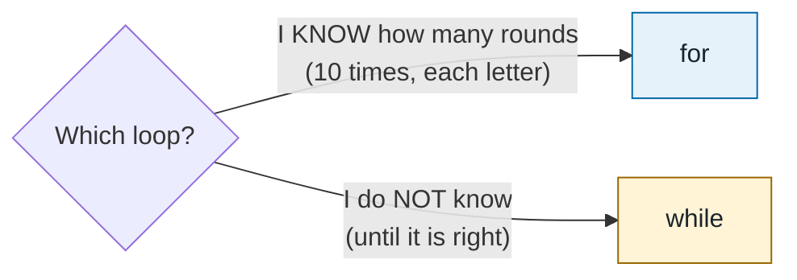
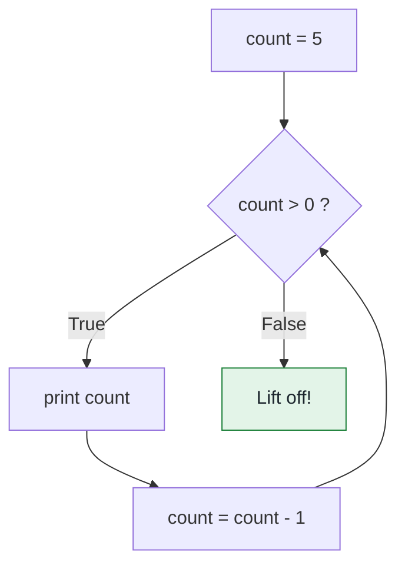
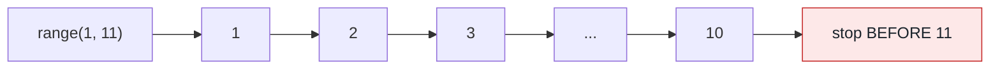
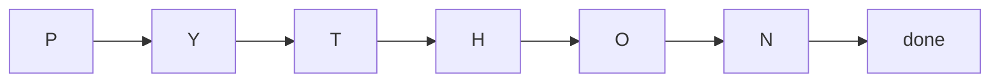
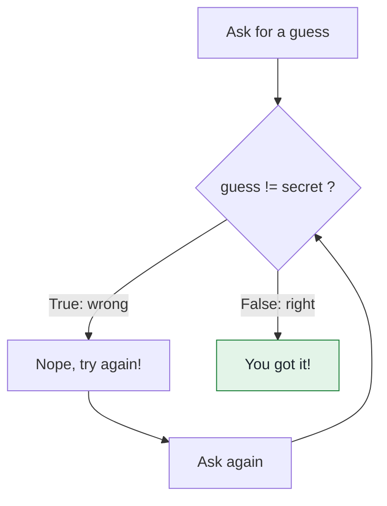
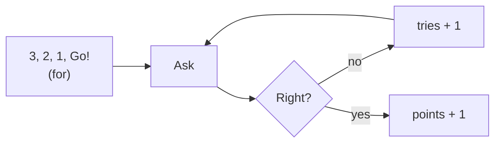

# Lab 3 - Loops

<div class="lab-summary" markdown>
**:material-presentation: After slides 43-54** <span class="slides-chip">Loops, range(), while, for</span>

**:material-hammer-wrench: You build:** a countdown, a times table, a guessing game, and a quiz question that does not give up

**:material-file-code: File:** `lab3/loops.py`
</div>

A **loop** repeats code: 10 times, a million times, or "until the answer is right".



<div class="concepts" markdown>
<div markdown>
<p class="card-title">while</p>
Repeats a block **while** a condition is `True`. Use it when you do not know how many rounds you need.
<p class="like">"keep stirring while the soup is cold"</p>
</div>
<div markdown>
<p class="card-title">for</p>
Repeats a block **once for each item**: each number, each letter, each name.
<p class="like">a playlist: play each song, one after another</p>
</div>
<div markdown>
<p class="card-title">range()</p>
Makes numbers for a `for` loop. `range(4)` gives 0, 1, 2, 3. `range(1, 4)` gives 1, 2, 3.
<p class="like">the page numbers in a book</p>
</div>
<div markdown>
<p class="card-title">break / continue</p>
`break` leaves the loop now. `continue` skips the rest of this round.
<p class="like">`break`: leave the party. `continue`: skip this song</p>
</div>
</div>

## Steps

Open `lab3/loops.py`. For each step, find its `TODO`.

### <span class="step-num">3.1</span> while: a countdown

Find `TODO 1` and run the file.

```python title="lab3/loops.py"
count = 5
while count > 0:
    print("Countdown:", count)
    count = count - 1
print("Lift off!")
```

```text title="Output"
Countdown: 5
Countdown: 4
Countdown: 3
Countdown: 2
Countdown: 1
Lift off!
```

Follow it like the computer does:



| count | `count > 0`? | Prints |
|---|---|---|
| 5 | True | Countdown: 5 |
| 4 | True | Countdown: 4 |
| ... | ... | ... |
| 1 | True | Countdown: 1 |
| 0 | **False** | Lift off! |

!!! error "Error decoder: the program never stops (infinite loop)"
    **What you see:** the terminal fills with the same line again and again, and never ends.

    **What it means:** the condition never becomes `False`. For example, you forgot
    `count = count - 1`, so `count` stays 5 forever.

    ```mermaid
    flowchart LR
        C{"5 > 0 ?"} -- "True, forever" --> P["print 5"] --> C
        style C fill:#fde8e8,stroke:#c62828,color:#1b242c
    ```

    **How to fix it:** click into the terminal and press ++ctrl+c++ (also on a Mac).
    This stops the program. Then make sure something in the loop changes the condition.

    Try it now: delete the line `count = count - 1`, run, press ++ctrl+c++, then put the line back.

### <span class="step-num">3.2</span> for and range(): a times table

Find `TODO 2`. Change `table = 7` to any number and run.

```python title="lab3/loops.py"
table = 7
for i in range(1, 11):
    print(f"{i} x {table} = {i * table}")
```

```text title="Output"
1 x 7 = 7
2 x 7 = 14
...
10 x 7 = 70
```

!!! predict "Predict"
    Why `range(1, 11)` and not `range(1, 10)`?

    ??? success "Show the answer"
        `range` **stops before** the last number. `range(1, 11)` gives 1, 2, ... 10.
        `range(1, 10)` would stop at 9. It is like slide 48: `range(1, 4)` gives 1, 2, 3.



| You write | You get |
|---|---|
| `range(4)` | 0, 1, 2, 3 |
| `range(1, 4)` | 1, 2, 3 |
| `range(0, 10, 2)` | 0, 2, 4, 6, 8 (count in steps of 2) |
| `range(3, 0, -1)` | 3, 2, 1 (count down!) |

### <span class="step-num">3.3</span> for: walk through a string

Find `TODO 3`. A `for` loop can go through **any** sequence, also the letters of a string.

```python title="lab3/loops.py"
for letter in "CISCO":
    print(letter)
```

Now remove the `#` from the second loop and make it print each letter of `PYTHON` with a star:

```text title="Output"
P *
Y *
T *
H *
O *
N *
```

Read it out loud: "for **each** letter in PYTHON, do this". Each round, `letter` holds the next one:



You choose the name: `for x in "PYTHON":` works too, but `letter` is clearer.

### <span class="step-num">3.4</span> break and continue

Find `TODO 4`. Guess the output before you run it.

```python title="lab3/loops.py"
for number in range(1, 11):
    if number == 4:
        continue  # skip 4
    if number == 8:
        break  # stop at 8
    print("Number", number)
```

??? success "Show the output"
    ```text title="Output"
    Number 1
    Number 2
    Number 3
    Number 5
    Number 6
    Number 7
    ```
    ```mermaid
    flowchart LR
        N1["1"] --> N2["2"] --> N3["3"] --> N4["4<br/>continue: skip"] --> N5["5"] --> N6["6"] --> N7["7"] --> N8["8<br/>break: leave"]
        style N4 fill:#fff4d6,stroke:#9a6700,color:#1b242c
        style N8 fill:#fde8e8,stroke:#c62828,color:#1b242c
    ```

    9 and 10 never happen.

### <span class="step-num">3.5</span> A guessing game

Find `TODO 5` and remove the `#` in front of the 6 lines. Run it and guess.

```python title="lab3/loops.py"
secret = 7
guess = int(input("Guess my number (1-10): "))
while guess != secret:
    print("Nope, try again!")
    guess = int(input("Guess my number (1-10): "))
print("You got it!")
```

You just wrote a real game!



Nobody knows how many tries the player needs, so `while` is the right loop.

## Practise: add up 1 to 100

The famous mathematician Gauss was given this task at school: add up all numbers from 1 to 100.
You have a computer!

=== "Follow along"

    Create `lab3/gauss.py` and type:

    ```python title="lab3/gauss.py"
    --8<-- "code/solutions/lab3_exercise.py"
    ```

    ```text title="Output"
    1 + 2 + ... + 100 = 5050
    1
    2
    Fizz
    4
    Buzz
    ...
    ```

=== "Try it"

    Write `lab3/gauss.py` that adds up 1 to 100 and prints the total.

    **Hints:**

    - Start with `total = 0` **before** the loop.
    - Inside a `for number in range(...)` loop, do `total = total + number`.
    - Print the total **after** the loop (not indented!).

=== "Challenge"

    **FizzBuzz**, a classic programming puzzle. Print the numbers 1 to 20, but:

    - for numbers divisible by 3, print `Fizz`,
    - for numbers divisible by 5, print `Buzz`,
    - for numbers divisible by both, print `FizzBuzz`.

    **Hint:** "divisible by 3" means `number % 3 == 0`. Which check must come first?

## Add it to your Quiz Game

Two changes to `quiz.py`:

1. **Add** a countdown after the "Start the quiz?" block.
2. **Replace** your Lab 2 question block (from `answer = input(...)` to the end) with a loop that
   keeps asking until the answer is right.

```python title="quiz.py"
# --- Lab 3: countdown, then ask until the answer is right ---
for number in range(3, 0, -1):
    print(number, "...")
print("Go!")

tries = 1
answer = input("What is the capital of Poland? ")
while answer != "Warsaw" and answer != "warsaw":
    print("Not quite. Try again!")
    answer = input("What is the capital of Poland? ")
    tries = tries + 1

print(f"Correct! You needed {tries} tries.")
points = points + 1
print(f"{name}, you have {points} points.")
```



```text title="Output"
Start the quiz? (Y/N) y
Great, let's go!
3 ...
2 ...
1 ...
Go!
What is the capital of Poland? Krakow
Not quite. Try again!
What is the capital of Poland? Warsaw
Correct! You needed 2 tries.
Ola, you have 1 points.
```

!!! predict "Predict"
    Why does the `while` line use `and`, not `or`?

    ??? success "Show the answer"
        The loop must continue while the answer is **neither** "Warsaw" **nor** "warsaw".
        With `or`, the condition would always be `True` (any answer is different from at least one
        of them) and the loop would never end. Try it, and stop it with ++ctrl+c++!

!!! checkpoint "Checkpoint"
    Your game counts down 3, 2, 1, and keeps asking until you type `Warsaw`.

    Not the same? Copy `code/solutions/quiz_after_lab3.py` over your `quiz.py`.

!!! badge "Badge earned"
    **Loop Master**

    You can repeat code with `while` and `for`, count with `range`, and stop with `break`.

??? instructor "For instructors"
    - Slide 49 shows the loop flowchart. Point at it during Step 3.1 when you trace the countdown.
    - Let everyone make an infinite loop once, on purpose, and stop it with Ctrl+C. It takes away
      the fear.
    - The "Exercise time!" slide (54) matches the Practise section.
