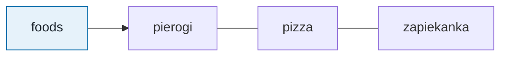
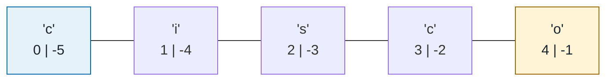
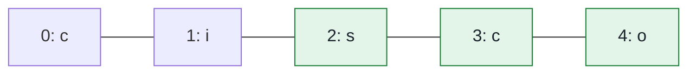
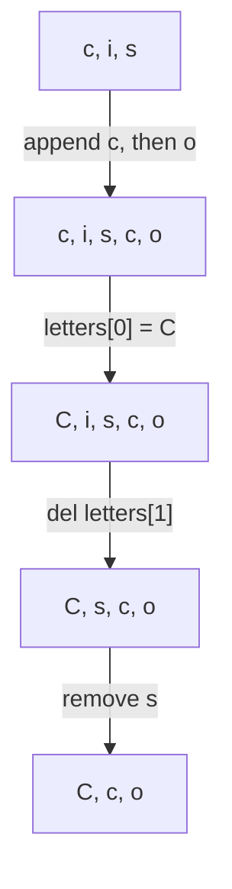
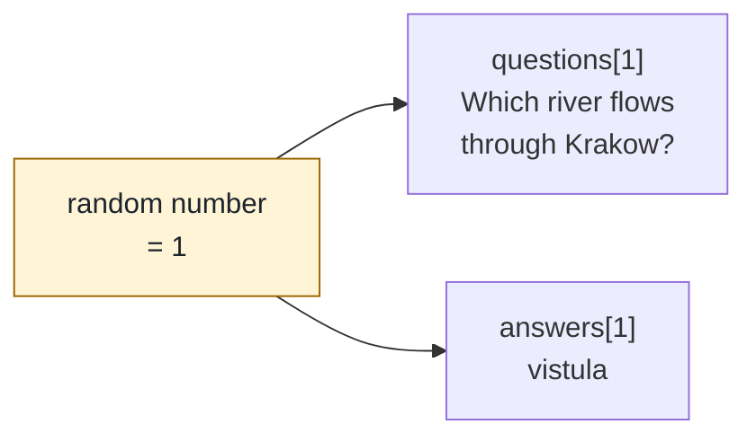

# Lab 4 - Lists and strings

<div class="lab-summary" markdown>
**:material-presentation: After slides 55-105** <span class="slides-chip">Lists, then "strings are lists!"</span>

**:material-hammer-wrench: You build:** a username generator, and a quiz that picks random questions

**:material-file-code: File:** `lab4/lists_and_strings.py`
</div>

20 questions in 20 variables? Messy. A **list** keeps many values in order, in **one** variable:



<div class="concepts" markdown>
<div markdown>
<p class="card-title">List</p>
Many values in order, inside `[ ]`: `[0, 1, 3]`. You can add, change and remove items.
<p class="like">a train: each wagon carries one value</p>
</div>
<div markdown>
<p class="card-title">Index</p>
The position of an item. **The first item is at index 0.** `-1` is the last item.
<p class="like">wagon numbers, but the first wagon is wagon 0</p>
</div>
<div markdown>
<p class="card-title">Slice</p>
A part of a list: `[start:stop]`. The `stop` item is **not** included.
<p class="like">a slice of cake: from here, up to (not including) there</p>
</div>
<div markdown>
<p class="card-title">Method</p>
A function that belongs to a value. You call it with a dot: `letters.append("o")`, `name.upper()`.
<p class="like">buttons on a machine: the TV remote has "volume up"</p>
</div>
</div>

## Steps

Open `lab4/lists_and_strings.py`. For each step, find its `TODO`.

### <span class="step-num">4.1</span> Make a list

Find `TODO 1` and run. Then make your own list of foods.

```python title="lab4/lists_and_strings.py"
num_pets = [0, 1, 0, 3, 2, 2]
print(num_pets)
print("Number of students:", len(num_pets))

foods = ["pierogi", "pizza", "zapiekanka"]
print(foods)
```

```text title="Output"
[0, 1, 0, 3, 2, 2]
Number of students: 6
['pierogi', 'pizza', 'zapiekanka']
```

`len()` tells you how many items a list has. A list can hold any values, even mixed ones
(slide 56): `[7.1, True, "cisco", 7 == 8]`. And `[]` is an empty list.

### <span class="step-num">4.2</span> Indexing

Every wagon has a number. **The first one is 0.** Negative numbers count from the end.



Find `TODO 2`. Guess each line, then remove the `#` and run.

```python title="lab4/lists_and_strings.py"
cisco = ["c", "i", "s", "c", "o"]
print(cisco[0])
print(cisco[4])
print(cisco[-1])
print(cisco[-3])
```

??? success "Show the answers"
    ```text title="Output"
    c
    o
    o
    s
    ```

!!! error "Error decoder: `IndexError: list index out of range`"
    **What it means:** you asked for a position that does not exist. `cisco` has 5 items, so the
    indexes go from 0 to 4. `cisco[5]` is the sixth item: there is none.

    **How to fix it:** the last index is always `len(cisco) - 1`. Or use `cisco[-1]` for the last one.

### <span class="step-num">4.3</span> Slicing

Find `TODO 3`. Remember: **start** is included, **stop** is not.



<p class="caption">Green = <code>cisco[2:5]</code>: start at 2, stop <strong>before</strong> 5.</p>

```python title="lab4/lists_and_strings.py"
print(cisco[2:5])   # from index 2 up to (not including) 5
print(cisco[:3])    # from the start up to 3
print(cisco[3:])    # from 3 to the end
print(cisco[:])     # everything: a copy
```

```text title="Output"
['s', 'c', 'o']
['c', 'i', 's']
['c', 'o']
['c', 'i', 's', 'c', 'o']
```

!!! predict "Predict"
    What does `cisco[-3:-1]` give? And `cisco[-1:-3]`?

    ??? success "Show the answer"
        `['s', 'c']`: from index -3 up to (not including) -1.
        `cisco[-1:-3]` gives `[]`, an **empty** list, because the start is already after the stop
        (slide 68).

### <span class="step-num">4.4</span> Change a list

Find `TODO 4`. A list is **mutable**: you can change it after you create it.



```python title="lab4/lists_and_strings.py"
letters = ["c", "i", "s"]
letters.append("c")     # add to the end
letters.append("o")
print(letters)          # ['c', 'i', 's', 'c', 'o']
letters[0] = "C"        # change one item
del letters[1]          # delete by position
letters.remove("s")     # delete by value
print(letters)          # ['C', 'c', 'o']
print(letters.index("o"))       # 2: the position of "o"
print(["a", "b"] + ["c", "d"])  # ['a', 'b', 'c', 'd']
```

| You want to... | Write | Slide |
|---|---|---|
| add to the end | `my_list.append(value)` | 71 |
| change an item | `my_list[2] = value` | 75 |
| delete by position | `del my_list[2]` | 77 |
| delete by value | `my_list.remove(value)` | 85 |
| find a position | `my_list.index(value)` | 82 |
| join two lists | `list_a + list_b` | 81 |
| check if a value is in it | `value in my_list` | 105 |

!!! error "Error decoder: `ValueError: list.remove(x): x not in list`"
    **What it means:** `remove()` or `index()` looked for a value that is not in the list.

    **How to fix it:** check first with `in`:

    ```python
    if "w" in letters:
        letters.remove("w")
    ```

### <span class="step-num">4.5</span> Loop through a list

Find `TODO 5`. A `for` loop visits each item. `enumerate()` gives you the index **and** the item.

```python title="lab4/lists_and_strings.py"
for i, letter in enumerate(cisco):
    print(f"#{i} : {letter}")
```

```text title="Output"
#0 : c
#1 : i
#2 : s
#3 : c
#4 : o
```

### <span class="step-num">4.6</span> Strings are lists (almost)

A string is a train of letters, so indexing and slicing work the same way:

| index | 0 | 1 | 2 | 3 | 4 | 5 | 6 | **7** | 8 | 9 | 10 | 11 |
|---|---|---|---|---|---|---|---|---|---|---|---|---|
| letter | W | e | ␣ | a | r | e | ␣ | **C** | i | s | c | o |

Spaces count too (shown as ␣). `wearecisco[7]` is `C`.

Find `TODO 6` and run. Then remove the `#` in front of `wearecisco[7] = "c"`.

```python title="lab4/lists_and_strings.py"
wearecisco = "We are Cisco"
print(wearecisco[0])     # W
print(wearecisco[-5:])   # Cisco
wearecisco[7] = "c"      # ???
```

!!! error "Error decoder: `TypeError: 'str' object does not support item assignment`"
    **What it means:** strings are **immutable**: you cannot change one letter inside a string.

    **How to fix it:** make a **new** string instead, for example with `replace()`:
    `wearecisco = wearecisco.replace("Cisco", "cisco")`. Put the `#` back on that line before you go on.

### <span class="step-num">4.7</span> String methods

Find `TODO 7`. Guess each result, then remove the `#` and run.

```python title="lab4/lists_and_strings.py"
print(wearecisco.upper())
print(wearecisco.lower())
print("   lots of space   ".strip())
print(wearecisco.split())
print(" *** ".join(["We", "are", "Cisco"]))
print(wearecisco.replace("Cisco", "awesome!"))
print(wearecisco.startswith("We"))
print("are" in wearecisco)
```

??? success "Show the answers"
    ```text title="Output"
    WE ARE CISCO
    we are cisco
    lots of space
    ['We', 'are', 'Cisco']
    We *** are *** Cisco
    We are awesome!
    True
    True
    ```

| Method | What it does | Example | Result |
|---|---|---|---|
| `.upper()` / `.lower()` | ALL CAPS / all small | `"Hi".lower()` | `'hi'` |
| `.strip()` | removes spaces at both ends | `"  hi ".strip()` | `'hi'` |
| `.split()` | cuts into a list of words | `"a b c".split()` | `['a', 'b', 'c']` |
| `"-".join(list)` | glues a list into one string | `"-".join(["a", "b"])` | `'a-b'` |
| `.replace(old, new)` | swaps text | `"cat".replace("c", "b")` | `'bat'` |
| `.startswith(x)` / `.endswith(x)` | True or False | `"Cisco".startswith("C")` | `True` |
| `x in text` | is `x` somewhere inside? | `"are" in "We are"` | `True` |

!!! tip "Methods give you a NEW string"
    ```mermaid
    flowchart LR
        N["name: #quot;ola#quot;"] -- ".upper()" --> U["new string #quot;OLA#quot;"] -- "name = ..." --> K["name: #quot;OLA#quot;"]
    ```

    `name` only changes if you store the result: `name = name.upper()`.

## Practise: username generator

Make a username from the first 3 letters of the first name, the first 3 letters of the last name,
and the last 2 digits of the birth year. Ola Nowak, born 2010, becomes `olanow10`.

=== "Follow along"

    Create `lab4/username.py` and type:

    ```python title="lab4/username.py"
    --8<-- "code/solutions/lab4_exercise.py"
    ```

    ```text title="Output"
    First name: Ola
    Last name: Nowak
    Year you were born: 2010
    Your username is: olanow10
    Vowels in your name: 4
    ```

=== "Try it"

    Write `lab4/username.py`.

    **Hints:**

    - `.strip().lower()` cleans what the user types. You can chain methods!
    - `first[:3]` gives the first 3 letters. Which slice gives the **last** 2 characters of the year?
    - Join the parts with `+`.

=== "Challenge"

    - Count the vowels in the full name (loop through the letters and use `in "aeiouy"`).
    - Make a list of 5 usernames for 5 friends using a loop, then print them all on one line
      with `", ".join(...)`.
    - A **palindrome** reads the same both ways ("kajak"). Check whether a word is one.
      Hint: search what `word[::-1]` does.

## Add it to your Quiz Game

Three improvements to `quiz.py`:

1. **At the top** of the file, add `import random`. A **module** is ready-made code you can use.
   `random` picks random things.
2. **Change** the start check so that `Y`, `y` and `  y ` all work:

    ```python title="quiz.py"
    start = input("Start the quiz? (Y/N) ").strip().lower()
    if start == "y":
    ```

3. **Replace** the Lab 3 question block (from `tries = 1` to the end) with questions from lists:

```python title="quiz.py"
# --- Lab 4: pick a random question from two lists ---
questions = [
    "What is the capital of Poland?",
    "Which river flows through Krakow?",
    "How many legs does a spider have?",
]
answers = ["warsaw", "vistula", "8"]

number = random.randint(0, len(questions) - 1)
question = questions[number]
correct = answers[number]

tries = 1
answer = input(question + " ").strip().lower()
while answer != correct:
    print("Not quite. Try again!")
    answer = input(question + " ").strip().lower()
    tries = tries + 1

print(f"Correct! You needed {tries} tries.")
points = points + 1
print(f"{name}, you have {points} points.")
```

`random.randint(0, 2)` gives 0, 1 or 2. The **same index** picks a question and its answer:



Run it a few times: you get different questions. And `  WARSAW ` now counts as correct!

!!! predict "Predict"
    Why `len(questions) - 1` and not `len(questions)`?

    ??? success "Show the answer"
        There are 3 questions, at indexes 0, 1 and 2. `randint(0, 3)` could give 3, and
        `questions[3]` is an `IndexError`. When you add a fourth question, `len()` updates by itself.

!!! checkpoint "Checkpoint"
    Your game asks a random question from the list and accepts answers in any case and with spaces.

    Not the same? Copy `code/solutions/quiz_after_lab4.py` over your `quiz.py`.

!!! badge "Badge earned"
    **List Collector**

    You can index, slice, change and loop through lists, and use string methods like a pro.

??? instructor "For instructors"
    - Slides 55-105 are mostly click-through animations. Go fast (about 15 seconds each): Steps
      4.2-4.7 repeat every example, and students try them themselves.
    - The two summary slides (90 and 104) are good to show again at the end of the lab.
    - This lab has 7 steps. If time is short, do Steps 4.1-4.4 and 4.7, then the Quiz Game step.
