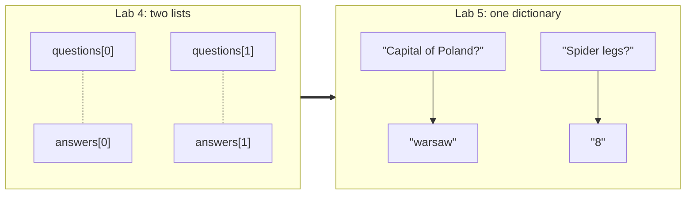
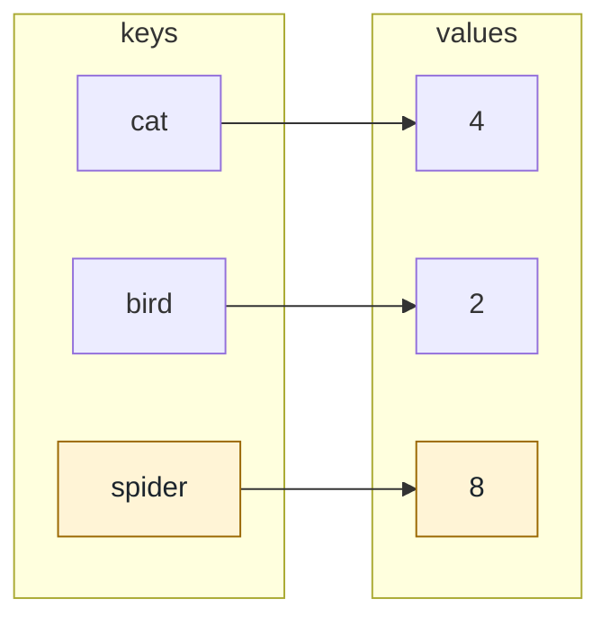
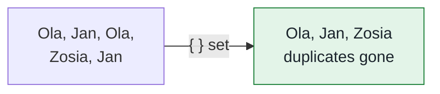
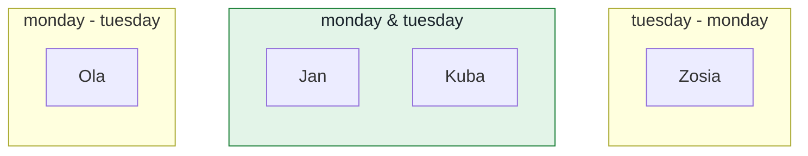
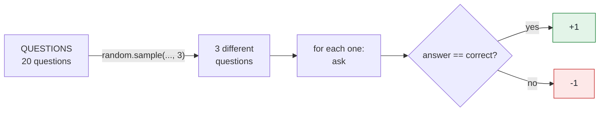

# Lab 5 - Tuples, dictionaries and sets

<div class="lab-summary" markdown>
**:material-presentation: After slides 106-117** <span class="slides-chip">Tuple, dictionary, set</span>

**:material-hammer-wrench: You build:** a Polish-English dictionary, and a quiz with a whole question bank and a score

**:material-file-code: File:** `lab5/collections_practice.py`
</div>

Lab 4 used **two** lists joined by an index. One wrong index and every answer is wrong.
A **dictionary** keeps each question **with** its answer:



<div class="concepts" markdown>
<div markdown>
<p class="card-title">Tuple</p>
Like a list, but it can never change: `(3, 4)`. Use it for things that belong together.
<p class="like">GPS coordinates or a date: you do not change one half</p>
</div>
<div markdown>
<p class="card-title">Dictionary</p>
Pairs of **key: value** in `{ }`. You look up a value by its key, not by a number.
<p class="like">the contacts in your phone: you look up "Mama", not "contact number 7"</p>
</div>
<div markdown>
<p class="card-title">Set</p>
A collection of **unique** values in `{ }`. Duplicates disappear by themselves.
<p class="like">a guest list: each person is on it once, however many times they say hello</p>
</div>
</div>

| | List | Tuple | Dictionary | Set |
|---|---|---|---|---|
| Brackets | `[1, 2]` | `(1, 2)` | `{"a": 1}` | `{1, 2}` |
| Can change? | yes | **no** | yes | yes |
| Find items by | index `[0]` | index `[0]` | key `["a"]` | only `in` |
| Duplicates? | allowed | allowed | keys are unique | **never** |

## Steps

Open `lab5/collections_practice.py`. For each step, find its `TODO`.

### <span class="step-num">5.1</span> Tuples

Find `TODO 1` and run.

```python title="lab5/collections_practice.py"
position = (3, 4)
print("x is", position[0], "and y is", position[1])

names = ["Ola", "Jan", "Zosia"]
scores = [7, 9, 8]
for pair in zip(names, scores):  # zip makes tuples from two lists
    print(pair)
```

```text title="Output"
x is 3 and y is 4
('Ola', 7)
('Jan', 9)
('Zosia', 8)
```

Now remove the `#` in front of `position[0] = 10` and run.

!!! error "Error decoder: `TypeError: 'tuple' object does not support item assignment`"
    **What it means:** a tuple cannot be changed after you create it. That is its job.

    **How to fix it:** if the values must change, use a list `[ ]`. Or make a new tuple:
    `position = (10, 4)`. Put the `#` back before you go on.

### <span class="step-num">5.2</span> Dictionaries

Find `TODO 2` and run.

```python title="lab5/collections_practice.py"
legs = {"cat": 4, "bird": 2, "spider": 8}
print(legs["spider"])
legs["fish"] = 0          # add a new key and value
legs["bird"] = 2          # change a value
print(legs)
print(len(legs), "animals")
```

```text title="Output"
8
{'cat': 4, 'bird': 2, 'spider': 8, 'fish': 0}
4 animals
```



<p class="caption"><code>legs["spider"]</code>: find the key, follow the arrow, get <code>8</code>.</p>

Now remove the `#` in front of `print(legs["dog"])` and run.

!!! error "Error decoder: `KeyError: 'dog'`"
    **What it means:** you asked for a key that is not in the dictionary.

    **How to fix it (two ways):**

    - Check first: `if "dog" in legs:`
    - Or use `.get()` with a default: `legs.get("dog", "unknown")` gives `'unknown'` instead of an error.

Put the `#` back, then remove it from the last four lines:

```python title="lab5/collections_practice.py"
print(legs.get("dog", "unknown"))
for animal in legs:
    print(f"A {animal} has {legs[animal]} legs")
print("cat" in legs)
```

```text title="Output"
unknown
A cat has 4 legs
A bird has 2 legs
A spider has 8 legs
A fish has 0 legs
True
```

A `for` loop over a dictionary visits each **key**. You get the value with `legs[animal]`.

!!! tip "Good to know about dictionaries"
    | Rule | Example |
    |---|---|
    | Keys are **unique**: same key = change the value | `legs["bird"] = 2` |
    | The order you add items is kept | loops go in that order |
    | Keys: strings, numbers, tuples. **Not lists** | `{"cat": 4}` |
    | Values: anything | `{"ola": [7, 9]}` |
    | No slicing: there are keys, not positions | ~~`legs[0:2]`~~ |

!!! predict "Predict"
    What does this print?

    ```python
    scores = {"Ola": 3}
    scores["Ola"] = scores["Ola"] + 2
    scores["Jan"] = 1
    print(scores)
    ```

    ??? success "Show the answer"
        `{'Ola': 5, 'Jan': 1}`. The first change updates Ola's value; the second adds a new key.

### <span class="step-num">5.3</span> Sets

Find `TODO 3` and run. Then remove the `#` from the last five lines.

```python title="lab5/collections_practice.py"
visitors = {"Ola", "Jan", "Ola", "Zosia", "Jan"}
print(visitors)
print(len(visitors), "different visitors")

monday = {"Ola", "Jan", "Kuba"}
tuesday = {"Jan", "Zosia", "Kuba"}
print(monday & tuesday)   # in both
print(monday | tuesday)   # in either
print(monday - tuesday)   # only on Monday
```

```text title="Output"
{'Zosia', 'Ola', 'Jan'}
3 different visitors
{'Jan', 'Kuba'}
{'Zosia', 'Ola', 'Jan', 'Kuba'}
{'Ola'}
```



!!! note "Your order may be different"
    A set has **no order**. Your output may list the names in a different order. That is fine!



<p class="caption"><code>monday | tuesday</code> = all three boxes together.</p>

## Practise: a tiny Polish-English dictionary

=== "Follow along"

    Create `lab5/translator.py` and type:

    ```python title="lab5/translator.py"
    --8<-- "code/solutions/lab5_exercise.py"
    ```

    ```text title="Output"
    Type a Polish word: smok
    smok -> dragon
    {'k': 2, 'r': 1, 'a': 1, 'o': 1, 'w': 1}
    ```

=== "Try it"

    Write `lab5/translator.py` with a dictionary of at least 5 Polish words and their English
    meanings. Ask for a word and print the translation.

    **Hints:** clean the input with `.strip().lower()`. Use `.get(word, "...")` so an unknown word
    does not crash the program.

=== "Challenge"

    - Count how many times each letter appears in a word, using a dictionary:
      `{'k': 2, 'r': 1, ...}`.
    - Translate a whole sentence: `.split()` it into words, translate each one, and `" ".join()` the result.
    - Make it work both ways: build an English-to-Polish dictionary from the first one with a loop.

## Add it to your Quiz Game

Open **`questions.py`** in the `code` folder. It is a dictionary called `QUESTIONS` with 20
questions: each **key** is a question and each **value** is its answer. Take a look, but do not
change it yet.

Now update `quiz.py`:

1. **At the top**, under `import random`, add:

    ```python title="quiz.py"
    from questions import QUESTIONS
    ```

    This loads the `QUESTIONS` dictionary from the file `questions.py`.

2. **Replace** the Lab 4 block (from the line `# --- Lab 4` to the end of the file) with:

```python title="quiz.py"
# --- Lab 5: 3 different questions from the question bank, +1 or -1 ---
chosen = random.sample(list(QUESTIONS.keys()), 3)

for question in chosen:
    correct = QUESTIONS[question]
    answer = input(question + " ").strip().lower()
    if answer == correct:
        print("Correct! +1 point")
        points = points + 1
    else:
        print(f"Wrong! The answer was {correct}. -1 point")
        points = points - 1

print(f"{name}, your score is {points}.")
```



The +1 / -1 rules come from slide 144.

```text title="Output"
3 ...
2 ...
1 ...
Go!
How many legs does a spider have? 8
Correct! +1 point
Which company makes Webex? cisco
Correct! +1 point
What does 7 % 2 give? 3
Wrong! The answer was 1. -1 point
Ola, your score is 1.
```

!!! tip "Add your own question"
    Open `questions.py`, copy one line, change the question and answer (lowercase!), and keep the
    comma at the end. Your game can now ask it, and you did not touch `quiz.py` at all.

!!! checkpoint "Checkpoint"
    Your game asks 3 different random questions from `questions.py` and keeps a +1 / -1 score.

    Not the same? Copy `code/solutions/quiz_after_lab5.py` over your `quiz.py`.

!!! badge "Badge earned"
    **Data Organiser**

    You know when to use a list, a tuple, a dictionary or a set.

??? instructor "For instructors"
    - Slides 111-112 say dictionaries are unordered and values cannot be lists. Both are out of date:
      dictionaries keep insertion order (Python 3.7+), and **keys** cannot be lists while **values**
      can be anything. This lab teaches the current behaviour.
    - The "Exercise time!" slide (116) matches the Practise section.
