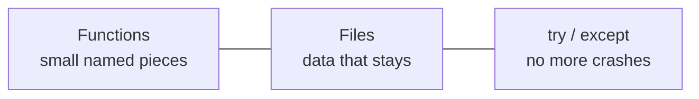
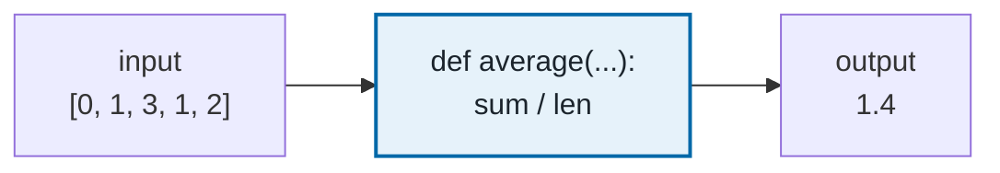
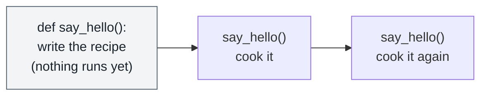
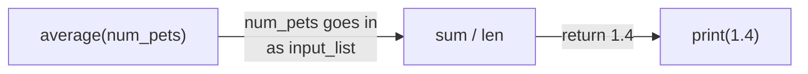
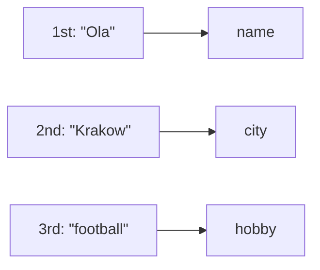
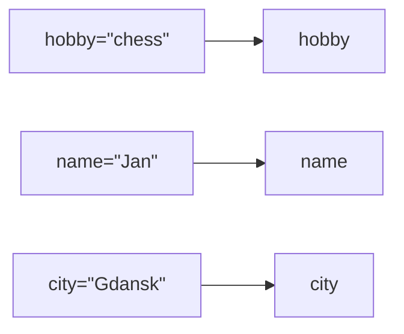
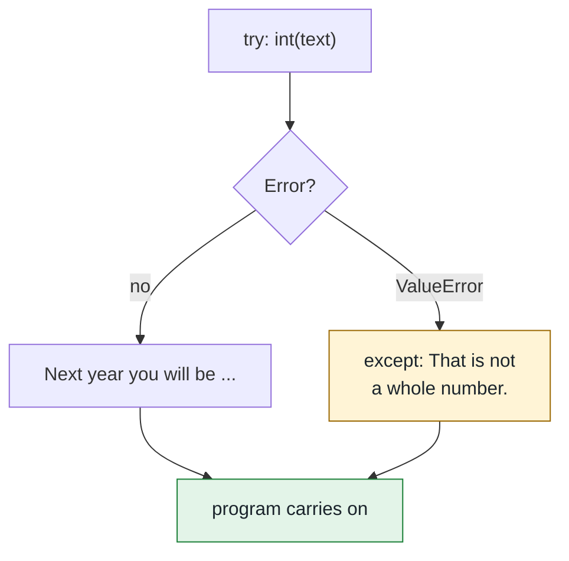
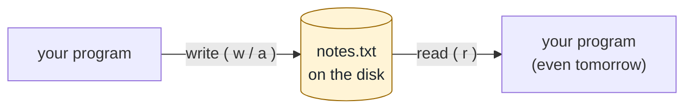
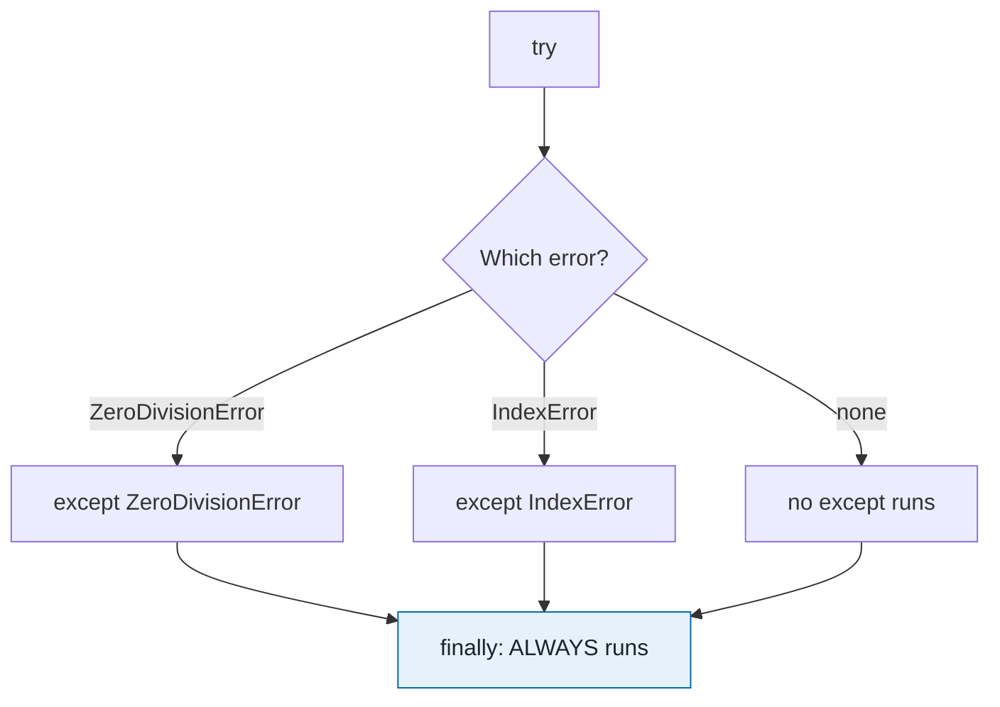
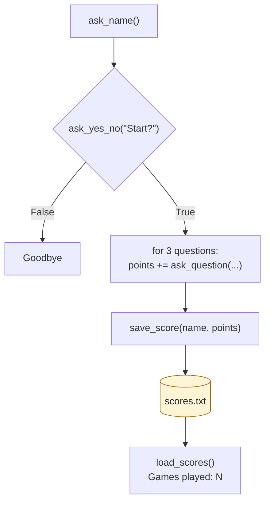

# Lab 6 - Functions, files and errors

<div class="lab-summary" markdown>
**:material-presentation: After slides 118-141** <span class="slides-chip">Functions, built-in functions, exceptions</span>

**:material-hammer-wrench: You build:** your own functions, a program that writes files, and a quiz that never crashes and saves every score

**:material-file-code: File:** `lab6/functions.py`
</div>

Your `quiz.py` is getting long. Three new tools:



<div class="concepts" markdown>
<div markdown>
<p class="card-title">Function</p>
A named piece of code that does one job. Define it once with `def`, use it many times.
<p class="like">a vending machine: put something in, press the button, get something out</p>
</div>
<div markdown>
<p class="card-title">Parameter / return</p>
Parameters are the **inputs** in the brackets. `return` sends the **output** back.
<p class="like">coins and a button in, a drink out</p>
</div>
<div markdown>
<p class="card-title">File</p>
`open()` reads or writes a file on the disk. Unlike variables, files stay after the program ends.
<p class="like">a notebook: you can read it again tomorrow</p>
</div>
<div markdown>
<p class="card-title">try / except</p>
Try some code. **If** an error happens, run the `except` block instead of crashing.
<p class="like">a safety net under a tightrope walker</p>
</div>
</div>



## Steps

Open `lab6/functions.py`. For each step, find its `TODO`.

### <span class="step-num">6.1</span> Your first function

Find `TODO 1` and run.

```python title="lab6/functions.py"
def say_hello():
    print("Hello from a function!")


say_hello()
say_hello()
```

```text title="Output"
Hello from a function!
Hello from a function!
```



Do not forget the `()` when you call it, and the `:` after `def`.

### <span class="step-num">6.2</span> Parameters and return

Find `TODO 2`. This is the average-pets example from slides 121-125. Remove the `#` in front of
`print(average([1, 2, 0]))` and run.

```python title="lab6/functions.py"
def average(input_list):
    output_average = sum(input_list) / len(input_list)
    return output_average


num_pets = [0, 1, 3, 1, 2]
print(average(num_pets))
print(average([1, 2, 0]))
```

```text title="Output"
1.4
1.0
```



Now write your own function `square(number)` that returns `number * number`, and print `square(5)`.
The three commented lines under `TODO 2` show you where.

??? example "Show the code"
    ```python
    def square(number):
        return number * number


    print(square(5))   # 25
    ```

!!! predict "Predict"
    What does this print?

    ```python
    def double(x):
        print(x * 2)

    result = double(4)
    print(result)
    ```

    ??? success "Show the answer"
        ```text title="Output"
        8
        None
        ```
        `double` **prints** 8 but does not **return** anything, so `result` is `None`.

        | `print` | `return` |
        |---|---|
        | shows a value to a **human** | gives a value back to your **program** |

### <span class="step-num">6.3</span> Positional and keyword arguments

Find `TODO 3`, remove the `#` in front of the second `introduce(...)` line, and run.

```python title="lab6/functions.py"
def introduce(name, city, hobby):
    print(f"I am {name} from {city} and I like {hobby}.")


introduce("Ola", "Krakow", "football")                  # positional: by order
introduce(hobby="chess", name="Jan", city="Gdansk")     # keyword: by name
```

```text title="Output"
I am Ola from Krakow and I like football.
I am Jan from Gdansk and I like chess.
```



<p class="caption"><strong>Positional</strong>: matched by ORDER.</p>



<p class="caption"><strong>Keyword</strong>: matched by NAME, so any order works.</p>

!!! error "Error decoder: `TypeError: introduce() missing 1 required positional argument: 'hobby'`"
    **What it means:** the function needs 3 values, but you gave it only 2.

    **How to fix it:** give one value for each parameter in the `def` line.

### <span class="step-num">6.4</span> Catch an error with try / except

Find `TODO 4`. It runs fine with `text = "12"`. Now remove the `#` in front of the `input` line,
run it, and type `abc` when it asks.

```python title="lab6/functions.py"
text = input("How old are you? ")
try:
    age = int(text)
    print(f"Next year you will be {age + 1}.")
except ValueError:
    print("That is not a whole number.")
```

```text title="Output"
How old are you? abc
That is not a whole number.
```



Without `try`, `int("abc")` would stop the whole program.

!!! error "Error decoder: `ValueError: invalid literal for int() with base 10: 'abc'`"
    **What it means:** `int()` can only turn digits into a number. `"abc"`, `"12.5"` or `""`
    (just pressing Enter) are not whole numbers.

    **How to fix it:** catch it with `try` / `except ValueError:` and ask again, as above.

### <span class="step-num">6.5</span> Write and read a file

Find `TODO 5` and run. Then look in the Explorer: there is a new file `notes.txt`. Open it!
Now remove the `#` from the last 3 lines of `TODO 5` and run again: the program reads the file back.

```python title="lab6/functions.py"
with open("notes.txt", "w") as file:
    file.write("Python is fun\n")
    file.write("Krakow is beautiful\n")

with open("notes.txt") as file:
    for line in file:
        print("Read:", line.strip())
```

```text title="Output"
Read: Python is fun
Read: Krakow is beautiful
```

| Mode | Means | If the file exists... |
|---|---|---|
| `open(name)` or `open(name, "r")` | **r**ead | reads it |
| `open(name, "w")` | **w**rite | **deletes** the old content first |
| `open(name, "a")` | **a**ppend | adds to the end |



- `with ... as file:` closes the file for you at the end of the block.
- `\n` = new line. `write()` does not add one; `.strip()` removes it when you read.

!!! error "Error decoder: `FileNotFoundError: [Errno 2] No such file or directory: 'notes.txt'`"
    **What it means:** you tried to **read** a file that does not exist (yet), or it is in another
    folder.

    **How to fix it:** check the name and that VS Code has the `code` folder open. In your game, you
    catch this error, because there is no scores file before the first game.

### <span class="step-num">6.6</span> Different errors, and finally

Find `TODO 6` and run. Then put a `#` in front of `result = 3 / 0`, remove the `#` in front of
`result = a_list[10]`, and run again. Which `except` runs now?

```python title="lab6/functions.py"
a_list = [1, 2, 3]
try:
    result = 3 / 0
except ZeroDivisionError:
    print("There was an exception: ZeroDivisionError")
except IndexError:
    print("There was an exception: IndexError")
finally:
    print("This will always be executed")
```

```text title="Output"
There was an exception: ZeroDivisionError
This will always be executed
```



!!! error "Error decoder: `ZeroDivisionError: division by zero`"
    **What it means:** you divided by 0, which is impossible in maths too.

    **How to fix it:** check the number first (`if b != 0:`) or catch the error with `except ZeroDivisionError:`.

!!! warning "try cannot catch a SyntaxError"
    `try` only catches errors that happen **while the program runs** (exceptions). A typo like a
    missing bracket is a **syntax error**: Python finds it before running anything (slide 135).

## Practise: temperature converter

=== "Follow along"

    Create `lab6/temperature.py` and type:

    ```python title="lab6/temperature.py"
    --8<-- "code/solutions/lab6_exercise.py"
    ```

    ```text title="Output"
    -5 C = 23.0 F, hot: False
    0 C = 32.0 F, hot: False
    18 C = 64.4 F, hot: False
    30 C = 86.0 F, hot: True
    5.0
    You cannot divide by zero!
    None
    ```

=== "Try it"

    Write two functions in `lab6/temperature.py`:

    - `celsius_to_fahrenheit(celsius)` returns `celsius * 9 / 5 + 32`.
    - `is_hot(celsius)` returns `True` if it is 25 degrees or more.

    Test them on the temperatures `[-5, 0, 18, 30]` with a `for` loop.

=== "Challenge"

    - Write `safe_divide(a, b)` that returns `a / b`, or prints a friendly message and returns
      `None` when `b` is 0. Use `try` / `except`.
    - Ask the user for temperatures until they type `stop`. Save every conversion to
      `temperatures.txt`, one per line.

## Add it to your Quiz Game

Time to tidy up! This is a bigger step: you rewrite `quiz.py` so that each job is a function.
The game does the same as before, plus three new things:

- It asks again if the name is empty or the reply to "Start?" is not Y or N (no more crashes or surprises).
- It saves every player's score in `scores.txt`.
- It reads `scores.txt` back and counts the games played.

Replace **everything** in `quiz.py` with this (copy it with the button at the top right):

```python title="quiz.py"
--8<-- "code/solutions/quiz_after_lab6.py"
```

Read it from top to bottom. Every function does one job you already wrote in Labs 1-5:



| Function | Job | You learned it in |
|---|---|---|
| `ask_name()` | ask for a name until it is not empty | Lab 1, Lab 3 |
| `ask_yes_no(prompt)` | ask until the reply is Y or N, return `True` or `False` | Lab 2, Lab 3 |
| `ask_question(question, correct)` | ask, check, return `1` or `-1` | Lab 2, Lab 4 |
| `save_score(name, points)` | add one line `name,points` to `scores.txt` | Lab 6 |
| `load_scores()` | read every line back as `(points, name)` tuples | Lab 4, Lab 5, Lab 6 |

```text title="Output"
What is your name?
Please type at least one letter.
What is your name? Ola
Hello, Ola! Welcome to the Python Quiz.
Start the quiz? (Y/N) maybe
Please type Y or N.
Start the quiz? (Y/N) y
...
Ola, your score is 1.
Saved! Games played so far: 1
```

!!! predict "Predict"
    In `load_scores()`, the first game has no `scores.txt` yet. Why does the game not crash?

    ??? success "Show the answer"
        `open("scores.txt")` raises a `FileNotFoundError`. The `except FileNotFoundError:` catches it,
        `pass` does nothing, and the function returns an empty list `[]`.

!!! tip "`while True:` and return"
    `ask_yes_no()` uses `while True:`, a loop that would run forever. It stops because `return` ends
    the **whole function** at once, as soon as the reply is Y or N.

!!! checkpoint "Checkpoint"
    Your game re-asks on an empty name and on `maybe`, and after each game `scores.txt` has one more
    line. Play twice and check "Games played so far: 2".

    Not the same? Copy `code/solutions/quiz_after_lab6.py` over your `quiz.py`.

!!! badge "Badge earned"
    **Function Architect**

    You can write functions, save and read files, and catch errors before they crash your program.

??? instructor "For instructors"
    - Slides 128-131 list `input()`, `read()`, `write()` and `open()`. Steps 6.4 and 6.5 cover all four.
    - The Quiz Game step is a full rewrite on purpose. Let students copy it, then walk through the
      table of functions together on the projector.
    - The "Exercise time!" slide (141) matches the Practise section.
