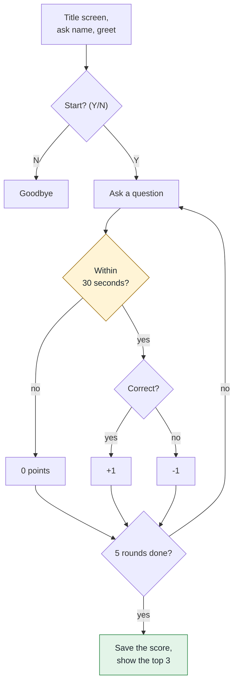
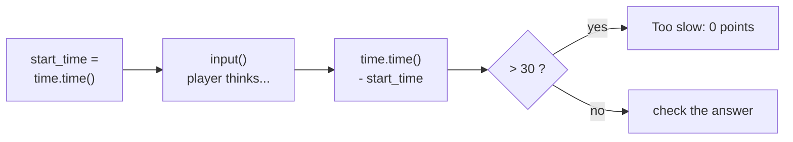
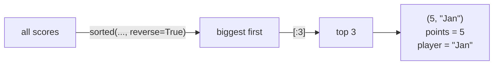
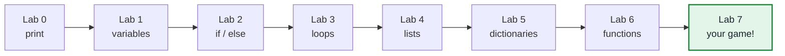

# Lab 7 - The Quiz Game project

<div class="lab-summary" markdown>
**:material-presentation: After slides 142-144** <span class="slides-chip">Project time!</span>

**:material-hammer-wrench: You build:** the finished Quiz Game from slide 144, then you make it yours

**:material-file-code: Files:** `lab7/timer_practice.py`, then `quiz.py`
</div>

This is it. The finished game from slide 144:



Most of it already works:

| Slide 144 asks for | Your game |
|---|---|
| Ask the player's name and print a greeting | :material-check-bold: since Lab 1 |
| Confirm the start of the quiz (Y/N) | :material-check-bold: since Lab 2 (and safe since Lab 6) |
| Ask **5** randomly selected questions | :material-progress-wrench: 3 random questions since Lab 5. Today: 5 |
| **30-second timer** for each answer | :material-progress-wrench: today |
| +1 for each correct answer, -1 for each wrong one | :material-check-bold: since Lab 5 |
| Store the score | :material-check-bold: since Lab 6. Today: show the **top 3** |

<div class="concepts" markdown>
<div markdown>
<p class="card-title">time.time()</p>
The number of seconds since 1 January 1970. Take it twice and subtract: that is how long something took.
<p class="like">a stopwatch: press start, press stop, read the difference</p>
</div>
<div markdown>
<p class="card-title">sorted()</p>
Gives you a sorted copy of a list. `reverse=True` puts the biggest first.
<p class="like">lining up a class from tallest to shortest</p>
</div>
<div markdown>
<p class="card-title">Constant</p>
A variable in CAPITALS that gets its value once, at the top, like `ROUNDS = 5`. Change it in one place, the whole game follows.
<p class="like">the rules of the game, written on the box</p>
</div>
</div>

## Steps

### <span class="step-num">7.1</span> A stopwatch with time.time()

Open `lab7/timer_practice.py`. Find `TODO 1`, remove the `#` from the 5 lines of the reaction game,
and run it.

```python title="lab7/timer_practice.py"
input("Press Enter, then press Enter again as fast as you can...")
start_time = time.time()
input("NOW!")
seconds = time.time() - start_time
print(f"Your reaction time: {round(seconds, 2)} seconds")
```

```text title="Output"
Seconds since 1 January 1970: 1795185969.3902836
Press Enter, then press Enter again as fast as you can...
NOW!
Your reaction time: 0.31 seconds
```

Who in your row is fastest? The 30-second rule works the same way:



!!! analogy "Why not a real countdown?"
    `input()` **waits** and nothing else can happen, not even a ticking clock. So the game measures
    the time **after** the answer. Real countdowns need programs that do two things at once.

### <span class="step-num">7.2</span> Sort the scores

Find `TODO 2` and remove the `#` from the last 5 lines.

```python title="lab7/timer_practice.py"
scores = [(2, "Ola"), (5, "Jan"), (-1, "Kuba"), (4, "Zosia"), (3, "Ania")]
top = sorted(scores, reverse=True)[:3]
place = 1
for points, player in top:
    print(f"{place}. {player} - {points} points")
    place = place + 1
```

```text title="Output"
1. Jan - 5 points
2. Zosia - 4 points
3. Ania - 3 points
```

!!! predict "Predict"
    Why are the scores stored as `(points, name)` and not `(name, points)`?

    ??? success "Show the answer"
        `sorted()` compares tuples by their **first** item (slide 109: comparison operators work
        with tuples). With the points first, it sorts by points. With the name first, it would
        sort alphabetically!



<p class="caption"><code>for points, player in top:</code> unpacks each tuple into two variables.</p>

### <span class="step-num">7.3</span> Five rounds

Now open **`quiz.py`**. Make these changes one at a time, and run the game after each one.

At the top, add `import time`, change `ROUNDS` from 3 to 5, and add a new constant `TIME_LIMIT`:

```python title="quiz.py"
import random
import time
from questions import QUESTIONS

ROUNDS = 5
TIME_LIMIT = 30  # seconds per question
```

That is all for 5 rounds: the loop already uses `ROUNDS`. Show the round number too: near the
bottom, replace the 3 lines from `points = 0` to the end of the `for` loop with:

```python title="quiz.py"
points = 0
round_number = 1
for question in random.sample(list(QUESTIONS.keys()), ROUNDS):
    print(f"\nQuestion {round_number} of {ROUNDS}")
    points = points + ask_question(question, QUESTIONS[question])
    round_number = round_number + 1
```

`\n` at the start of the text adds an empty line, so each question stands out.

### <span class="step-num">7.4</span> The 30-second rule

Replace your `ask_question()` function with this version:

```python title="quiz.py"
def ask_question(question, correct):
    start_time = time.time()
    answer = input(question + " ").strip().lower()
    seconds = round(time.time() - start_time)

    if seconds > TIME_LIMIT:
        print(f"Too slow! You took {seconds} seconds. 0 points")
        return 0
    if answer == correct:
        print(f"Correct! +1 point ({seconds} seconds)")
        return 1
    print(f"Wrong! The answer was {correct}. -1 point")
    return -1
```

Test it: wait more than 30 seconds before you answer one question. To test faster, set
`TIME_LIMIT = 5` for a moment, then put it back to 30.

```text title="Output"
Question 2 of 5
How many bits are in one byte? 8
Too slow! You took 34 seconds. 0 points
```

### <span class="step-num">7.5</span> The top 3

Add this function next to the others (above the line `# --- The game ---`):

```python title="quiz.py"
def show_top_scores():
    top = sorted(load_scores(), reverse=True)[:3]
    print("=== TOP 3 ===")
    place = 1
    for points, player in top:
        print(f"{place}. {player} - {points} points")
        place = place + 1
```

At the very end of the game, replace the last three lines (from `print(f"{name}, your score is ...`
to the "Games played so far" line) with:

```python title="quiz.py"
print(f"\nWell played, {name}! Your final score is {points}.")
save_score(name, points)
show_top_scores()
```

### <span class="step-num">7.6</span> A title screen

Right after `# --- The game ---`, add a title, and tell the player the rules after the greeting:

```python title="quiz.py"
print("=" * 30)
print("   THE BIG PYTHON QUIZ")
print("=" * 30)
```

```python title="quiz.py"
print(f"You get {ROUNDS} questions and {TIME_LIMIT} seconds for each one.")
```

### <span class="step-num">7.7</span> Play-test

Swap laptops with your neighbour and play each other's game. Try to break it: type nothing, type
`maybe`, answer in CAPITALS, wait 31 seconds. A good game survives all of it.

??? example "The finished game: compare with yours"
    ```python title="quiz.py"
    --8<-- "code/solutions/quiz_final.py"
    ```

```text title="Output"
==============================
   THE BIG PYTHON QUIZ
==============================
What is your name? Ola
Hello, Ola! Welcome to the Python Quiz.
You get 5 questions and 30 seconds for each one.
Start the quiz? (Y/N) y
3 ...
2 ...
1 ...
Go!

Question 1 of 5
Which river flows through Krakow? vistula
Correct! +1 point (4 seconds)
...

Well played, Ola! Your final score is 3.
=== TOP 3 ===
1. Jan - 5 points
2. Ola - 3 points
3. Zosia - 2 points
```

!!! checkpoint "Checkpoint"
    Your game asks 5 different questions, gives +1 / -1 / 0 (too slow), and shows the top 3 at the end.

    Not the same? Copy `code/solutions/quiz_final.py` over your `quiz.py`.

## Make it yours

Your game works. Now make it **yours**. Pick one or more:

=== "Follow along"

    **Add 3 questions about your school or your town.** Open `questions.py`, copy a line, change
    the question and the answer, and keep the comma:

    ```python title="questions.py"
        "In which year was our school founded?": "1965",
        "What is the name of our football team?": "orly",
    ```

    Answers in lowercase, one word or number. Play your game: your questions come up!

=== "Try it"

    **Play again?** After the top 3, ask `ask_yes_no("Play again? (Y/N) ")`. If yes, play another
    round.

    **Hints:** put the whole game (from the countdown to `show_top_scores()`) inside a
    `while True:` loop, indented by 4 more spaces. Leave the loop with `break` when the answer is no.
    VS Code indents a selected block with ++tab++.

=== "Challenge"

    Pick a big one:

    - **Categories:** change `questions.py` so that each category ("poland", "tech", "fun") has its
      own dictionary inside one big dictionary. Ask the player which category to play.
    - **Difficulty:** give each question a difficulty (1-3). Hard questions give 3 points.
      Hint: the value could be a tuple: `"question": ("answer", 3)`.
    - **Bonus for speed:** answers in under 5 seconds get a bonus point.
    - **Hints:** if the answer is wrong, show the first letter (`correct[0]`) and give one more try.

!!! badge "Badge earned"
    **Game Developer**

    You built a complete game from slide 144 with variables, decisions, loops, lists,
    dictionaries, functions, files and error handling. Well done!

## What you learned



```python title="workshop_summary.py"
skills = {
    "Lab 0": "print, comments, reading error messages",
    "Lab 1": "variables, int / float / str / bool, operators, f-strings, input()",
    "Lab 2": "comparisons, and / or / not, if / elif / else, indentation",
    "Lab 3": "while, for, range(), break, continue",
    "Lab 4": "lists, indexes, slices, string methods, random",
    "Lab 5": "tuples, dictionaries, sets, importing your own file",
    "Lab 6": "functions, return, files, try / except / finally",
    "Lab 7": "time, sorting, and putting it all together",
}
for lab, skill in skills.items():
    print(f"{lab}: {skill}")
```

Keep your `quiz.py` and keep experimenting: add your own questions, share it with friends, or try
one of the challenges above!

??? instructor "For instructors"
    - Slide 144's "30 sec timer" is implemented as "measure after the answer". A live countdown needs
      threads, which is beyond these basics. Step 7.1 explains why in plain words.
    - Steps 7.3-7.6 can be done in any order, but have students run the game after each one.
    - If a group needs a shorter path, focus on steps 7.3 and 7.4 first so the game meets slide 144,
      then add the top 3 leaderboard.
    - Ask two or three students to show their game on the projector at the end.
