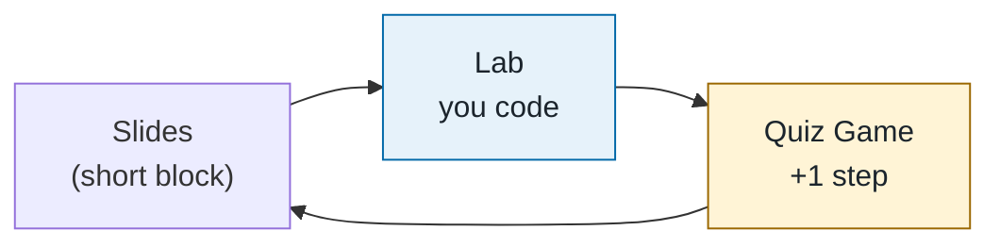
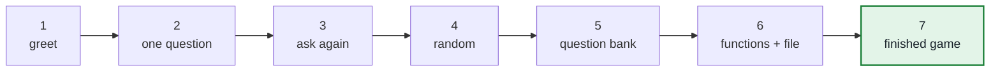
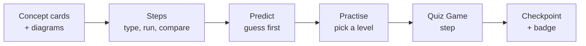

# Workshop roadmap

```python title="python_workshop.py"
Python_Workshop = [
    {"Part 1": "Introduction to Python"},
    {"Part 2": "Learning structure"},
    {"Part 3": "Project"},
]
```

A few slides, then **you** code in VS Code. Repeat. Your instructors set the pace.



## Slides and labs

<table class="roadmap" markdown>
<thead><tr><th>Slides</th><th>Topic</th><th>Lab</th></tr></thead>
<tbody markdown>
<tr><td>1-19</td><td>Programming basics, what Python is, VS Code, Hello World</td><td><a href="lab0-setup.html">Lab 0 - Setup check</a></td></tr>
<tr><td>20-28</td><td>Variables, data types, operators</td><td><a href="lab1-variables.html">Lab 1 - Variables</a></td></tr>
<tr><td>29-42</td><td>Booleans, comparisons, if / elif / else, indentation</td><td><a href="lab2-decisions.html">Lab 2 - Decisions</a></td></tr>
<tr><td>43-54</td><td>Loops, range(), while, for</td><td><a href="lab3-loops.html">Lab 3 - Loops</a></td></tr>
<tr><td>55-105</td><td>Lists, then strings ("strings are lists!")</td><td><a href="lab4-lists-strings.html">Lab 4 - Lists and strings</a></td></tr>
<tr><td>106-117</td><td>Tuple, dictionary, set</td><td><a href="lab5-collections.html">Lab 5 - Tuples, dictionaries, sets</a></td></tr>
<tr><td>118-141</td><td>Functions, built-in functions, exceptions</td><td><a href="lab6-functions.html">Lab 6 - Functions and errors</a></td></tr>
<tr><td>142-144</td><td>Project: the Quiz Game</td><td><a href="lab7-quiz-game.html">Lab 7 - Quiz Game project</a></td></tr>
</tbody>
</table>

## One game, built step by step

Slide 144 asks for a **Quiz Game**. You do not build it at the end: it grows a little after every lab,
in `code/quiz.py`.



| After lab | Your game can... |
|---|---|
| Lab 1 | greet the player by name |
| Lab 2 | ask "Start the quiz? (Y/N)" and ask one question |
| Lab 3 | count down 3, 2, 1 and ask until the answer is right |
| Lab 4 | pick a random question and accept `Warsaw`, `warsaw` or `  WARSAW ` |
| Lab 5 | use a whole question bank and keep a score (+1 or -1) |
| Lab 6 | use functions, never crash on bad input, and save scores to a file |
| Lab 7 | play 5 rounds with a 30-second rule and show the top 3 players |

!!! checkpoint "Fell behind? No problem."
    After every lab there is a ready-made version of the game in `code/solutions/`. Copy it over your
    `quiz.py` and you are back on track for the next lab. Nobody gets left behind.

## How every lab works



| Practise tab | You get |
|---|---|
| **Follow along** | all the code: type it and run it |
| **Try it** | hints, not the code |
| **Challenge** | a harder task for when you are fast |

??? instructor "For instructors"
    - Slide blocks are short on purpose. Slides 55-105 are mostly click-through animations, because
      Lab 4 repeats every example hands-on.
    - Start each lab with everyone on the same page of the guide, then let students work. Walk the
      room. The **Challenge** tabs keep fast students busy.
    - If a group needs to move faster, skip the **Practise** section of a lab and go straight to
      the Quiz Game step. The game step always includes the full code.
