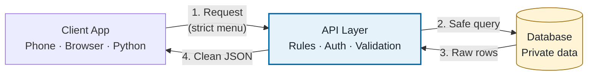
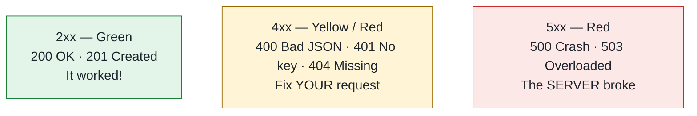
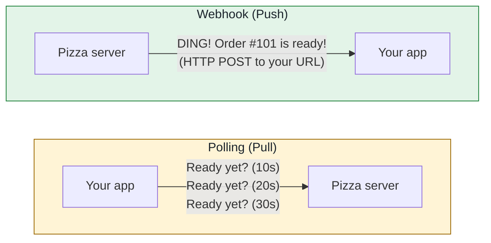

<div class="api-page-header" markdown>

# Lab 0 - API core principles

<div class="lab-summary" markdown>
**:material-presentation: 30-minute interactive talk** <span class="slides-chip">Pure API theory · Design principles · Live offline simulator</span>

**:material-lightbulb-on-outline: You master:** how APIs work under the hood, how HTTP requests & responses talk, and how engineers design clean, safe APIs

**:material-laptop: Setup needed:** none — every diagram, simulator, and challenge runs right here in your browser
</div>

</div>

<div id="api-intro-root" class="api-intro" markdown>

<div class="api-intro-banner">
<div class="api-intro-banner__meta">
<strong>Presenting on a projector? Switch to Present Mode.</strong>
<span>9 visual beats · ~30 minutes · Campus Pizza example · 100% offline</span>
<span class="api-intro-banner__keys">Shortcuts: <kbd>P</kbd> toggle Present Mode · <kbd>&larr;</kbd> <kbd>&rarr;</kbd> switch beats · <kbd>Esc</kbd> exit</span>
</div>
<button type="button" id="api-start-present" class="api-btn api-btn--primary">Start Present Mode (P)</button>
</div>

<section class="api-beat" data-beat="1" data-title="The Invisible Bridge" data-mins="3" markdown>

<div class="api-beat__kicker">Beat 1 of 9 <span class="api-beat__time">00–03 min</span></div>

## Your phone is almost empty — APIs fill it

Your phone does **not** store 100 million Spotify songs, live Google Maps traffic, or every pizza shop's menu. Instead, your app asks a remote server for small pieces of data on demand through an **API** *(Application Programming Interface)*.



<div class="api-grid-3" markdown>
<div class="api-card" markdown>
### 1. Security
Never hand a stranger your database password. The API checks **who you are** and **what you are allowed to touch**.
</div>
<div class="api-card" markdown>
### 2. Stability
The company can rewrite its database tomorrow — as long as the **API contract** stays the same, every mobile app keeps working.
</div>
<div class="api-card" markdown>
### 3. Universal language
An iPhone (Swift), a browser (JavaScript), and a laptop (Python) can **all talk to the exact same API** using HTTP and JSON.
</div>
</div>

??? instructor "Presenter notes (00–03 min)"
    - Ask the room: *"If Spotify has 100 million songs, how do they fit on a 128 GB phone?"*
    - Point to the middle box (**API Layer**): compare it to a restaurant counter. You never walk into the kitchen and open the fridge; you place an order at the counter using the menu.

</section>

<section class="api-beat" data-beat="2" data-title="Resources & Endpoints" data-mins="3" markdown>

<div class="api-beat__kicker">Beat 2 of 9 <span class="api-beat__time">03–06 min</span></div>

## Everything is a resource with an address

Imagine we are building the **Campus Pizza API**. Good REST APIs organize data like a clean folder tree of **nouns** (called **resources**), each with its own **endpoint** URL:

```text
https://api.campuspizza.local  /v1        /menu        ?category=pizza&maxPrice=30
        ─────────────────────  ───        ─────        ───────────────────────────
        Server (who)           Version    Resource     Query parameters (optional filter)
```

| Endpoint | What it points to | Mental model |
|---|---|---|
| `/v1/menu` | The whole menu collection | A folder of items |
| `/v1/menu/2` | One specific item (ID `2`, Pepperoni) | One file inside the folder |
| `/v1/orders` | All customer orders | Another folder |
| `/v1/orders/101` | Order `#101` specifically | One order ticket |
| `/v1/menu?category=pizza` | Only pizzas from the menu | A filtered search of the folder |

!!! analogy "Think of URLs like postal addresses"
    The **host** is the building, `/v1/orders` is the floor, `/101` is the exact apartment door, and `?status=ready` is a sticky note asking only for ready orders.

??? instructor "Presenter notes (03–06 min)"
    - Point out the `?` character: everything **before** `?` identifies *which resource*; everything **after** `?` filters, sorts, or limits it.
    - Ask the room: *"If `/v1/orders/101` is order 101, what URL would you guess gives order 105?"* Predictability is the superpower of REST.

</section>

<section class="api-beat" data-beat="3" data-title="Request & Response Anatomy" data-mins="3" markdown>

<div class="api-beat__kicker">Beat 3 of 9 <span class="api-beat__time">06–09 min</span></div>

## Anatomy of an HTTP request & response

Every API call is just **two plain-text envelopes**: your app sends a **Request**, and the server sends back a **Response**. **Click any highlighted part below** to inspect what it does:

<div class="api-anatomy">
<div class="api-anatomy__panels">
<div class="api-envelope api-envelope--req">
<div class="api-envelope__head">
<span>1. HTTP Request (Client &rarr; Server)</span>
<span>4 parts</span>
</div>
<div class="api-envelope__body">
<div class="api-envelope__line">
<button type="button" class="api-part is-selected" data-part="req-verb">POST</button>
<button type="button" class="api-part" data-part="req-url">/v1/orders</button>
</div>
<button type="button" class="api-part api-part--block" data-part="req-headers">Content-Type: application/json&#10;Authorization: Bearer student-token-9841</button>
<button type="button" class="api-part api-part--block" data-part="req-body">{&#10;  "customer": "Ola",&#10;  "item": "Margherita"&#10;}</button>
</div>
</div>
<div class="api-envelope api-envelope--res">
<div class="api-envelope__head">
<span>2. HTTP Response (Server &rarr; Client)</span>
<span>3 parts</span>
</div>
<div class="api-envelope__body">
<div class="api-envelope__line">
<button type="button" class="api-part" data-part="res-status">201 Created</button>
</div>
<button type="button" class="api-part api-part--block" data-part="res-headers">Content-Type: application/json&#10;X-RateLimit-Remaining: 59</button>
<button type="button" class="api-part api-part--block" data-part="res-body">{&#10;  "id": 103,&#10;  "customer": "Ola",&#10;  "item": "Margherita",&#10;  "status": "preparing"&#10;}</button>
</div>
</div>
</div>
<div class="api-anatomy__detail" aria-live="polite">
<div class="api-anatomy__detail-top">
<span id="api-anatomy-badge" class="api-anatomy__badge">Request · Part 1</span>
<span id="api-anatomy-title" class="api-anatomy__title">HTTP Verb (Method) — POST</span>
</div>
<p id="api-anatomy-desc" class="api-anatomy__desc"></p>
<p id="api-anatomy-pitfall" class="api-anatomy__pitfall"></p>
</div>
</div>

??? instructor "Presenter notes (06–09 min)"
    - Click through all 7 parts left-to-right on the projector.
    - Emphasize **JSON** (`{ "key": "value" }`): it is just a universal text format (looks almost identical to a Python dictionary!) so any programming language can read and write it.

</section>

<section class="api-beat" data-beat="4" data-title="Verbs & Status Codes" data-mins="3" markdown>

<div class="api-beat__kicker">Beat 4 of 9 <span class="api-beat__time">09–12 min</span></div>

## 4 verbs for actions, 3 colors for answers

An endpoint names the **thing** (`/v1/orders`). The **HTTP verb** names the **action** (often called **CRUD**: Create, Read, Update, Delete):

| Verb | Action | Campus Pizza example | Typical success code |
|---|---|---|---|
| <span class="api-pill api-pill--get">GET</span> | **Read** data (safe, changes nothing) | `GET /v1/menu` — read the menu | `200 OK` |
| <span class="api-pill api-pill--post">POST</span> | **Create** a brand-new item | `POST /v1/orders` — place a new order | `201 Created` |
| <span class="api-pill api-pill--patch">PATCH / PUT</span> | **Update** an existing item | `PATCH /v1/orders/101` — mark as `ready` | `200 OK` |
| <span class="api-pill api-pill--delete">DELETE</span> | **Remove** an item | `DELETE /v1/orders/101` — cancel order | `200 OK` or `204` |

!!! tip "Quick nuance: `PUT` vs `PATCH`"
    **`PUT`** replaces the *entire* record (you must send every field). **`PATCH`** updates *just one field* (for example, changing only `"status": "ready"`).

Before your code reads a single line of JSON, the **first digit** of the **status code** acts like a traffic light:



??? instructor "Presenter notes (09–12 min)"
    - Memory trick for students: **`4xx` = your fault** (client mistake: wrong URL, bad JSON, missing key); **`5xx` = their fault** (server crashed).
    - Quick shout-out check: *"If I ask for `/v1/orders/999` and it doesn't exist, which code comes back?"* (`404`!)

</section>

<section class="api-beat" data-beat="5" data-title="Live API Playground" data-mins="6" markdown>

<div class="api-beat__kicker">Beat 5 of 9 <span class="api-beat__time">12–18 min</span></div>

## Live Playground: talk to the Campus Pizza API

Try sending real HTTP requests to a live mini-server running inside this page. Watch the **status code**, **JSON response**, and **live database tables** react immediately!

<div class="api-pg">
<div class="api-pg__presets">
<span class="api-pg__presets-label">Quick demos:</span>
<button type="button" class="api-btn api-btn--sm" data-pg-preset="list-menu">1. List Menu (200)</button>
<button type="button" class="api-btn api-btn--sm" data-pg-preset="place-order">2. Place Order (201)</button>
<button type="button" class="api-btn api-btn--sm" data-pg-preset="hack-delete">3. Hack Delete! (401)</button>
<button type="button" class="api-btn api-btn--sm" data-pg-preset="filter-pizza">4. Filter ?category=pizza</button>
<button type="button" class="api-btn api-btn--sm" data-pg-preset="not-found">5. Missing #999 (404)</button>
<button type="button" id="api-pg-reset" class="api-btn api-btn--sm">Reset Data</button>
</div>
<div class="api-pg__grid">
<div>
<div class="api-pg__bar">
<select id="api-pg-verb" class="api-pg__verb" aria-label="HTTP verb">
<option value="GET">GET</option>
<option value="POST">POST</option>
<option value="PATCH">PATCH</option>
<option value="PUT">PUT</option>
<option value="DELETE">DELETE</option>
</select>
<div class="api-pg__urlwrap">
<span class="api-pg__host">api.campuspizza.local</span>
<input id="api-pg-path" class="api-pg__path" type="text" value="/v1/menu" aria-label="Endpoint path">
</div>
<button type="button" id="api-pg-send" class="api-btn api-btn--primary">Send</button>
</div>
<div class="api-pg__auth">
<label><input type="checkbox" id="api-pg-auth"> Include Staff API Key</label>
<span id="api-pg-auth-preview" class="api-pg__header-preview">Header: (none — anonymous student)</span>
</div>
<div id="api-pg-body-wrap" class="api-pg__body-wrap" hidden>
<label class="api-pg__label" for="api-pg-body">JSON Request Body</label>
<textarea id="api-pg-body" class="api-pg__textarea" spellcheck="false">{&#10;  "customer": "Kuba",&#10;  "item": "Pepperoni"&#10;}</textarea>
</div>
<div class="api-pg__response">
<div class="api-pg__res-head">
<span id="api-pg-status" class="api-status api-status--idle">Ready</span>
<span id="api-pg-meta">Pick a quick demo or click Send</span>
</div>
<pre id="api-pg-res-body" class="api-pg__res-body">// Click "Send" or any Quick Demo button above to call the API!</pre>
</div>
</div>
<div class="api-pg__db">
<div class="api-db-box">
<div class="api-db-box__head">
<span>Database Table: menu</span>
<span>/v1/menu</span>
</div>
<table class="api-db-table">
<thead><tr><th>ID</th><th>Name</th><th>Category</th><th>Price</th></tr></thead>
<tbody id="api-db-menu"></tbody>
</table>
</div>
<div class="api-db-box">
<div class="api-db-box__head">
<span>Database Table: orders</span>
<span>/v1/orders</span>
</div>
<table class="api-db-table">
<thead><tr><th>ID</th><th>Customer</th><th>Item</th><th>Status</th></tr></thead>
<tbody id="api-db-orders"></tbody>
</table>
</div>
</div>
</div>
</div>

??? instructor "Presenter notes (12–18 min)"
    - Run the 4 crowd demos live on the projector:
      1. Click **1. List Menu** (`200 OK`) — point out how the JSON mirrors the `menu` table.
      2. Click **2. Place Order** (`201 Created`) — ask a student for their name, type it into `"customer"`, click **Send**, and watch their row flash green in the `orders` table!
      3. Click **3. Hack Delete!** (`401 Unauthorized`) — show that deleting a menu item is blocked until you check **Include Staff API Key** (`Authorization: Bearer ...`) and click **Send** again.
      4. Click **4. Filter** (`?category=pizza&maxPrice=30`) — show query parameters filtering without needing a brand-new endpoint.
      5. Bonus: switch to `PATCH` `/v1/orders/101` with `{"status": "ready"}` to demonstrate a partial update!

</section>

<section class="api-beat" data-beat="6" data-title="API Design: URL & Data Craft" data-mins="3" markdown>

<div class="api-beat__kicker">Beat 6 of 9 <span class="api-beat__time">18–21 min</span></div>

## Thinking like an API designer (Part 1: URL & data craft)

Anyone can make an endpoint that *works*. Good engineers design APIs that **another developer can guess on the first try**. Ask the room what's wrong with each red card, then click **Reveal clean fix**:

<div style="margin-bottom: 0.4rem;">
<button type="button" id="api-flip-all" class="api-btn api-btn--sm">Reveal all fixes</button>
</div>

<div class="api-flip-grid">
<div class="api-flip">
<div class="api-flip__rule">Rule 1: Nouns in URLs, verbs in HTTP</div>
<div class="api-flip__box api-flip__box--bad"><span class="api-flip__tag">Messy</span>&#10;POST /createNewOrder&#10;POST /deleteOrderById?id=101&#10;GET  /getAllPizzas</div>
<div class="api-flip__good-wrap">
<div class="api-flip__box api-flip__box--good"><span class="api-flip__tag">Clean REST</span>&#10;POST   /v1/orders&#10;DELETE /v1/orders/101&#10;GET    /v1/menu?category=pizza</div>
<p class="api-flip__why">HTTP already gives you verbs! Putting verbs in URLs turns 1 resource into 10 random names to memorize.</p>
</div>
<button type="button" class="api-btn api-btn--sm api-flip-toggle">Reveal clean fix</button>
</div>
<div class="api-flip">
<div class="api-flip__rule">Rule 2: Stay plural &amp; predictable</div>
<div class="api-flip__box api-flip__box--bad"><span class="api-flip__tag">Messy</span>&#10;GET /pizza/1&#10;GET /Orders&#10;GET /user_list</div>
<div class="api-flip__good-wrap">
<div class="api-flip__box api-flip__box--good"><span class="api-flip__tag">Clean REST</span>&#10;GET /v1/pizzas/1&#10;GET /v1/orders&#10;GET /v1/users</div>
<p class="api-flip__why">Pick lowercase plural nouns everywhere so developers never waste 20 minutes guessing singular vs uppercase.</p>
</div>
<button type="button" class="api-btn api-btn--sm api-flip-toggle">Reveal clean fix</button>
</div>
<div class="api-flip">
<div class="api-flip__rule">Rule 3: Never lie with status codes</div>
<div class="api-flip__box api-flip__box--bad"><span class="api-flip__tag">Messy</span>&#10;HTTP 200 OK&#10;{ "ok": false, "msg": "Order not found!" }</div>
<div class="api-flip__good-wrap">
<div class="api-flip__box api-flip__box--good"><span class="api-flip__tag">Clean REST</span>&#10;HTTP 404 Not Found&#10;{ "error": "Order #999 not found." }</div>
<p class="api-flip__why">Monitoring tools and client apps check the status code first. Returning 200 on an error hides real bugs!</p>
</div>
<button type="button" class="api-btn api-btn--sm api-flip-toggle">Reveal clean fix</button>
</div>
</div>

??? instructor "Presenter notes (18–21 min)"
    - Before clicking **Reveal clean fix**, pause for 10 seconds on each card and let students diagnose the bug.
    - Emphasize Rule 3: *"Returning `200 OK` with `error: true` is like a smoke alarm that plays calm elevator music when the kitchen is on fire."*

</section>

<section class="api-beat" data-beat="7" data-title="API Design: Real-World Rules" data-mins="3" markdown>

<div class="api-beat__kicker">Beat 7 of 9 <span class="api-beat__time">21–24 min</span></div>

## Thinking like an API designer (Part 2: real-world rules)

Four engineering principles that separate a school toy from an API used by millions of apps:

<div class="api-grid-2" markdown>
<div class="api-card" markdown>
### 4. Stateless (no server memory)
Every request must carry **everything needed** to handle it — including your auth token.  
*Why?* Big services run 50+ copies of the server behind a load balancer; your next request might hit a different machine!
</div>
<div class="api-card" markdown>
### 5. Secrets in Headers, NEVER in URLs
**Bad:** `/v1/orders?api_key=my_secret_99`  
**Good:** `Authorization: Bearer my_secret_99`  
*Why?* URLs get saved in browser history, Wi-Fi proxies, screenshots, and server access logs.
</div>
<div class="api-card" markdown>
### 6. Version your API (`/v1/` &rarr; `/v2/`)
Need to rename `"price"` to `"priceCents"`? Release it under **`/v2/menu`** and keep **`/v1/menu`** running.  
*Why?* People who haven't updated their phone app yet won't suddenly crash!
</div>
<div class="api-card" markdown>
### 7. Rate limiting (`429 Too Many Requests`)
Servers cap how fast one client can call them (e.g. `60 requests / minute`).  
*Why?* Stops a buggy `while True:` loop—or an attacker—from knocking the service offline for everyone else.
</div>
</div>

??? instructor "Presenter notes (21–24 min)"
    - Highlight **#5 (Secrets in Headers)** and **#7 (Rate Limiting)** — students will literally use Bearer headers and avoid infinite-loop spam in their own Python scripts today!

</section>

<section class="api-beat" data-beat="8" data-title="Challenge: Code Review" data-mins="4" markdown>

<div class="api-beat__kicker">Beat 8 of 9 <span class="api-beat__time">24–28 min</span></div>

## Boss challenge: code-review this rushed intern's API!

A rushed intern shipped 4 endpoints for Campus Pizza right before lunch. Vote as a class and pick the **best fix** for each bug:

<div class="api-quiz">
<div class="api-quiz__bar">
<span id="api-quiz-score" class="api-quiz__score">Score: 0 / 4</span>
<button type="button" id="api-quiz-reset" class="api-btn api-btn--sm">Reset Challenge</button>
</div>
<div class="api-quiz__grid">
<div class="api-qcard" data-reason="Use the DELETE HTTP verb on the plural resource /v1/orders/101 instead of putting a verb in the URL.">
<div class="api-qcard__title">PR #1 — Cancelling an order</div>
<pre class="api-qcard__code">POST /remove_order?orderId=101</pre>
<div class="api-qcard__opts">
<button type="button" class="api-qopt" data-correct="0">GET /v1/deleteOrder/101</button>
<button type="button" class="api-qopt" data-correct="1">DELETE /v1/orders/101</button>
<button type="button" class="api-qopt" data-correct="0">PUT /v1/remove-order</button>
</div>
<div class="api-qcard__fb"></div>
</div>
<div class="api-qcard" data-reason="Never mask a failure behind 200 OK. Bad or missing input from the client should return 400 Bad Request.">
<div class="api-qcard__title">PR #2 — Empty pizza name sent</div>
<pre class="api-qcard__code">HTTP 200 OK&#10;{ "success": false, "error": "item is required" }</pre>
<div class="api-qcard__opts">
<button type="button" class="api-qopt" data-correct="1">Return 400 Bad Request with the JSON error</button>
<button type="button" class="api-qopt" data-correct="0">Return 500 Internal Server Error</button>
<button type="button" class="api-qopt" data-correct="0">Keep 200 OK because JSON was returned</button>
</div>
<div class="api-qcard__fb"></div>
</div>
<div class="api-qcard" data-reason="URLs are logged in browser history, proxies, and server logs. Always send tokens in the Authorization header.">
<div class="api-qcard__title">PR #3 — Staff login check</div>
<pre class="api-qcard__code">GET /v1/orders?staff_token=s3cr3t_key</pre>
<div class="api-qcard__opts">
<button type="button" class="api-qopt" data-correct="0">Rename staff_token to key so it is shorter</button>
<button type="button" class="api-qopt" data-correct="0">Put the token inside the path: /v1/s3cr3t_key/orders</button>
<button type="button" class="api-qopt" data-correct="1">Move it into the Authorization: Bearer header</button>
</div>
<div class="api-qcard__fb"></div>
</div>
<div class="api-qcard" data-reason="Versioning (/v2/) lets old apps keep calling /v1/ safely while new apps upgrade on their own schedule.">
<div class="api-qcard__title">PR #4 — Breaking JSON change</div>
<pre class="api-qcard__code">Change /v1/menu field "price" -> "priceCents"&#10;(10,000 mobile phones already use "price"!)</pre>
<div class="api-qcard__opts">
<button type="button" class="api-qopt" data-correct="0">Rename it in /v1/menu and hope users update</button>
<button type="button" class="api-qopt" data-correct="1">Keep /v1/menu unchanged and ship /v2/menu</button>
<button type="button" class="api-qopt" data-correct="0">Return 404 until users reinstall the app</button>
</div>
<div class="api-qcard__fb"></div>
</div>
</div>
</div>

??? instructor "Presenter notes (24–28 min)"
    - Ask students to raise hands (1, 2, or 3) for each card before clicking!
    - Aim for 4/4 as a group — this locks in every design rule before they touch real APIs.

</section>

<section class="api-beat" data-beat="9" data-title="Polling vs Webhooks & Next Step" data-mins="2" markdown>

<div class="api-beat__kicker">Beat 9 of 9 <span class="api-beat__time">28–30 min</span></div>

## One more pattern: Polling vs. Webhooks

So far, **your app** always starts the conversation (*"Hey server, give me the menu"*). What if you want to know **the instant your pizza is ready**?



<div class="api-grid-2" markdown>
<div class="api-card" markdown>
### Polling ("Are we there yet?")
Your app keeps sending `GET /v1/orders/101` every few seconds. Simple, but wastes requests when nothing has changed.
</div>
<div class="api-card" markdown>
### Webhook ("Take a restaurant buzzer")
You give the server your callback URL once. When an event happens, **the server sends an HTTP `POST` to you** automatically! *(You will build a live webhook server later today in Labs 6 & 7.)*
</div>
</div>

!!! badge "Foundation unlocked!"
    **API Architect** — You now understand the exact core principles behind almost every modern cloud API on the planet (social media, payments, maps, chat, AI).

    **Next step:** Ready to send real HTTP requests to a live cloud API? Continue to **[Lab 1 - Setup, Bruno and REST](lab1-rest.md)**.

??? instructor "Presenter notes (28–30 min)"
    - Press `Esc` to leave Present Mode, take 2 minutes for questions, then transition straight into **Lab 1**, where students apply every single concept they just learned (verbs, headers, Bearer tokens, status codes, JSON) to a real cloud API in Bruno and Python!

</section>

<div id="api-hud" class="api-hud" aria-hidden="true">
<div id="api-hud-progress" class="api-hud__progress" style="width: 11%;"></div>
<div class="api-hud__group">
<button type="button" id="api-hud-prev" class="api-btn api-btn--sm">&larr; Prev</button>
<select id="api-hud-select" class="api-hud__select" aria-label="Jump to beat"></select>
<button type="button" id="api-hud-next" class="api-btn api-btn--sm">Next &rarr;</button>
</div>
<div class="api-hud__group">
<span id="api-timer-display" class="api-hud__timer" title="30-minute pacing timer">30:00</span>
<button type="button" id="api-timer-toggle" class="api-btn api-btn--sm">Start</button>
<button type="button" id="api-timer-reset" class="api-btn api-btn--sm">Reset</button>
<button type="button" id="api-hud-exit" class="api-btn api-btn--sm">Exit (Esc)</button>
</div>
</div>

</div>
