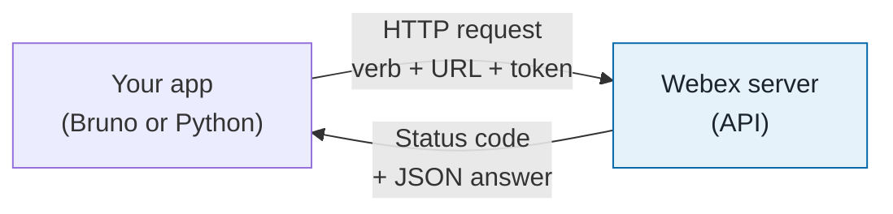
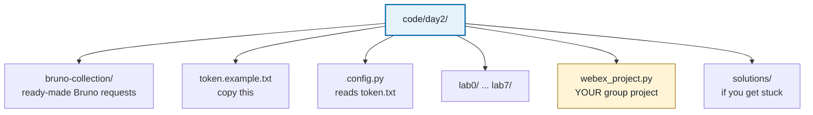
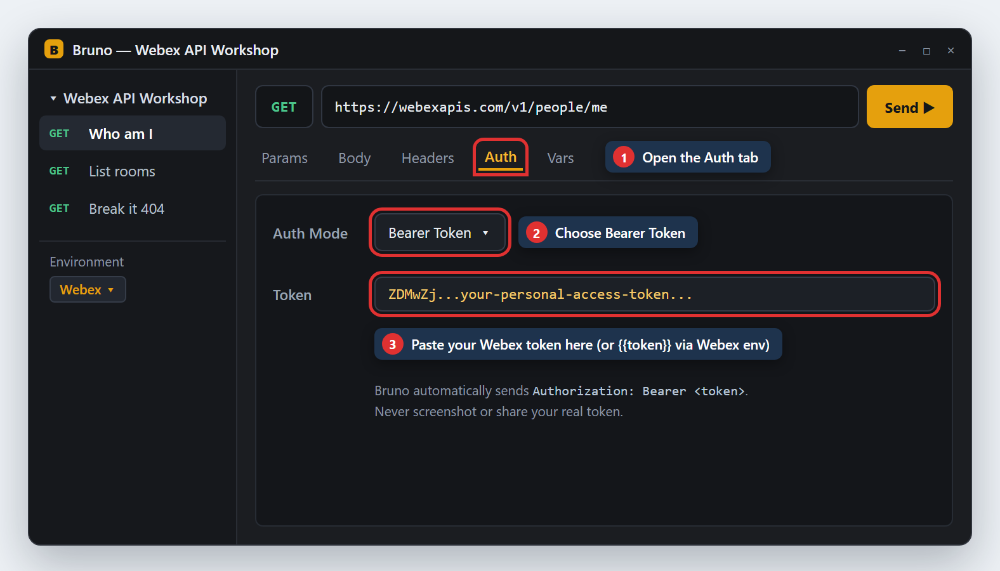
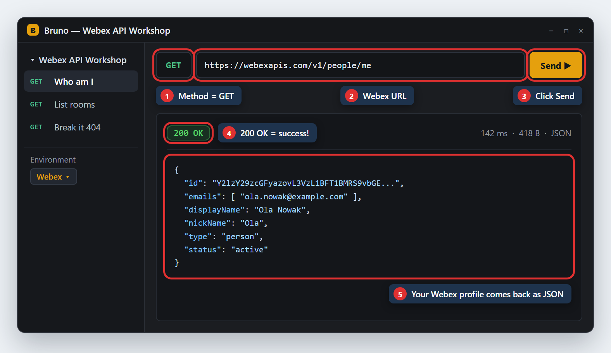

# Lab 0 - Token and setup

<div class="lab-summary" markdown>
**:material-presentation: After the Day 2 intro** <span class="slides-chip">API basics, Bruno &amp; Webex</span>

**:material-hammer-wrench: You build:** your first live API call in Bruno, a safe place for your token, and today's libraries

**:material-file-code: File:** `lab0/setup.py`
</div>

Every app on your phone—Instagram, Spotify, Google Maps, Webex—talks to servers behind the scenes using an **API**. Today you send the requests yourself: first visually in **Bruno**, then in Python.



## APIs in 30 seconds: the 4 verbs

An HTTP request always picks a **verb** (what you want to do) and a **URL** (where to do it):

| Verb | Meaning | Everyday app example | Webex example |
|---|---|---|---|
| `GET` | Read | Scroll your Instagram feed | List your rooms |
| `POST` | Create | Post a new photo | Create a room or send a message |
| `PUT` | Update | Edit your photo caption | Edit a message |
| `DELETE` | Remove | Delete a comment | Delete a message |

!!! predict "API Detective: match the verb!"
    Before you open any tool, guess the verb for each action:

    1. You open Spotify and load your playlist.
    2. You tap **Send** on a Webex message.
    3. You fix a typo in a message you already sent.

    ??? success "Show the answers"
        1. **`GET`** — you are only reading data.
        2. **`POST`** — you are creating something new.
        3. **`PUT`** — you are updating something that already exists.

<div class="concepts" markdown>
<div markdown>
<p class="card-title">API</p>

A menu of things a service will do for you if you ask in a fixed way. Webex's menu includes
"who am I?", "create a room", and "send a message".

<p class="like">the waiter in a restaurant: you do not cook in the kitchen, you order from the menu</p>
</div>
<div markdown>
<p class="card-title">Token</p>

A secret password for programs. Whoever has it can act as you in Webex.

<p class="like">a key card for a hotel room. Do not photograph it. Do not lend it.</p>
</div>
<div markdown>
<p class="card-title">JSON</p>

A way to write data as text with `{ }`, `[ ]` and `"keys"`. Webex answers in JSON.

<p class="like">a labelled form: Name, Email, Status — easy for both humans and programs to read</p>
</div>
<div markdown>
<p class="card-title">Bruno</p>

A free desktop app for sending API requests and reading JSON responses—no account or sign-in needed.

<p class="like">a walkie-talkie for APIs: test a request in one click before you write Python</p>
</div>
</div>

## Open the Day 2 folder

In VS Code choose **File > Open Folder...** and select **`code/day2`** (inside `python-workshop`).



## Steps

### <span class="step-num">0.1</span> Install Bruno and today's Python libraries

First, install **Bruno** (free, open-source, no account needed):

=== "Windows"

    Download and run the installer from [usebruno.com/downloads](https://www.usebruno.com/downloads), or run:

    ```powershell
    winget install Bruno.Bruno
    ```

=== "Mac"

    Download from [usebruno.com/downloads](https://www.usebruno.com/downloads) and drag Bruno to **Applications**, or run:

    ```bash
    brew install --cask bruno
    ```

Next, open a VS Code terminal (**Terminal > New Terminal**). Check it starts with `(.venv)`, then install today's Python libraries:

=== "Windows"

    ```powershell
    python -m pip install requests webexteamssdk flask fastapi uvicorn
    ```

=== "Mac"

    ```bash
    python3 -m pip install requests webexteamssdk flask fastapi uvicorn
    ```

| Library | What it is for |
|---|---|
| `requests` | send HTTP requests (Lab 1, Lab 4, the bots) |
| `webexteamssdk` | a friendlier way to create rooms and messages (Labs 2-5) |
| `flask` | a small web server for the echo bot (Lab 6) |
| `fastapi` + `uvicorn` | another web server, used a lot with APIs (Lab 7) |

!!! error "Error decoder: `No module named 'requests'`"
    **What it means:** the library is not installed in *this* virtual environment.

    **How to fix it:** make sure the terminal starts with `(.venv)`, then run the `pip install`
    line again.

### <span class="step-num">0.2</span> Get a personal access token

1. Open [https://developer.webex.com](https://developer.webex.com) and sign in with your Webex
   account.
2. Open [Getting Started](https://developer.webex.com/docs/getting-started).
3. Copy **Your Personal Access Token**.

The token looks like a long mix of letters. Treat it like a password.

!!! analogy "Why a token, not your Webex password?"
    Your password opens the whole account, including the website. A token is a temporary key that
    programs use. If it leaks, you generate a new one and the old one stops working.

### <span class="step-num">0.3</span> Make your first live API call in Bruno

Let's ask Webex **"Who am I?"** and watch live JSON come back!

1. Open **Bruno**.
2. Click **Open Collection** and choose **`code/day2/bruno-collection`** (or click **Create Collection** -> **New Request** to build it from scratch).
3. Open **Who am I** (`GET https://webexapis.com/v1/people/me`).
4. Click the **Auth** tab, choose **Bearer Token**, and paste your Webex token *(or pick the **Webex** environment at the top right and paste it into `token`)*.

    

5. Click **Send**!



You should see a green **`200 OK`** badge and **your own Webex name and email** in JSON!

!!! checkpoint "Quick check"
    Do you see `200 OK` and your `displayName`? You just talked directly to a Cisco cloud API—no browser, no Python yet!

### <span class="step-num">0.4</span> Save the token for Python (never in a `.py` file)

In VS Code's Explorer, right-click `token.example.txt` > **Copy**, then **Paste**. Rename the copy to
`token.txt`.

Open `token.txt`, delete the placeholder line, paste your token, save.

```text title="token.txt"
your-long-token-goes-here
```

!!! vscode "VS Code tip"
    `token.txt` is on purpose **not** named `.py`. You will not click Run on it. Python reads it
    through `config.py`.

### <span class="step-num">0.5</span> A promise, then a Python check

Open `lab0/setup.py`. Find `TODO 3`, change `Ola` to your name, save, run.

```python title="lab0/setup.py"
name = "Ola"
print(f"{name} will never share a Webex token in a chat, a screenshot, or GitHub.")
print("The token lives only in token.txt, on this laptop.")
```

```text title="Output"
Ola will never share a Webex token in a chat, a screenshot, or GitHub.
The token lives only in token.txt, on this laptop.
```

Find `TODO 4`. Remove the `#` from those lines, save, run.

```text title="Output"
Token loaded. It starts with: ZDMwZj...
Length: 108 characters
```

You should see the **first six characters** only. If the whole token prints, you uncommented the
wrong line — put the `#` back on any `print(token)` you added.

!!! error "Error decoder: `No token.txt yet`"
    **What it means:** Python looked next to `config.py` and did not find `token.txt`.

    **How to fix it:** the file must be `code/day2/token.txt`, not inside `lab0`. Copy
    `token.example.txt` again if you are unsure.

!!! predict "Predict"
    Why do we print `token[:6] + "..."` instead of the whole token?

    ??? success "Show the answer"
        So a screenshot of the terminal cannot steal the key. Six characters are enough to see
        that the file loaded.

## Practise: keep the secret

=== "Follow along"

    Add one more print under TODO 3:

    ```python
    print("If someone asks for my token, I say no.")
    ```

=== "Try it"

    Without looking at `config.py`, write in one sentence what that file does.

    **Hint:** it reads `token.txt` and stops with a clear message if the file is missing.

=== "Challenge"

    Read [Getting Started](https://developer.webex.com/docs/getting-started) for two minutes.
    What is the difference between a **personal access token** and a **bot token**? You will need
    both later today.

!!! checkpoint "Checkpoint"
    Bruno shows `200 OK` on `/v1/people/me`, `pip` installed the libraries, `token.txt` sits in
    `code/day2`, and running `lab0/setup.py` shows the first six characters of your token.

    Not the same? Compare with `code/day2/solutions/lab0_setup.py`.

!!! badge "Badge earned"
    **API Explorer &amp; Key Keeper**

    You sent your first live REST API request in Bruno and kept your token safe from your code.

??? instructor "For instructors"
    - If a student's laptop blocks installing Bruno, pair them with a neighbour or let them follow the
      annotated screenshots—Lab 1's Python steps still run offline with `rooms_sample.json`.
    - Personal tokens expire after ~12 hours. Plan a "new token" minute after lunch.
    - If a student has no Webex account, pair them with a neighbour who does. One token per group
      is enough for Labs 2-4. Each student still creates a bot in Lab 5.
    - Walk the room for tokens pasted into `setup.py`. That is the main fail of this lab.
