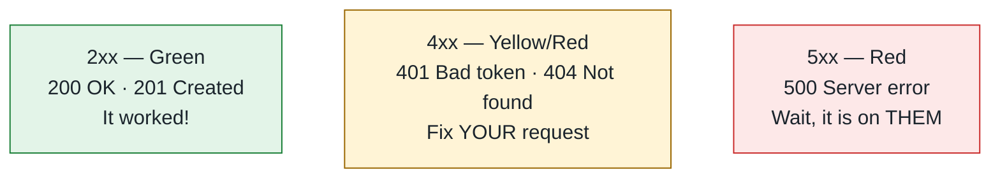
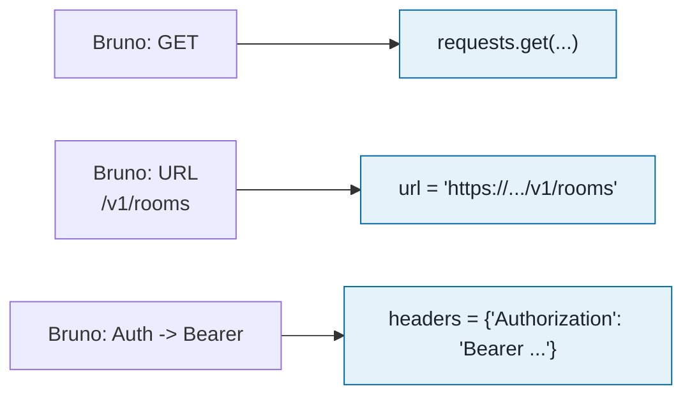
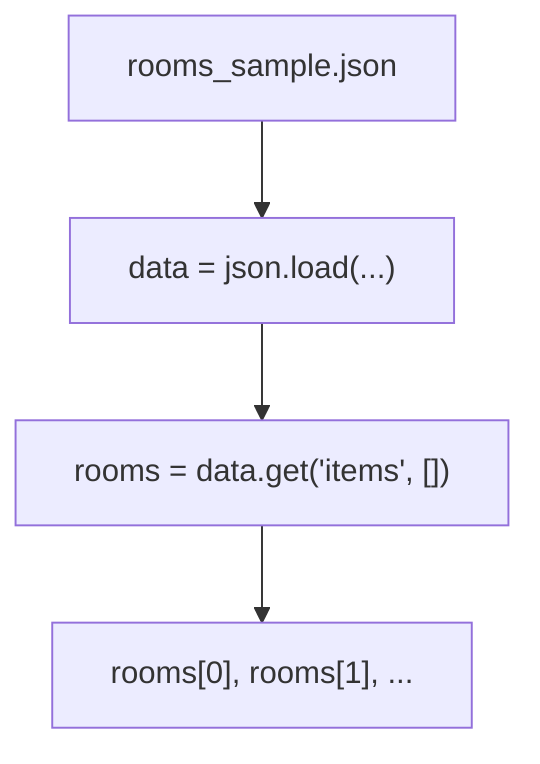

# Lab 1 - REST and JSON

<div class="lab-summary" markdown>
**:material-presentation: Talking to APIs** <span class="slides-chip">Bruno, status codes, GET, JSON</span>

**:material-hammer-wrench: You build:** 3 quick Bruno API experiments, then a Python script that lists rooms and saves their titles to a file

**:material-file-code: File:** `lab1/get_rooms.py`
</div>

Webex (and almost every modern service) speaks **REST**: you ask for a **URL** with a **verb**
such as `GET` or `POST`, and you get back a **status code** plus **JSON**.

## Status codes: the API traffic light

Before you even read the JSON, the **first digit** of the status code tells you what happened:



## Break it on purpose in Bruno (2 minutes)

Open **Bruno** (`code/day2/bruno-collection`) and run these 3 fast missions. Breaking an API on purpose makes real errors way less scary!

1. **List your rooms (`200 OK`):** Open **List rooms** (`GET https://webexapis.com/v1/rooms?max=5`) and click **Send**. Notice the response starts with `"items": [ ... ]` — a list of rooms.
2. **Ask for something impossible (`404 Not Found`):** Open **Break it 404** (`GET https://webexapis.com/v1/pizza`) and click **Send**. Webex replies **`404`** — there is no pizza endpoint!
3. **Damage your token (`401 Unauthorized`):** Go back to **List rooms**, delete the last character of your token in **Auth** (or **Webex** env), and click **Send**. You get a red **`401 Unauthorized`**! *(Put the character back right after.)*


!!! tip "Bonus 10-second trick: query parameters"
    In **List rooms**, change `?max=5` at the end of the URL to `?max=2` and click **Send**. Webex now sends back **only 2 rooms**! Everything after `?` in a URL filters what the API returns.

## From Bruno to Python

Bruno is awesome for clicking and testing—but Python lets you **loop over 100 rooms, filter them, and save files automatically**. Look how the 3 boxes you clicked in Bruno become 3 lines of Python:



<div class="concepts" markdown>
<div markdown>
<p class="card-title">GET</p>

Ask for data. You do not change anything. Listing rooms is `GET`.

<p class="like">looking at the menu. You have not ordered yet.</p>
</div>
<div markdown>
<p class="card-title">Status code</p>

A three-digit number that says how the request went. `200` means OK. `401` means "who are you?". `404` means "not found".

<p class="like">a traffic light: green go, red stop, and the number tells you why</p>
</div>
<div markdown>
<p class="card-title">items</p>

Webex wraps lists in a JSON object: `{ "items": [ ... ] }`. You ask for the `items` key.

<p class="like">a box labelled "photos" with the pictures inside, not loose on the table</p>
</div>
</div>

## Steps in VS Code

Open `lab1/get_rooms.py`. It already runs: click the triangle. You should see:

```text title="Output"
Keys in the response: ['items']
```

That file is **not** the internet yet. It reads `rooms_sample.json`, a copy of a real Webex answer.
You learn the shape first, then you switch the same code onto a live `GET`.

### <span class="step-num">1.1</span> Look at the keys

Find `TODO 1`. `json.load` turns the text file into a Python dictionary.

```python title="lab1/get_rooms.py"
with open(SAMPLE, encoding="utf-8") as file:
    data = json.load(file)

print("Keys in the response:", list(data.keys()))
```

### <span class="step-num">1.2</span> Print five rooms

Find `TODO 2` and remove the `#` from that block. Save and run.

```text title="Output"
Keys and Values for Rooms:
Room ID: Y2lzY29zcGFyazovL3VzL1JPT00vcm9vbS0x
Room Title: Krakow CTE Group 1
Room Type: group
...
```



`.get("items", [])` means: give me the list called `items`, or an empty list if it is missing.
That way the program does not crash on a bad answer.

!!! predict "Predict"
    What is `rooms[0]["title"]` for this sample file?

    ??? success "Show the answer"
        `Krakow CTE Group 1`. Index `0` is the first room. Then we look up the key `"title"`.

### <span class="step-num">1.3</span> Write the titles to a file

Find `TODO 3`, remove the `#`, run. A new file `rooms.txt` appears next to the script
(or in the folder VS Code has open). Open it: five titles, one per line.

You did this on Day 1 in Lab 6 with `notes.txt`. Same idea, new data.

### <span class="step-num">1.4</span> The live request

Find `TODO 4`. Remove the `#` only if Lab 0's `token.txt` is ready. Run.

```python
url = "https://webexapis.com/v1/rooms"
headers = {
    "Authorization": f"Bearer {access_token()}",
    "Content-Type": "application/json",
}
response = requests.get(url, headers=headers)
print("Status of the Request:", response.status_code)
```

```text title="Output"
Status of the Request: 200
Live room: Krakow CTE Group 1
...
```

`Bearer` is the word Webex expects in front of the token. It means "the holder of this key may
come in" — the exact same thing Bruno did when you chose **Bearer Token**!

!!! error "Error decoder: `401` or `Failed to fetch room details`"
    **What it means:** Webex did not accept the token. It expired, it has a space at the end, or
    `token.txt` still says `PASTE_YOUR_TOKEN_HERE`.

    **How to fix it:** copy a fresh token from the developer site into `token.txt`, save, run again.

!!! error "Error decoder: `ModuleNotFoundError: No module named 'requests'`"
    **What it means:** `pip install` did not run in this `.venv`.

    **How to fix it:** go back to Lab 0, step 0.1.

!!! analogy "The weather script that cannot work"
    This is a common first try:

    ```python
    import request
    response = request.get("https://api.weather.com/city/Almere")
    ```

    Two problems: the library is called `requests` (with an **s**), and that weather URL is not a
    real public API. Naming and a real URL both have to be right, or you get an error before any
    JSON arrives.

## Practise: count the rooms

=== "Follow along"

    Create `lab1/count_rooms.py` and type:

    ```python title="lab1/count_rooms.py"
    # Lab 1 exercise: count room types from the sample JSON

    import json
    from pathlib import Path

    SAMPLE = Path(__file__).resolve().parent.parent / "rooms_sample.json"

    with open(SAMPLE, encoding="utf-8") as file:
        rooms = json.load(file).get("items", [])

    group = 0
    direct = 0
    locked = 0
    for room in rooms:
        if room["type"] == "group":
            group = group + 1
        elif room["type"] == "direct":
            direct = direct + 1
        if room["isLocked"]:
            locked = locked + 1

    print(f"Rooms in the file: {len(rooms)}")
    print(f"Group rooms: {group}")
    print(f"Direct rooms: {direct}")
    print(f"Locked rooms: {locked}")
    ```

    ```text title="Output"
    Rooms in the file: 5
    Group rooms: 4
    Direct rooms: 1
    Locked rooms: 1
    ```

=== "Try it"

    Write `lab1/count_rooms.py` that reads `rooms_sample.json` and prints how many rooms are
    `group`, how many are `direct`, and how many are locked.

    **Hints:** `json.load`, a `for` loop, `if room["type"] == "group"`.

=== "Challenge"

    From the **live** GET (TODO 4), print only rooms whose title contains `CTE`. Use
    `if "CTE" in room["title"]`. Then write those titles to `cte_rooms.txt`.

## Add it to your project

Open **`webex_project.py`**. You do not add API calls yet. At the top, make sure these imports stay.
They are the toolkit for the rest of the day.

!!! checkpoint "Checkpoint"
    You triggered `200`, `404`, and `401` in Bruno, and `lab1/get_rooms.py` prints five sample rooms
    and writes `rooms.txt`. If TODO 4 is on, a live GET returns `200`.

    Not the same? Copy `code/day2/solutions/lab1_get_rooms.py`.

!!! badge "Badge earned"
    **JSON Reader**

    You can test a REST API in Bruno, read status codes, and take a JSON list apart in Python.

??? instructor "For instructors"
    - Let everyone trigger the `404` and `401` in Bruno before moving to VS Code—seeing the red badge
      once on purpose prevents panic later in the day.
    - Stay on `rooms_sample.json` until the whole room has seen `items` and a `for` loop. Then live GET.
    - The original student script used a hardcoded bearer token. Call that out: that is the
      anti-pattern Lab 0 exists to prevent.
