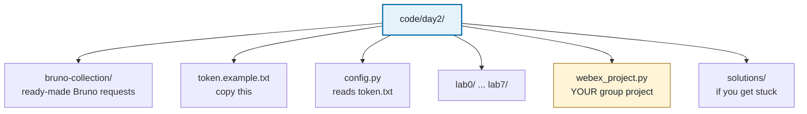
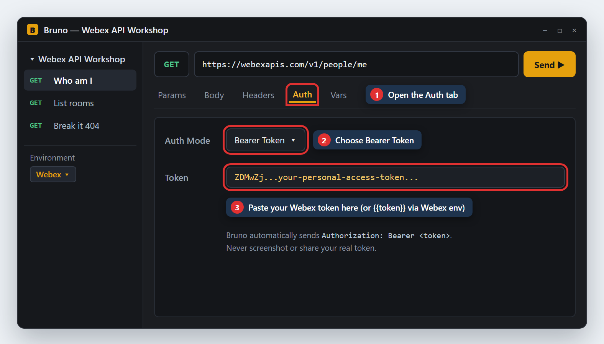
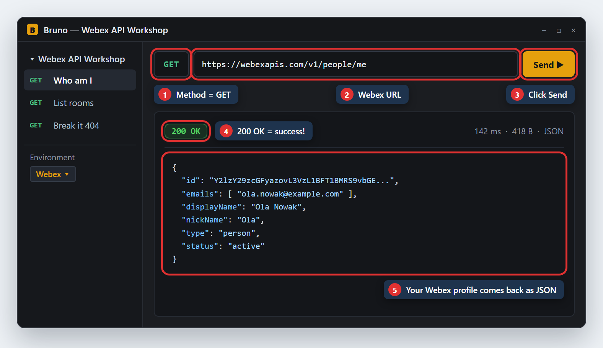
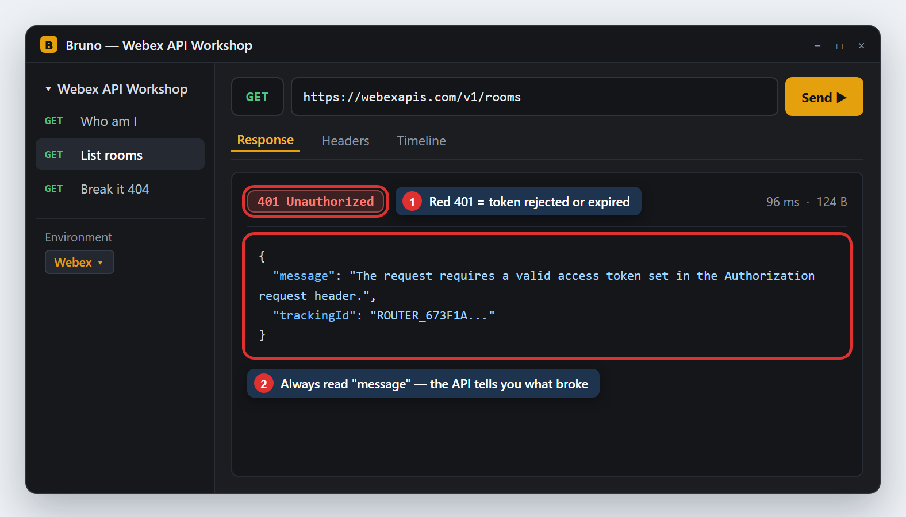
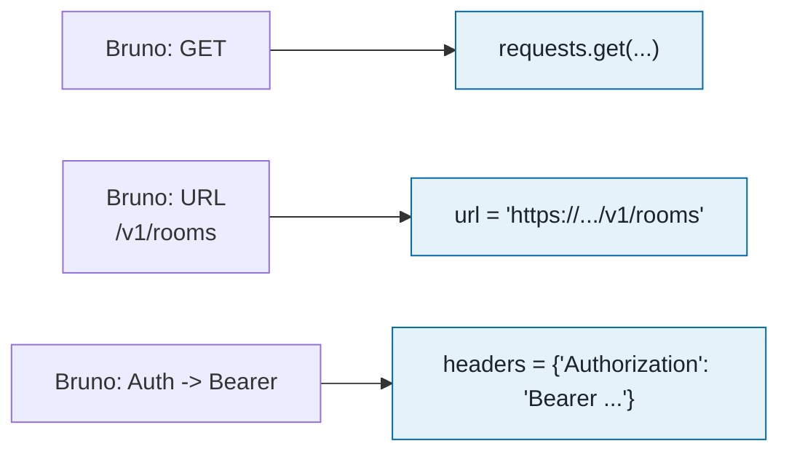
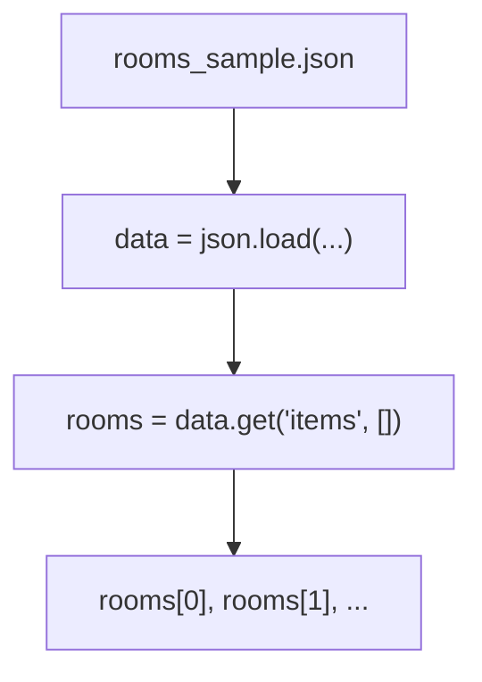

# Lab 1 - Setup, Bruno and REST

<div class="lab-summary" markdown>
**:material-presentation: First live cloud API** <span class="slides-chip">Setup · Token · Bruno · Python requests</span>

**:material-hammer-wrench: You build:** a safe place for your Webex token, your first live API calls in Bruno (`200`, `404`, `401`), and a Python script that lists rooms and saves them to a file

**:material-file-code: Files:** `lab0/setup.py`, then `lab1/get_rooms.py`
</div>

In [Lab 0](lab0-api-basics.md) you learned the rules every REST API follows—verbs, URLs, headers,
status codes, and JSON. Now you apply those exact rules to a **real cloud API (Webex)**: first
visually in **Bruno**, then automatically in **Python**.

<div class="concepts" markdown>
<div markdown>
<p class="card-title">Token</p>

A temporary secret key for programs. Whoever has it can act as you in Webex.

<p class="like">a key card for a hotel room. Do not photograph it. Do not lend it.</p>
</div>
<div markdown>
<p class="card-title">Bruno</p>

A free desktop app for sending HTTP requests and reading JSON responses—no account or sign-in needed.

<p class="like">a walkie-talkie for APIs: test a request in one click before you write Python</p>
</div>
<div markdown>
<p class="card-title">items</p>

Webex wraps lists in a JSON object: `{ "items": [ ... ] }`. You ask for the `items` key.

<p class="like">a box labelled "photos" with the pictures inside, not loose on the table</p>
</div>
</div>

## Open the Day 2 folder

In VS Code choose **File > Open Folder...** and select **`code/day2`** (inside `python-workshop`).



## Part A: Setup and your Webex token

### <span class="step-num">1.1</span> Install Bruno and today's Python libraries

First, install **Bruno** (free, open-source, no account needed):

=== "Windows"

    Download and run the installer from [usebruno.com/downloads](https://www.usebruno.com/downloads), or run:

    ```powershell
    winget install Bruno.Bruno
    ```

=== "Mac"

    Download from [usebruno.com/downloads](https://www.usebruno.com/downloads) and drag Bruno to **Applications**, or run:

    ```bash
    brew install --cask bruno
    ```

Next, open a VS Code terminal (**Terminal > New Terminal**). Check it starts with `(.venv)`, then
install today's Python libraries:

=== "Windows"

    ```powershell
    python -m pip install requests webexteamssdk flask fastapi uvicorn
    ```

=== "Mac"

    ```bash
    python3 -m pip install requests webexteamssdk flask fastapi uvicorn
    ```

| Library | What it is for |
|---|---|
| `requests` | send HTTP requests (Lab 1, Lab 4, the bots) |
| `webexteamssdk` | a friendlier way to create rooms and messages (Labs 2-5) |
| `flask` | a small web server for the echo bot (Lab 6) |
| `fastapi` + `uvicorn` | another web server, used a lot with APIs (Lab 7) |

!!! error "Error decoder: `No module named 'requests'`"
    **What it means:** the library is not installed in *this* virtual environment.

    **How to fix it:** make sure the terminal starts with `(.venv)`, then run the `pip install`
    line again.

### <span class="step-num">1.2</span> Get a personal access token

1. Open [https://developer.webex.com](https://developer.webex.com) and sign in with your Webex
   account.
2. Open [Getting Started](https://developer.webex.com/docs/getting-started).
3. Copy **Your Personal Access Token**.

The token looks like a long mix of letters. Treat it like a password.

!!! analogy "Why a token, not your Webex password?"
    Your password opens the whole account, including the website. A token is a temporary key that
    programs use. If it leaks, you generate a new one and the old one stops working.

### <span class="step-num">1.3</span> Save the token for Python (never in a `.py` file)

In VS Code's Explorer, right-click `token.example.txt` > **Copy**, then **Paste**. Rename the copy to
`token.txt`. Open `token.txt`, delete the placeholder line, paste your token, and save.

```text title="token.txt"
your-long-token-goes-here
```

!!! vscode "VS Code tip"
    `token.txt` is on purpose **not** named `.py`. Python reads it through `config.py`, and Git
    ignores it so your secret never leaks.

Now verify it loads safely: open **`lab0/setup.py`**. Find `TODO 3`, change `Ola` to your name,
save, and run. Then uncomment `TODO 4`, save, and run:

```text title="Output"
Ola will never share a Webex token in a chat, a screenshot, or GitHub.
The token lives only in token.txt, on this laptop.
Token loaded. It starts with: ZDMwZj...
Length: 108 characters
```

!!! error "Error decoder: `No token.txt yet`"
    **What it means:** Python looked next to `config.py` and did not find `token.txt`.

    **How to fix it:** the file must sit directly inside `code/day2/token.txt`, not inside `lab0/`.

!!! predict "Predict"
    Why do we print `token[:6] + "..."` instead of the whole token?

    ??? success "Show the answer"
        So a screenshot of the terminal cannot steal the key. Six characters are enough to confirm
        the file loaded.

## Part B: Live Webex calls in Bruno

### <span class="step-num">1.4</span> Your first live cloud API call (`200 OK`)

Let's ask Webex **"Who am I?"** and watch real JSON come back!

1. Open **Bruno**.
2. Click **Open Collection** and choose **`code/day2/bruno-collection`** (or click **Create Collection** -> **New Request** to build it from scratch).
3. Open **Who am I** (`GET https://webexapis.com/v1/people/me`).
4. Click the **Auth** tab, choose **Bearer Token**, and paste your Webex token *(or pick the **Webex** environment at the top right and paste it into `token`)*.

    

5. Click **Send**!



You should see a green **`200 OK`** badge and **your own Webex name and email** in JSON!

### <span class="step-num">1.5</span> Break it on purpose in Bruno (2 minutes)

Remember the status code traffic light from Lab 0? Let's trigger all three in real life—breaking an
API on purpose makes real errors way less scary!

1. **List your rooms (`200 OK`):** Open **List rooms** (`GET https://webexapis.com/v1/rooms?max=5`) and click **Send**. Notice the response starts with `"items": [ ... ]` — a list of rooms.
2. **Ask for something impossible (`404 Not Found`):** Open **Break it 404** (`GET https://webexapis.com/v1/pizza`) and click **Send**. Webex replies **`404`** — Campus Pizza is not on Webex!
3. **Damage your token (`401 Unauthorized`):** Go back to **List rooms**, delete the last character of your token in **Auth** (or **Webex** env), and click **Send**. You get a red **`401 Unauthorized`**! *(Put the character back right after.)*



!!! tip "Bonus 10-second trick: query parameters"
    In **List rooms**, change `?max=5` at the end of the URL to `?max=2` and click **Send**. Webex
    now sends back **only 2 rooms**!

## Part C: From Bruno to Python

Bruno is awesome for clicking and testing—but Python lets you **loop over 100 rooms, filter them,
and save files automatically**. Look how the 3 boxes you clicked in Bruno become 3 lines of Python:



Open **`lab1/get_rooms.py`**. It already runs: click the triangle. You should see:

```text title="Output"
Keys in the response: ['items']
```

That file is **not** calling the internet yet. It reads `rooms_sample.json`, a saved copy of a real
Webex answer. You learn the shape first, then switch the same code onto a live `GET`.

### <span class="step-num">1.6</span> Look at the keys (`TODO 1`)

Find `TODO 1`. `json.load` turns the text file into a Python dictionary.

```python title="lab1/get_rooms.py"
with open(SAMPLE, encoding="utf-8") as file:
    data = json.load(file)

print("Keys in the response:", list(data.keys()))
```

### <span class="step-num">1.7</span> Print five rooms (`TODO 2`)

Find `TODO 2` and remove the `#` from that block. Save and run.

```text title="Output"
Keys and Values for Rooms:
Room ID: Y2lzY29zcGFyazovL3VzL1JPT00vcm9vbS0x
Room Title: Krakow CTE Group 1
Room Type: group
...
```



`.get("items", [])` means: give me the list called `items`, or an empty list if it is missing.
That way the program does not crash on a bad answer.

!!! predict "Predict"
    What is `rooms[0]["title"]` for this sample file?

    ??? success "Show the answer"
        `Krakow CTE Group 1`. Index `0` is the first room. Then we look up the key `"title"`.

### <span class="step-num">1.8</span> Write the titles to a file (`TODO 3`)

Find `TODO 3`, remove the `#`, and run. A new file `rooms.txt` appears next to the script
(or in the folder VS Code has open). Open it: five titles, one per line.

You did this on Day 1 in Lab 6 with `notes.txt`. Same idea, new data.

### <span class="step-num">1.9</span> The live request (`TODO 4`)

Find `TODO 4`. Remove the `#` now that `token.txt` is ready, save, and run.

```python
url = "https://webexapis.com/v1/rooms"
headers = {
    "Authorization": f"Bearer {access_token()}",
    "Content-Type": "application/json",
}
response = requests.get(url, headers=headers)
print("Status of the Request:", response.status_code)
```

```text title="Output"
Status of the Request: 200
Live room: Krakow CTE Group 1
...
```

`Bearer` is the word Webex expects in front of the token—the exact same `Authorization` header you
saw in Lab 0 and clicked in Bruno!

!!! error "Error decoder: `401` or `Failed to fetch room details`"
    **What it means:** Webex did not accept the token. It expired, it has a space at the end, or
    `token.txt` still says `PASTE_YOUR_TOKEN_HERE`.

    **How to fix it:** copy a fresh token from the developer site into `token.txt`, save, run again.

!!! error "Error decoder: `ModuleNotFoundError: No module named 'requests'`"
    **What it means:** `pip install` did not run in this `.venv`.

    **How to fix it:** go back to step 1.1 and make sure the terminal starts with `(.venv)`.

!!! analogy "The weather script that cannot work"
    This is a common first try:

    ```python
    import request
    response = request.get("https://api.weather.com/city/Almere")
    ```

    Two problems: the library is called `requests` (with an **s**), and that weather URL is not a
    real public API. Naming and a real URL both have to be right, or you get an error before any
    JSON arrives.

## Practise: count the rooms

=== "Follow along"

    Create `lab1/count_rooms.py` and type:

    ```python title="lab1/count_rooms.py"
    # Lab 1 exercise: count room types from the sample JSON

    import json
    from pathlib import Path

    SAMPLE = Path(__file__).resolve().parent.parent / "rooms_sample.json"

    with open(SAMPLE, encoding="utf-8") as file:
        rooms = json.load(file).get("items", [])

    group = 0
    direct = 0
    locked = 0
    for room in rooms:
        if room["type"] == "group":
            group = group + 1
        elif room["type"] == "direct":
            direct = direct + 1
        if room["isLocked"]:
            locked = locked + 1

    print(f"Rooms in the file: {len(rooms)}")
    print(f"Group rooms: {group}")
    print(f"Direct rooms: {direct}")
    print(f"Locked rooms: {locked}")
    ```

    ```text title="Output"
    Rooms in the file: 5
    Group rooms: 4
    Direct rooms: 1
    Locked rooms: 1
    ```

=== "Try it"

    Write `lab1/count_rooms.py` that reads `rooms_sample.json` and prints how many rooms are
    `group`, how many are `direct`, and how many are locked.

    **Hints:** `json.load`, a `for` loop, `if room["type"] == "group"`.

=== "Challenge"

    From the **live** GET (`TODO 4`), print only rooms whose title contains `CTE`. Use
    `if "CTE" in room["title"]`. Then write those titles to `cte_rooms.txt`.

## Add it to your project

Open **`webex_project.py`**. You do not add API calls yet. At the top, make sure the imports stay—
they are the toolkit for the rest of the day.

!!! checkpoint "Checkpoint"
    `token.txt` sits in `code/day2` (verified by `lab0/setup.py`), Bruno showed `200`, `404`, and
    `401`, and `lab1/get_rooms.py` prints five sample rooms, writes `rooms.txt`, and returns `200`
    on the live `GET`.

    Not the same? Compare with `code/day2/solutions/lab0_setup.py` and `code/day2/solutions/lab1_get_rooms.py`.

!!! badge "Badge earned"
    **API Explorer &amp; JSON Reader**

    You kept your token safe, tested live Webex endpoints in Bruno, and parsed live JSON in Python.

??? instructor "For instructors"
    - If a student's laptop blocks installing Bruno, pair them with a neighbour or let them follow
      the annotated screenshots—Part C still runs offline with `rooms_sample.json`.
    - Personal tokens expire after ~12 hours. Plan a "new token" minute after lunch.
    - Walk the room for tokens pasted directly into `.py` files. That is the main security fail.
    - Stay on `rooms_sample.json` until everyone sees `items` and a `for` loop, then flip on `TODO 4`.
