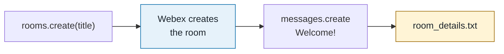

# Lab 2 - Create a room

<div class="lab-summary" markdown>
**:material-presentation: After Tasks 1** <span class="slides-chip">Create a virtual Webex room</span>

**:material-hammer-wrench: You build:** a group space with a welcome message, and a details file to share

**:material-file-code: File:** `lab2/create_room.py`
</div>

A **Webex room** (also called a space) is a chat that people and bots can join. Your Python script
creates one, then talks inside it.



<div class="concepts" markdown>
<div markdown>
<p class="card-title">SDK</p>

A library that wraps the REST calls in Python names. `api.rooms.create(...)` is easier than
building the JSON yourself.

<p class="like">a vending machine: you press "tea" instead of mixing the drink by hand</p>
</div>
<div markdown>
<p class="card-title">Room ID</p>

A long string that uniquely names the room. Titles can repeat. IDs cannot.

<p class="like">a PESEL number, not a first name</p>
</div>
</div>

## Steps

Open `lab2/create_room.py`. Find `TODO 1`. Change the title to **your group's name**.

One person in the group runs this lab. The others wait for `room_details.txt`.

### <span class="step-num">2.1</span> Create the room

Remove the `#` from the three lines under TODO 1. Save and run.

```python title="lab2/create_room.py"
title = "Krakow CTE Group 1"
room = api.rooms.create(title=title)
print("Room ID:", room.id)
print("Room Title:", room.title)
```

```text title="Output"
Room ID: Y2lzY29zcGFyazovL3VzL1JPT00v...
Room Title: Krakow CTE Group 1
```

`WebexTeamsAPI` uses your token from `config.py`. You do not paste the token in this file.

!!! error "Error decoder: `ApiError` or `401` on rooms.create`"
    **What it means:** the token is missing, expired, or has a newline in `token.txt`.

    **How to fix it:** open `token.txt`, make sure there is **one** line, paste a fresh token from
    the developer site, save, run again.

### <span class="step-num">2.2</span> Post the welcome

Find `TODO 2`, remove the `#`, run.

```python title="lab2/create_room.py"
api.messages.create(
    roomId=room.id,
    text="Welcome! Your room has been created!",
)
```

Open the Webex app. You should see the new space and that exact sentence.

!!! predict "Predict"
    What happens if you run the file **twice**?

    ??? success "Show the answer"
        Two rooms with the same title. Webex allows duplicate titles. That is why we save the
        **id** in the next step, and why the rest of the group uses that file instead of guessing
        the name.

### <span class="step-num">2.3</span> Save the details

Find `TODO 3`, remove the `#`, run. Open `room_details.txt` and share it with your group
(USB, chat, or a photo of the **title** only — not of `token.txt`).

```text title="room_details.txt"
Room Title: Krakow CTE Group 1
Room ID: Y2lzY29zcGFyazovL3VzL1JPT00v...
```

## Practise: say more in the room

=== "Follow along"

    After the welcome, send a second message with an f-string:

    ```python
    api.messages.create(
        roomId=room.id,
        text=f"This room is called {room.title}.",
    )
    ```

=== "Try it"

    Send a third message that includes today's city, using an f-string and a variable `city = "Krakow"`.

=== "Challenge"

    Use `api.rooms.list()` and print every room title that contains your group name. How many copies
    did you create by accident?

## Add it to your project

Copy the working Lab 2 lines into `webex_project.py` under the Lab 2 comment. Run
`webex_project.py` only when you **want** a new room. Otherwise keep using the id you already saved.

!!! checkpoint "Checkpoint"
    The Webex app shows your room and the welcome sentence. `room_details.txt` has the title and id.

    Not the same? Compare with `code/day2/solutions/lab2_create_room.py`.

!!! badge "Badge earned"
    **Space Maker**

    You created a real Webex room from Python and wrote its details to a file.

??? instructor "For instructors"
    - Only one create per group. If five people run TODO 1, you get five rooms.
    - Collecting room ids on a shared board helps Lab 3 start together.
