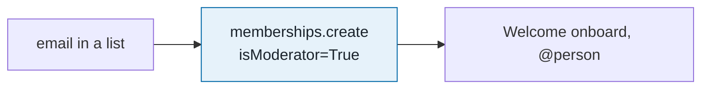

# Lab 3 - Add members

<div class="lab-summary" markdown>
**:material-presentation: After Tasks 1** <span class="slides-chip">Members and moderators</span>

**:material-hammer-wrench: You build:** a group space where every member is a moderator, and each one is welcomed by name

**:material-file-code: File:** `lab3/memberships.py`
</div>

A **membership** is the link between a person and a room. Creating one is how you add someone.



<div class="concepts" markdown>
<div markdown>
<p class="card-title">Moderator</p>

A member who can add people and change room settings. `isModerator=True` gives that role.

<p class="like">a class prefect, not only a student in the room</p>
</div>
<div markdown>
<p class="card-title">Mention</p>

A message that pings someone. In Webex markdown you write `<@personId>`.

<p class="like">tapping someone on the shoulder in a noisy room</p>
</div>
</div>

## Steps

Open `lab3/memberships.py`.

### <span class="step-num">3.1</span> Paste the room id

Find `TODO 1`. Copy the **Room ID** line from `room_details.txt` into `room_id`.

### <span class="step-num">3.2</span> The member list

Find `TODO 2`. Replace the example emails with your group's emails. Do not include the person who
created the room: they are already in it.

```python title="lab3/memberships.py"
members = [
    "ola@example.com",
    "jan@example.com",
]
```

### <span class="step-num">3.3</span> Add and welcome

Find `TODO 3`, remove the `#`, run.

```python title="lab3/memberships.py"
for email in members:
    membership = api.memberships.create(
        roomId=room_id,
        personEmail=email,
        isModerator=True,
    )
    api.messages.create(
        roomId=room_id,
        markdown=f"Welcome onboard, <@{membership.personId}>",
    )
    print("Added:", email)
```

Each person should see a mention in the space.

!!! error "Error decoder: `personEmail was not found` / `404`"
    **What it means:** that email is not a Webex account, or it is misspelled.

    **How to fix it:** check the spelling with the person. They may need to sign in to Webex once
    so the account exists.

!!! error "Error decoder: `409` Conflict`"
    **What it means:** that person is already in the room.

    **How to fix it:** skip them. Comment out that email and run again for the others.

### <span class="step-num">3.4</span> Who is in the room?

Find `TODO 4`, remove the `#`, run.

```text title="Output"
People in the room:
- Ola Nowak ola@example.com
- Jan Kowalski jan@example.com
...
```

!!! predict "Predict"
    Why do we mention `<@{membership.personId}>` instead of the email address in the text?

    ??? success "Show the answer"
        Webex highlights a mention only if you use the person's id in that special markdown. Plain
        text with an email is just text. The membership object already has `personId`, so we reuse it.

## Practise: a polite host

=== "Follow along"

    After the loop, send one more message:

    ```python
    api.messages.create(roomId=room_id, markdown="Welcome onboard, <@all>")
    ```

    `<@all>` pings everyone.

=== "Try it"

    Print how many members the room has, using a counter in the TODO 4 loop.

=== "Challenge"

    Add `isModerator=False` for a second list called `guests`. Can you keep moderators and guests
    in two lists and use one function `add_people(emails, moderator)`?

## Add it to your project

Copy the member loop into `webex_project.py` under the Lab 3 comment. Use `room.id` if you still
have the room object from Lab 2, or the string from `room_details.txt`.

!!! checkpoint "Checkpoint"
    Every group member is in the space, the welcome mention appeared, and TODO 4 prints the list.

    Not the same? Compare with `code/day2/solutions/lab3_memberships.py`.

!!! badge "Badge earned"
    **Host**

    You added people through the API and greeted them by mention.

??? instructor "For instructors"
    - Cisco emails and school emails both work if the person has a Webex account.
    - If adding as moderator fails for bots, that is expected: Lab 5 adds bots as participants.
