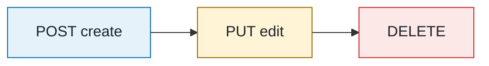

# Lab 4 - Edit and delete

<div class="lab-summary" markdown>
**:material-presentation: After Tasks 2** <span class="slides-chip">Send, edit, delete</span>

**:material-hammer-wrench: You build:** a message that appears, changes, then disappears

**:material-file-code: File:** `lab4/messages.py`
</div>

REST is not only GET. Creating is usually **POST**. Changing is **PUT**. Removing is **DELETE**.



<div class="concepts" markdown>
<div markdown>
<p class="card-title">POST</p>

Create something new: a message, a room, a membership.

<p class="like">putting a new sticky note on the board</p>
</div>
<div markdown>
<p class="card-title">PUT</p>

Replace something that already exists. Here: the text of a message.

<p class="like">taking the sticky note off, rewriting it, putting it back</p>
</div>
<div markdown>
<p class="card-title">DELETE</p>

Remove it. After this, GET on that id returns 404.

<p class="like">throwing the sticky note away</p>
</div>
</div>

## Steps

Open `lab4/messages.py`. Paste the room id (`TODO 1`).

The SDK can **create** and **delete** messages. It has no simple `edit` helper, so we use
`requests.put` for that one call — the same style as Lab 1.

### <span class="step-num">4.1</span> Send

Find `TODO 2`, remove the `#`, run. Watch the space: a draft appears.

### <span class="step-num">4.2</span> Edit

Find `TODO 3`, remove the `#`, run. The same message changes its text. Status should be `200`.

```python title="lab4/messages.py"
edit = requests.put(
    f"https://webexapis.com/v1/messages/{message.id}",
    headers=headers,
    json={
        "roomId": room_id,
        "text": "This message was edited by Python!",
    },
)
print("Edit status:", edit.status_code)
```

The URL includes the message id. That is how Webex knows *which* message to change.

### <span class="step-num">4.3</span> Delete

Find `TODO 4`, remove the `#`, run. The message vanishes.

```python
api.messages.delete(message.id)
print("Deleted the message.")
```

!!! predict "Predict"
    If you skip TODO 3 and only create then delete, what does the group see?

    ??? success "Show the answer"
        A message that flashes and goes. The edit step is the one that proves PUT works. Do the
        three steps in order, and pause so people can watch the app.

!!! error "Error decoder: `404` on edit or delete`"
    **What it means:** that message id is already gone, or it belongs to another room.

    **How to fix it:** run TODO 2 again so you have a fresh `message.id`, then edit and delete
    **that** id.

!!! error "Error decoder: `NameError: name 'message' is not defined`"
    **What it means:** TODO 2 is still commented, so `message` was never created.

    **How to fix it:** uncomment TODO 2 first. Python runs top to bottom.

## Practise: a short story

=== "Follow along"

    Create a message `Once upon a time...`, edit it to `The dragon woke up.`, then delete it.

=== "Try it"

    Print `edit.json()` after the PUT. Which keys came back? Find `text` and `id`.

=== "Challenge"

    Write a function `send_edit_delete(room_id, first, second)` that does all three steps. Call it
    twice with different sentences.

## Add it to your project

You do not have to keep the delete in `webex_project.py`. It is a demo. If you add it, run it once
so the group can see it, then comment it out so you do not wipe real chat later.

!!! checkpoint "Checkpoint"
    You watched a message appear, change its text, and disappear.

    Not the same? Compare with `code/day2/solutions/lab4_messages.py`.

!!! badge "Badge earned"
    **Message Editor**

    You used POST, PUT and DELETE on the same object.

??? instructor "For instructors"
    - Project this on a screen if you can: the three-step animation is the whole point.
    - `webexteamssdk` versions differ; teaching PUT with `requests` avoids SDK gaps.
