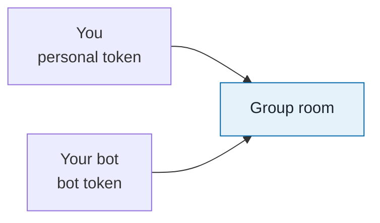

# Lab 5 - Bots

<div class="lab-summary" markdown>
**:material-presentation: After Tasks 2** <span class="slides-chip">Bots and a message log</span>

**:material-hammer-wrench: You build:** your own bot in the common room, an introduction, and a saved chat log

**:material-file-code: File:** `lab5/bots.py`
</div>

A **bot** is a Webex account for a program. It has an email like `mybot@webex.bot` and its **own**
token. Labs 6 and 7 use that bot token. Today you only create the bot and invite it.



<div class="concepts" markdown>
<div markdown>
<p class="card-title">Bot</p>

A machine user. It can post messages, but it should not be a moderator of a student room.

<p class="like">a helpful robot that sits in the chat, not the teacher</p>
</div>
<div markdown>
<p class="card-title">Participant</p>

A member with `isModerator=False`. That is how we add the bot.

<p class="like">a guest at the table, not the host</p>
</div>
</div>

## Steps

### <span class="step-num">5.1</span> Create the bot in the browser

Each person in the group creates **their own** bot:

1. Open [https://developer.webex.com/docs/bots](https://developer.webex.com/docs/bots).
2. Create a bot. Pick a name you will recognise, for example `ola-cte-bot`.
3. Copy the **bot access token** into a **new** file `bot_token.txt` next to `token.txt`.
   Do not overwrite your personal token.
4. Copy the bot's email (`something@webex.bot`).

!!! analogy "Two keys"
    `token.txt` is *you*. `bot_token.txt` is *the robot*. Mixing them is the number one bug in
    Labs 6 and 7. Label the files now.

### <span class="step-num">5.2</span> Invite the bot

Open `lab5/bots.py`. Paste the room id (`TODO 1`) and the bot email (`TODO 2`).

Find `TODO 3`, remove the `#`, run. The bot appears in the space as a member.

### <span class="step-num">5.3</span> Introduce yourself

Find `TODO 4`. Change the sentence so it is about **you**. Uncomment, run.

Wait until **every** group member has posted an introduction.

### <span class="step-num">5.4</span> Write the chat to a file

Find `TODO 5`, remove the `#`, run.

```python title="lab5/bots.py"
lines = []
for message in api.messages.list(roomId=room_id):
    who = message.personEmail or "unknown"
    text = message.text or ""
    lines.append(f"{who}: {text}")
Path("messages.txt").write_text("\n".join(lines), encoding="utf-8")
```

Open `messages.txt`. You should see welcomes, mentions, and the introductions.

Webex returns newest messages first. That is normal.

!!! predict "Predict"
    Why is it `message.personEmail or "unknown"`?

    ??? success "Show the answer"
        Some messages have no email (for example system messages). `or "unknown"` means: if the
        email is missing, use the word unknown so the line still prints.

!!! error "Error decoder: `ApiError` adding the bot`"
    **What it means:** the bot email is wrong, or the bot was already added.

    **How to fix it:** copy the email from the developer site again. If it is already in the room,
    skip TODO 3 and go to the introduction.

## Practise: a nicer log

=== "Follow along"

    Write a header line first:

    ```python
    lines.insert(0, "=== Room messages ===")
    ```

    before you save the file.

=== "Try it"

    Save only messages whose text contains `"Hi,"` so the file is just the introductions.

=== "Challenge"

    Reverse the list so the file is oldest-first: `lines.reverse()` before writing. Compare with
    the Webex app.

## Add it to your project

Copy Lab 5 into `webex_project.py`. You now have the full Tasks 1 and 2 project: room, members,
message edit demo, bot, introductions, log file.

!!! checkpoint "Checkpoint"
    Every student bot is in the common room, everyone posted an intro, and `messages.txt` exists.

    Not the same? Compare with `code/day2/solutions/lab5_bots.py`.

!!! badge "Badge earned"
    **Bot Maker**

    You created a bot identity and saved a conversation from the API.

??? instructor "For instructors"
    - Creating bots needs the developer portal. If an account cannot create bots, share one
      instructor bot for the Flask demo and still let students write the intro as themselves.
    - `messages.list` paginates. For a class room of a few dozen messages, the default list is enough.
