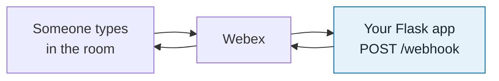
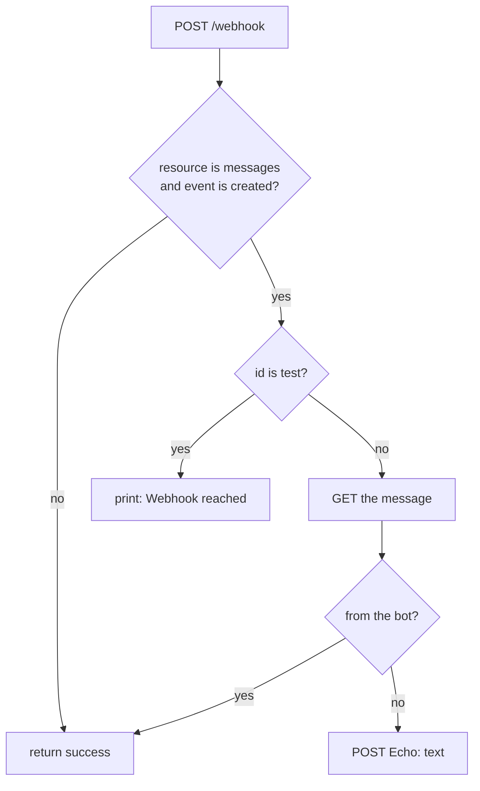

# Lab 6 - Flask webhook

<div class="lab-summary" markdown>
**:material-presentation: Project** <span class="slides-chip">A bot that talks back</span>

**:material-hammer-wrench: You build:** a tiny web server that echoes messages in the room

**:material-file-code: File:** `lab6/echo_flask.py`
</div>

So far **your script** called Webex. Now **Webex calls you**. That incoming knock is a **webhook**.



<div class="concepts" markdown>
<div markdown>
<p class="card-title">Webhook</p>

Webex sends an HTTP POST to a URL you give it, whenever something happens (here: a message is created).

<p class="like">a doorbell. You do not keep opening the door to check. The bell rings.</p>
</div>
<div markdown>
<p class="card-title">Flask</p>

A Python library that turns functions into web pages and POST handlers.

<p class="like">a receptionist: GET / says hello, POST /webhook takes a parcel</p>
</div>
<div markdown>
<p class="card-title">Echo</p>

The bot repeats what it heard, with a prefix. It must ignore its own messages or it loops forever.

<p class="like">a parrot that is smart enough not to copy itself</p>
</div>
</div>

## Steps

Open `lab6/echo_flask.py`.

### <span class="step-num">6.1</span> Bot token, not your token

Find `TODO 1`. Paste the **bot** token and the bot email from Lab 5.

```python
bot_token = "YOUR_BOT_ACCESS_TOKEN"
bot_email = "YOUR_BOT_EMAIL"
```

### <span class="step-num">6.2</span> Read the webhook function

`send_message` is POST `/v1/messages`, like Lab 2, but with the **bot** token.

`webhook` does three things:

1. Read the JSON Webex sent.
2. GET the full message by id (the webhook only includes the id).
3. If the sender is not the bot, reply `Echo: ...`.



### <span class="step-num">6.3</span> Run the server

In the terminal, from `code/day2`:

```bash
python lab6/echo_flask.py
```

```text title="Output"
 * Running on http://127.0.0.1:5000
```

Leave it running. Open [http://127.0.0.1:5000](http://127.0.0.1:5000) in a browser. You should see
the home sentence.

!!! vscode "VS Code tip"
    The terminal is busy while Flask runs. Open a **second** terminal (**Terminal > New Terminal**)
    for the next commands. Stop Flask with ++ctrl+c++.

### <span class="step-num">6.4</span> Ring the doorbell locally

Webex cannot reach `127.0.0.1` on your laptop. First prove the route works on this machine.

=== "Windows"

    ```powershell
    curl.exe -X POST http://127.0.0.1:5000/webhook -H "Content-Type: application/json" -d "{\"resource\":\"messages\",\"event\":\"created\",\"data\":{\"id\":\"test\"}}"
    ```

=== "Mac"

    ```bash
    curl -X POST http://127.0.0.1:5000/webhook \
      -H "Content-Type: application/json" \
      -d '{"resource":"messages","event":"created","data":{"id":"test"}}'
    ```

The Flask terminal should print `Webhook reached (local test).` The curl window should show
`{"status":"success"}`.

!!! predict "Predict"
    What happens if we echo the bot's own messages too?

    ??? success "Show the answer"
        The bot posts `Echo: ...`, Webex fires the webhook again, the bot posts another echo, and
        it never stops. That is why we compare `personEmail` to `bot_email`.

!!! error "Error decoder: `Address already in use`"
    **What it means:** port 5000 is already taken (an old Flask still running).

    **How to fix it:** in that old terminal press ++ctrl+c++, or change `app.run(port=5000)` to
    `app.run(port=5001)`.

### <span class="step-num">6.5</span> Optional: a real Webex webhook

Webex will only POST to a **public https** URL. Your instructor may start [ngrok](https://ngrok.com)
(or similar) so `https://....ngrok.io/webhook` points at your Flask.

Only then create the webhook, **once**, with that public URL:

```python
requests.post(
    "https://webexapis.com/v1/webhooks",
    headers={
        "Authorization": f"Bearer {bot_token}",
        "Content-Type": "application/json",
    },
    json={
        "name": "Echo bot",
        "targetUrl": "https://YOUR-PUBLIC-URL/webhook",
        "resource": "messages",
        "event": "created",
    },
)
```

Do not create a webhook that points at `https://your-server.com/webhook`. That URL is a placeholder
and Webex will reject it or call a site that is not yours.

If the classroom network cannot do this, you still passed the lab: the server runs and the local
POST works. Watch the instructor demo for the live echo.

## Practise: a smarter parrot

=== "Follow along"

    Change the reply to include the sender's email:

    ```python
    send_message(
        message["roomId"],
        f"Echo from {message.get('personEmail')}: {message.get('text')}",
    )
    ```

    You can test this only with a real webhook.

=== "Try it"

    If the text is `ping`, reply `pong` instead of echoing. **Hint:** an `if` on `message.get("text")`.

=== "Challenge"

    Ignore messages that do not start with `!echo`. Strip that prefix, then send the rest back.
    That way the bot is quiet unless someone asks.

!!! checkpoint "Checkpoint"
    Flask is running on port 5000, the home page loads, and a local POST with `"id": "test"` prints
    `Webhook reached (local test).`

    Not the same? Compare with `code/day2/solutions/lab6_echo_flask.py`.

!!! badge "Badge earned"
    **Doorbell**

    You wrote a web server that can receive a Webex event.

??? instructor "For instructors"
    - Default path: local POST only. Live webhook is a demo unless ngrok is allowed.
    - Never create the webhook automatically on `app.run()`. Students will spam invalid target URLs.
    - One shared ngrok URL can serve one bot for the projector.
