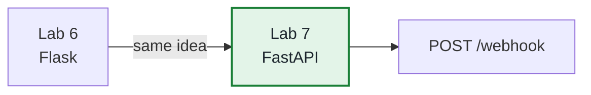
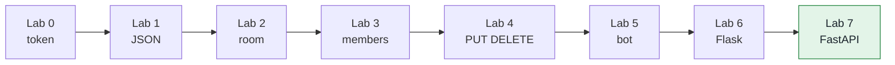

# Lab 7 - FastAPI webhook

<div class="lab-summary" markdown>
**:material-presentation: Project** <span class="slides-chip">The same bot, a different server</span>

**:material-hammer-wrench: You build:** the echo bot again, this time with FastAPI

**:material-file-code: File:** `lab7/echo_fastapi.py`
</div>

Flask and FastAPI both listen for HTTP. FastAPI is what many API teams use today. The Webex part
does not change: same token, same POST `/webhook`, same "do not echo yourself" rule.



<div class="concepts" markdown>
<div markdown>
<p class="card-title">FastAPI</p>

A library for building APIs. You mark functions with `@app.get` and `@app.post`.

<p class="like">the same receptionist as Flask, with a different uniform</p>
</div>
<div markdown>
<p class="card-title">async / await</p>

The function can pause while it waits for the JSON body, without freezing the whole server.

<p class="like">taking another customer's order while the kettle boils</p>
</div>
<div markdown>
<p class="card-title">lifespan</p>

Code that runs when the server starts, then waits, then runs at shutdown.

<p class="like">opening the shop in the morning and locking up at night</p>
</div>
</div>

## Steps

Open `lab7/echo_fastapi.py`. Put the **same bot token and email** as Lab 6 (`TODO 1`).

### <span class="step-num">7.1</span> lifespan

```python title="lab7/echo_fastapi.py"
@asynccontextmanager
async def lifespan(app: FastAPI):
    print("FastAPI echo bot starting. Waiting for POST /webhook ...")
    yield
    print("FastAPI echo bot stopping.")
```

Everything **before** `yield` runs at start. Everything **after** runs at stop. We do **not**
create a Webex webhook here. That belongs after you have a public URL.

### <span class="step-num">7.2</span> Start the server

Stop Flask first (++ctrl+c++), so port 8000 is free. From `code/day2`:

```bash
python -m uvicorn lab7.echo_fastapi:app --reload --port 8000
```

```text title="Output"
FastAPI echo bot starting. Waiting for POST /webhook ...
Uvicorn running on http://127.0.0.1:8000
```

Open [http://127.0.0.1:8000](http://127.0.0.1:8000). You should see JSON:
`{"status":"Echo bot is running"}`.

`--reload` restarts the server when you save the file.

### <span class="step-num">7.3</span> The local doorbell

Same test as Lab 6, new port:

=== "Windows"

    ```powershell
    curl.exe -X POST http://127.0.0.1:8000/webhook -H "Content-Type: application/json" -d "{\"resource\":\"messages\",\"event\":\"created\",\"data\":{\"id\":\"test\"}}"
    ```

=== "Mac"

    ```bash
    curl -X POST http://127.0.0.1:8000/webhook \
      -H "Content-Type: application/json" \
      -d '{"resource":"messages","event":"created","data":{"id":"test"}}'
    ```

The uvicorn terminal prints `Webhook reached (local test).`

!!! predict "Predict"
    Flask used `request.json`. FastAPI uses `await request.json()`. Why `await`?

    ??? success "Show the answer"
        Reading the body can take time. `await` means: pause this function until the JSON is here,
        and let the server handle other requests in the meantime. For this workshop you can treat
        it as "the FastAPI spelling of request.json".

!!! error "Error decoder: `Error loading ASGI app`"
    **What it means:** uvicorn cannot find `lab7.echo_fastapi:app`. The terminal is in the wrong
    folder.

    **How to fix it:** `cd` into `code/day2` so the `lab7` folder is visible, then run the command
    again.

!!! error "Error decoder: `ModuleNotFoundError: No module named 'fastapi'`"
    **What it means:** Lab 0's pip install did not include FastAPI in this `.venv`.

    **How to fix it:** `python -m pip install fastapi uvicorn` with `(.venv)` active.

## Practise: pick a framework

=== "Follow along"

    Open [http://127.0.0.1:8000/docs](http://127.0.0.1:8000/docs). FastAPI built an interactive
    page from your functions. Try GET `/` there.

=== "Try it"

    Add `@app.get("/health")` that returns `{"ok": True}`. Reload the docs page. The new route
    should appear.

=== "Challenge"

    Copy one improvement from Lab 6 (ping/pong, or `!echo`) into the FastAPI webhook. The Webex
    logic is identical; only the decorator and `await` are new.

### Make it yours

Your group now has:

- a room you created from Python
- members added as moderators
- a message you edited and deleted
- a bot in the room
- a chat log file
- a server that *can* echo, locally for sure, live if the network allows

Swap laptops and show the room. Then pick one extra: a custom welcome, a `ping` command, or a
second bot that only answers one person.

!!! checkpoint "Checkpoint"
    Uvicorn serves FastAPI on port 8000, `/` returns JSON, and a local POST with `"id": "test"`
    prints `Webhook reached (local test).`

    Not the same? Compare with `code/day2/solutions/lab7_echo_fastapi.py`.

!!! badge "Badge earned"
    **API Builder**

    You used REST, the Webex SDK, Flask and FastAPI in one day.

## What you learned



Keep `webex_project.py` and your bot token **on this laptop only**. When the workshop ends, you can
delete `token.txt` and `bot_token.txt`. Generate new tokens next time.

??? instructor "For instructors"
    - FastAPI's `/docs` is a crowd-pleaser. Show it on the projector.
    - If uvicorn cannot import `lab7.echo_fastapi`, they opened `code` instead of `code/day2`.
    - Ask two groups to show their Webex room, not the tokens.
