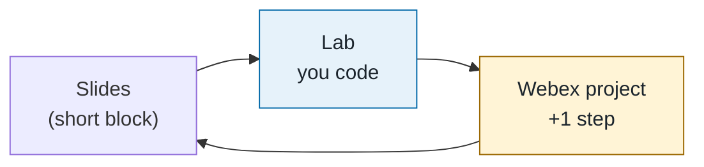
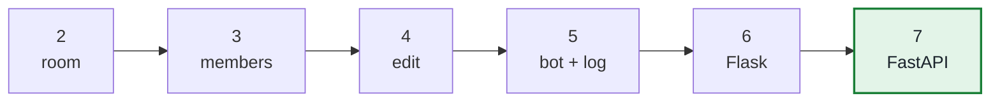

# Day 2 roadmap

```python title="python_workshop.py"
Python_Workshop = [
    {"Day 1": "Python basics and the Quiz Game"},
    {"Day 2": "APIs, Webex rooms, and a bot"},
]
```

Yesterday you taught the computer what to do on **your** laptop. Today the computer talks to
**Webex** on the internet: it creates a room, invites your group, and runs a small bot.



## Labs

<table class="roadmap" markdown>
<thead><tr><th>Block</th><th>Topic</th><th>Lab</th></tr></thead>
<tbody markdown>
<tr><td>Intro</td><td>API basics (4 verbs), first live call in Bruno, your token</td><td><a href="lab0-setup.html">Lab 0 - Token and setup</a></td></tr>
<tr><td>REST</td><td>Break it in Bruno (200/404/401), JSON, GET rooms with <code>requests</code></td><td><a href="lab1-rest.html">Lab 1 - REST and JSON</a></td></tr>
<tr><td>Tasks 1</td><td>Create a room, welcome message, save the details</td><td><a href="lab2-room.html">Lab 2 - Create a room</a></td></tr>
<tr><td>Tasks 1</td><td>Add members as moderators, welcome each person</td><td><a href="lab3-members.html">Lab 3 - Add members</a></td></tr>
<tr><td>Tasks 2</td><td>Send a message, edit it, delete it</td><td><a href="lab4-messages.html">Lab 4 - Edit and delete</a></td></tr>
<tr><td>Tasks 2</td><td>Create a bot, introductions, write messages to a file</td><td><a href="lab5-bots.html">Lab 5 - Bots</a></td></tr>
<tr><td>Project</td><td>A Flask echo bot that answers the room</td><td><a href="lab6-flask.html">Lab 6 - Flask webhook</a></td></tr>
<tr><td>Project</td><td>The same bot with FastAPI</td><td><a href="lab7-fastapi.html">Lab 7 - FastAPI webhook</a></td></tr>
</tbody>
</table>

## One project, built step by step

The slides ask for a **group Webex room**. You do not build it at the end: it grows in
`code/day2/webex_project.py`.



| After lab | Your project can... |
|---|---|
| Lab 0 | keep a token on this laptop, never in the script |
| Lab 1 | read JSON and list rooms |
| Lab 2 | create a room and post `Welcome! Your room has been created!` |
| Lab 3 | add the group as moderators and mention each person |
| Lab 4 | send a message, change it, then delete it |
| Lab 5 | add your bot, post an introduction, save the chat to a file |
| Lab 6 | run a Flask server that echoes messages |
| Lab 7 | run the same idea with FastAPI |

!!! checkpoint "Fell behind? No problem."
    After every lab there is a ready-made file in `code/day2/solutions/`. Copy it over and you are
    back on track. Nobody gets left behind.

## How every lab works

The same pattern as Day 1: concept cards, steps with `TODO`s, a Predict, practise tabs, then a
checkpoint.

| Practise tab | You get |
|---|---|
| **Follow along** | all the code: type it and run it |
| **Try it** | hints, not the code |
| **Challenge** | a harder task for when you are fast |

??? instructor "For instructors"
    - Work in groups of 4 or 5. One person creates the room (Lab 2). Everyone else is added in Lab 3.
    - Personal access tokens last a few hours. If a `401` appears after lunch, they copy a fresh token
      into `token.txt`.
    - Do not put student emails in the guide. They type their own list in Lab 3.
    - Labs 6 and 7 need a public URL for a *real* Webex webhook. If the room network blocks ngrok,
      students still write the server and test it with a local POST. Demo one live webhook on the
      projector.
    - Never collect tokens. Walk the room and look at `token.txt` only on the student's screen.
