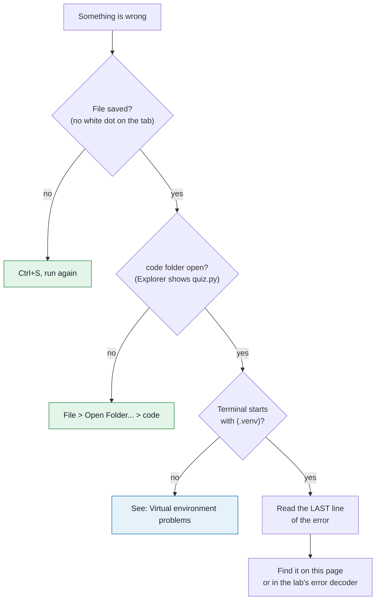
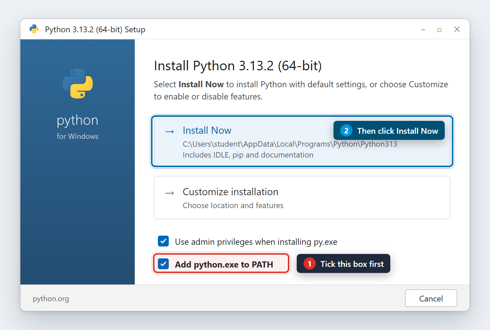
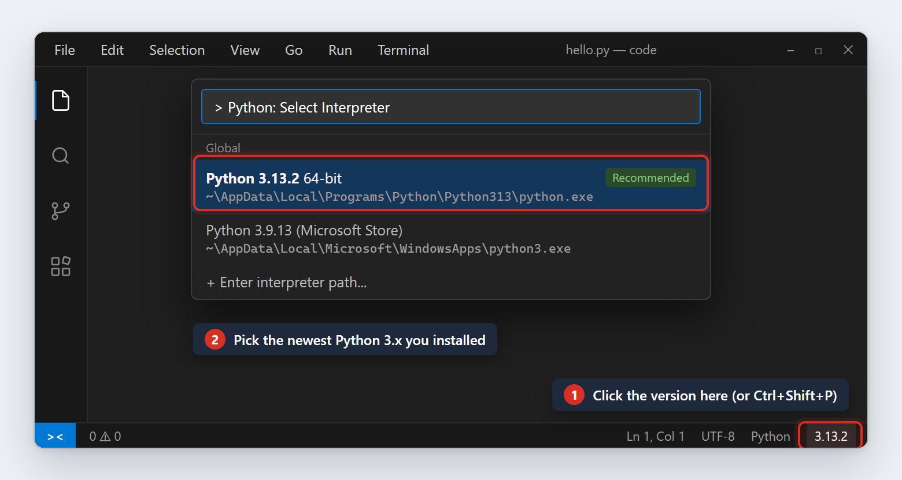
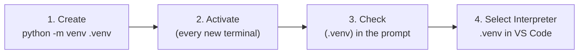
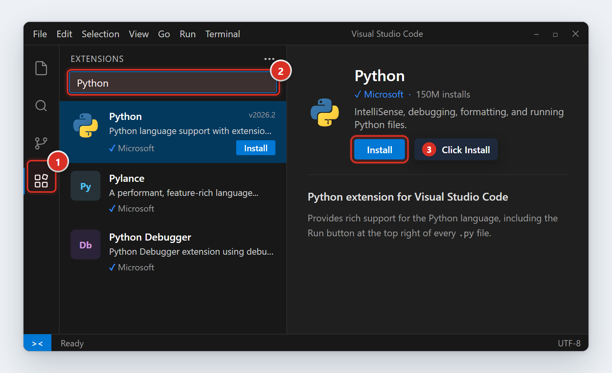

# Troubleshooting

Every programmer sees these problems. Each one below says **what you see**, **why**, and **how to fix it**.



## Python opens the Microsoft Store

**What you see:** you type `python` in the terminal and the Microsoft Store opens, or you see
`Python was not found; run without arguments to install from the Microsoft Store`.

**Why:** Windows has a fake "python" shortcut that points to the Store. It is used when the real
Python is not installed, or not on the **PATH** (the list of folders where Windows looks for programs).

**How to fix it:**

1. Open the Windows **Settings** and search for **Manage app execution aliases**.
2. Switch **off** the two entries **App Installer python.exe** and **App Installer python3.exe**.
3. Close the terminal and open a new one (**Terminal > New Terminal**), then type `python --version` again.

Still not working? Python is not on the PATH: see the next problem.

## python is not recognized (Windows PATH)

**What you see:** `'python' is not recognized as an internal or external command`, or
`python : The term 'python' is not recognized`.

**Why:** during the installation, the box **Add python.exe to PATH** was not ticked.

**How to fix it:**

1. Run the Python installer again (the file you downloaded from python.org).
2. Choose **Modify**, click **Next**, and tick **Add Python to environment variables**. Click **Install**.
3. Close VS Code completely and open it again, then try `python --version`.



!!! note "The quick way"
    Try `py --version` instead. Windows installs the `py` launcher with Python, and it often
    works even when `python` does not. In VS Code, the Run button does not need either of them.

## On a Mac, python is not found

**What you see:** `zsh: command not found: python`.

**Why:** on macOS the command is called `python3`, not `python`.

**How to fix it:** type `python3 --version`. Everywhere the guide says `python`, type `python3`.
The Run button in VS Code works the same on a Mac.

If `python3` asks you to install the **command line developer tools**, click **Install** and wait,
or install Python from [python.org](https://www.python.org/downloads/) as described in
[Before you come](../day1/before-you-come.md).

## VS Code uses the wrong Python

**What you see:** the code runs in the terminal but VS Code underlines `import` lines, or the Run
button says Python is not found, or the version is not the one you installed.

**Why:** VS Code can see several Pythons (or none) and has picked the wrong one, called the
**interpreter**.

**How to fix it:**

1. Press ++ctrl+shift+p++ (Mac: ++cmd+shift+p++).
2. Type **Python: Select Interpreter** and press ++enter++.
3. Pick the one that says **`('.venv': venv)`**. No `.venv` in the list? Pick the newest
   **Python 3.1x** (the one you installed), or create the `.venv` first (Lab 0).



## Virtual environment problems



Find the step that fails:

| Step | Windows | macOS |
|---|---|---|
| Create | `python -m venv .venv` | `python3 -m venv .venv` |
| Activate (PowerShell) | `.venv\Scripts\Activate.ps1` | `source .venv/bin/activate` |
| Activate (Command Prompt) | `.venv\Scripts\activate.bat` | - |
| Leave | `deactivate` | `deactivate` |

### Running scripts is disabled

**What you see:**
`.venv\Scripts\Activate.ps1 cannot be loaded because running scripts is disabled on this system.`

**Why:** PowerShell blocks scripts by default, and activating is a script.

**How to fix it:** in the same terminal, run this once, type `Y`, press ++enter++, then activate again:

```powershell
Set-ExecutionPolicy -Scope CurrentUser -ExecutionPolicy RemoteSigned
```

Not allowed on a school laptop? Use Command Prompt instead: click the **v** next to the **+** in
the terminal, choose **Command Prompt**, and run `.venv\Scripts\activate.bat`.

### The path is not recognized

**What you see:** `.venv\Scripts\Activate.ps1 is not recognized`, or on a Mac
`no such file or directory: .venv/bin/activate`.

**Why:** the terminal is in the wrong folder, or the `.venv` was never created.

**How to fix it:**

1. Look at the terminal line: it must end in `\code>` (Mac: `code %`). If not, close the terminal
   and make sure VS Code has the `code` folder open (**File > Open Folder...**).
2. Look in the Explorer: is there a `.venv` folder? If not, run the **create** command first.

### No (.venv) in the terminal

**What you see:** the terminal line does not start with `(.venv)`.

**Why:** every **new** terminal starts without it, unless VS Code activates it for you.

**How to fix it:** run the activate command again. To make VS Code do it for you, select the
`.venv` interpreter (**Python: Select Interpreter**), then close the terminal (bin icon) and open a
new one.

### venv fails on a Mac or Linux

**What you see:** `Error: Command '...ensurepip...' returned non-zero exit status`, or
`The virtual environment was not created successfully because ensurepip is not available`.

**Why:** your Python came without the `venv` part (common with Linux or very old Mac Pythons).

**How to fix it:** install Python from [python.org](https://www.python.org/downloads/) as in
[Before you come](../day1/before-you-come.md), delete the half-made `.venv` folder, and create it
again. Short on time? Skip the `.venv`: today's programs work without it.

### The easy way: let VS Code do it

Press ++ctrl+shift+p++ (Mac: ++cmd+shift+p++), run **Python: Create Environment**, choose
**Venv**, then your Python. VS Code creates the `.venv`, selects it, and activates it in new terminals.

## There is no Run button

**What you see:** no :material-play: triangle at the top right of the editor.

**Why:** the **Python extension** is not installed, or the open file does not end in `.py`.

**How to fix it:**

1. Click the **Extensions** icon on the left (four squares), or press ++ctrl+shift+x++.
2. Search for **Python**, choose the one by **Microsoft**, and click **Install**.
3. Make sure your file name ends with `.py`, for example `hello.py`, not `hello.txt`.



## My change does nothing

**What you see:** you changed the code, ran it, and the output is the same as before.

**Why:** the file is not **saved**. Python runs the saved version.

**How to fix it:** press ++ctrl+s++ (Mac: ++cmd+s++) before running. Even better, turn on
**File > Auto Save**, and VS Code saves for you.

## No such file or directory

**What you see:** `No module named 'questions'`, or
`FileNotFoundError: [Errno 2] No such file or directory`, or
`can't open file ... No such file or directory`.

**Why:** VS Code has the wrong folder open. Python looks for files in the folder that is open.

**How to fix it:** choose **File > Open Folder...** and open the folder **`code`** itself, not the
folder above it and not `lab1`. The Explorer must show `quiz.py` and `questions.py` at the top level.

## The program waits and nothing happens

**What you see:** you clicked Run and nothing happens, or nothing more is printed.

**Why:** the program is waiting at an `input()` for you to type something.

**How to fix it:** click into the **terminal** at the bottom, type your answer, and press ++enter++.

## The program never stops

**What you see:** the same text is printed again and again.

**Why:** a `while` loop whose condition is always `True`. Usually you forgot to change the variable
inside the loop (Lab 3).

**How to fix it:** click into the terminal and press ++ctrl+c++. Then check that the variable in
the `while` line changes inside the loop.

## I broke my quiz.py

**What you see:** your Quiz Game does not work any more and you cannot find why.

**How to fix it:** every lab ends with a checkpoint. Open the matching file in `code/solutions/`,
for example `quiz_after_lab4.py`, select everything (++ctrl+a++), copy it, and paste it over
everything in your `quiz.py`. You can carry on with the next lab from there.

## Still stuck?

1. **Read the error again**, especially the last line and the line number. Look for its error decoder in the lab.
2. **Ask your neighbour.** Two pairs of eyes find a missing `:` faster than one.
3. **Raise your hand.** That is what the instructors are here for.

If Python or VS Code does not work on your laptop at all, **sit with a neighbour** and work
together on their laptop while an instructor fixes yours. You will not miss anything: you can copy
your code over later.
